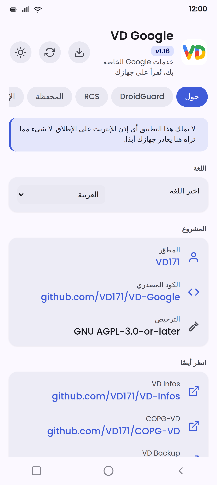
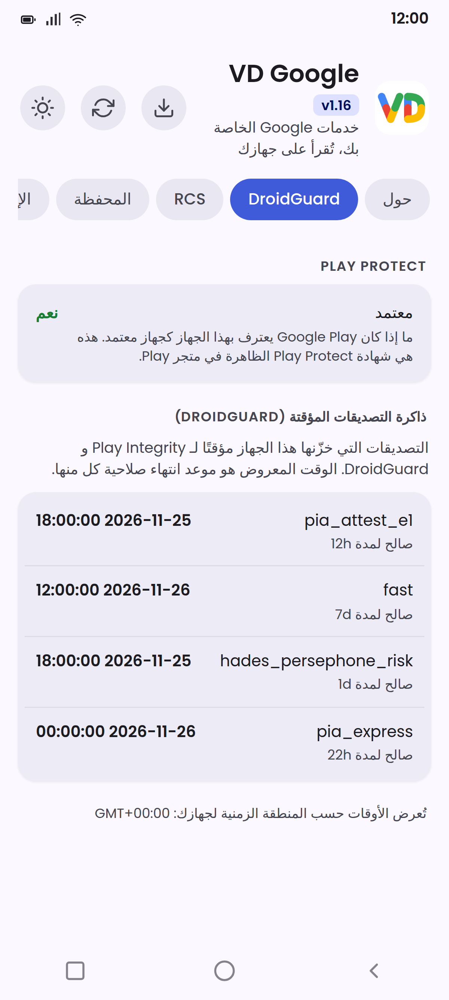
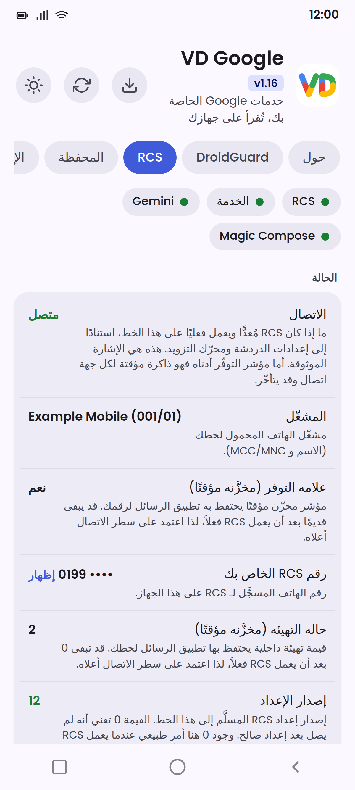
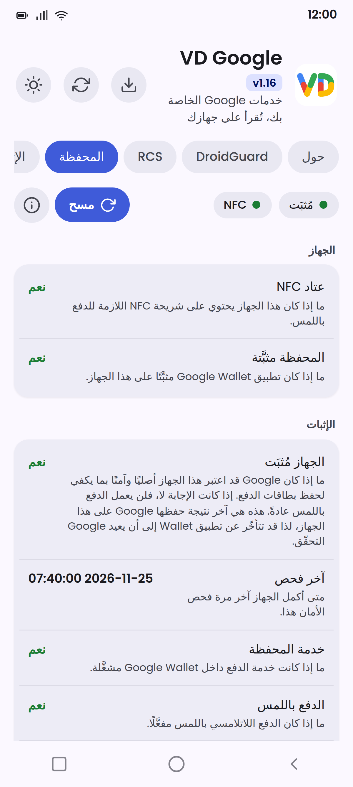
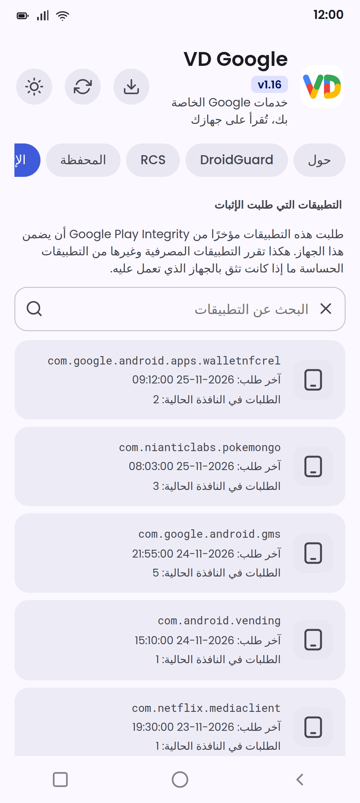

<!--
  ======================================================================
   VD GOOGLE  ::  your Google services, read on-device
   RCS, Google Wallet and Play Integrity attestations: local, no internet.

   Copyright (C) 2026  VD171
   SPDX-License-Identifier: AGPL-3.0-or-later

   Free software under the GNU AGPL v3 or later. NETWORK COPYLEFT: run a
   modified version, even as a service, and you MUST offer its source.

   Site           : https://vd171.ru
   Site           : https://vd.priv8.ru
   Source         : https://github.com/VD171/VD-Google
   GitHub         : @VD171 https://github.com/VD171
   XDA-Developers : @VD171 https://xdaforums.com/m/vd171.4699873/
   XDA thread     : https://xdaforums.com/t/VD-Google.4803837/
   Telegram       : @VD_Priv8 https://t.me/VD_Priv8
   Channel        : @Priv8_VD https://t.me/Priv8_VD
   Discord        : @VD.Priv8 https://discord.com/users/1296831918989639721
   E-mail         : vd.priv8@pm.me
  ======================================================================
-->

# VD Google

  

  
  
  
  

  <b>خدمات Google الخاصة بك، تُقرأ على جهازك. بلا إنترنت أبدًا.</b> 
  يعرض لك VD Google ما يسجّله Google نفسه على هاتفك بشأن ثلاثة أمور، ويشرح معنى كل عنصر، دون إرسال أي شيء إلى أي مكان.

  <a href="https://github.com/VD171/VD-Google/releases">Releases</a> ·
  <a href="https://github.com/VD171/VD-Google/wiki/ar-Home">Wiki</a> ·
  <a href="https://github.com/VD171/VD-Google/wiki/ar-USER-GUIDE">دليل المستخدم</a> ·
  <a href="https://github.com/VD171/VD-Google/wiki/ar-ARCHITECTURE">البنية</a> ·
  <a href="https://github.com/VD171/VD-Google/wiki/ar-PRIVACY">الخصوصية</a> ·
  <a href="https://github.com/VD171/VD-Google/wiki/ar-BINARIES">الملفات الثنائية المضمَّنة</a> ·
  <a href="https://github.com/VD171/VD-Google/wiki/ar-FILE-STRUCTURE">بنية الملفات</a> ·
  <a href="CHANGELOG.md">Changelog</a> ·
  <a href="https://xdaforums.com/t/VD-Google.4803837/">XDA thread</a>

> **Languages:** [English](README.md) · العربية · [Čeština](README.cs.md) · [Deutsch](README.de.md) · [Español](README.es.md) · [فارسی](README.fa.md) · [Français](README.fr.md) · [हिन्दी](README.hi.md) · [Bahasa Indonesia](README.id.md) · [Italiano](README.it.md) · [日本語](README.ja.md) · [한국어](README.ko.md) · [Nederlands](README.nl.md) · [Polski](README.pl.md) · [Português](README.pt.md) · [Русский](README.ru.md) · [Svenska](README.sv.md) · [ไทย](README.th.md) · [Türkçe](README.tr.md) · [Українська](README.uk.md) · [Tiếng Việt](README.vi.md) · [中文](README.zh.md)

  
  
  
  
  

---

## التطبيق أو WebUI

يأتي كل إصدار بطريقتين، وكلاهما يقرأ المعلومات نفسها على جهازك دون إنترنت:

- **App**: ملف `.apk`، تطبيق أندرويد عادي.
- **WebUI**: ملف `.zip`، وحدة تثبّتها في مدير الروت لديك (KernelSU أو APatch أو Magisk) وتفتحها من هناك.

في كلتا الحالتين، الروت مطلوب.

## ما الذي يعرضه

### RCS
ما إذا كان RCS متاحًا لخطك، ورقم RCS الخاص بك، وحالة RCS، وإصدار الإعداد، وكم من جهات اتصالك تدعم RCS، وتخويل المشغّل، والحضور (UCE)، والطوابع الزمنية ذات الصلة (التهيئة، المزامنة، آخر رسالة، انتهاء الرمز المميز، وغيرها). ويُظهر أيضًا ما إذا كان Gemini في Google Messages جاهزًا: ميزة Magic Compose (مساعدة Gemini في الكتابة)، ومحرك الذكاء الاصطناعي على الجهاز (AICore الذي يشغّل Gemini Nano)، ومحادثة Gemini التي تصل عبر RCS.

### Google Wallet
ما إذا كان جهازك مُثبَتًا للمدفوعات، وما إذا كان يملك عتاد NFC، وما إذا كانت المحفظة مثبَّتة، وحالة خدمة الدفع والدفع باللمس، وما إذا كان قفل شاشتك مقبولًا، وما إذا سبق أن أُضيفت بطاقة.

### DroidGuard
ما إذا كان Google Play يعترف بهذا الجهاز كجهاز معتمد. هذه هي شهادة Play Protect الظاهرة في متجر Play. التصديقات التي خزّنها هذا الجهاز مؤقتًا لـ Play Integrity و DroidGuard. الوقت المعروض هو موعد انتهاء صلاحية كل منها.

### الإثباتات (Play Integrity)
التطبيقات التي طلبت مؤخرًا من Google Play Integrity أن يضمن جهازك، كل منها مع أيقونته واسمه والوقت الكامل لآخر طلب وعدد الطلبات التي أجراها في النافذة الحالية.

يرافق كل عنصر شرح قصير بلغة بسيطة لما يعنيه فعلًا.

## الخصوصية: بلا إنترنت

لا يعلن VD Google عن **أي أذونات على الإطلاق**، ولا حتى الوصول إلى الإنترنت. لا شيء مما يقرأه يغادر جهازك أبدًا. يمكنك التأكد من ذلك في ملف البيان وفي الكود المصدري.

## المتطلبات

- Android 8.0 (API 26) أو أحدث.
- يعمل على أجهزة arm وarm64 وx86 وx86_64: الهواتف والأجهزة اللوحية والمحاكيات وChromeOS.
- **الجذر مطلوب.** توجد المعلومات أعلاه في مناطق محمية من Android لا يصل إليها سوى النظام. يقرأها VD Google بوصول المستخدم الخارق ولا يفعل بها أي شيء آخر. بدون جذر، يعرض التطبيق فقط شاشة تشرح سبب الحاجة إلى الجذر.

## الطوابع الزمنية

تُعرض جميع الأوقات حسب المنطقة الزمنية الحالية لجهازك، والمنطقة الزمنية مُبيّنة دائمًا.

## وكلاء الذكاء الاصطناعي

يكتب VD Google **تصديرًا** واحدًا بصيغة JSON: لقطة منظمة وقابلة للقراءة آليًا لما يسجّله Google على جهازك بخصوص RCS وWallet وPlay Integrity، دون أي بيانات شخصية فيها. يقرأ الوكيل الذي يدقّق جهازًا هذا الملف الواحد بدلاً من تتبع عدة تطبيقات وقواعد بيانات من Google يدويًا. ينتج التطبيق وWebUI المخطط نفسه تمامًا، ولا يمسّ أي منهما الشبكة. راجع [docs/AI-AGENTS.md](docs/AI-AGENTS.md).

## البناء

دائمًا release ولا تستخدم debug أبدًا. يُبنى تطبيق Android من `VDGoogle/` بالأمر `./gradlew assembleRelease`؛ وتُحزَم وحدة WebUI باستخدام `webui/package.sh`. الملف الثنائي الأصلي الوحيد هو `sqlite3`، يُجلَب من مستودع Termux مع إغلاق مكتباته ويُسجَّل مع بصمته SHA-256. راجع [المساهمة](CONTRIBUTING.md) و[الملفات الثنائية المضمّنة](https://github.com/VD171/VD-Google/wiki/BINARIES) و[الويكي](https://github.com/VD171/VD-Google/wiki).

## التوثيق

- **[Wiki](https://github.com/VD171/VD-Google/wiki/ar-Home)**: كل الوثائق، قابلة للتصفّح عبر الإنترنت.
- **[دليل المستخدم](https://github.com/VD171/VD-Google/wiki/ar-USER-GUIDE)**: ما تعرضه كل شاشة وما يعنيه كل نتيجة.
- **[البنية](https://github.com/VD171/VD-Google/wiki/ar-ARCHITECTURE)** و**[بنية الملفات](https://github.com/VD171/VD-Google/wiki/ar-FILE-STRUCTURE)**: كيف يعمل وأين يوجد كل شيء.
- **[الخصوصية](https://github.com/VD171/VD-Google/wiki/ar-PRIVACY)**: لا إذن للإنترنت، كل قراءة تمر عبر الجذر، ولا شيء يغادر الجهاز أبدًا.
- **[الملفات الثنائية المضمَّنة](https://github.com/VD171/VD-Google/wiki/ar-BINARIES)**: المصدر وSHA-256 لكل ملف ثنائي مُسبق البناء، لتدقيق كامل.
- **[المساهمة](https://github.com/VD171/VD-Google/wiki/ar-CONTRIBUTING)** و**[الأمان](https://github.com/VD171/VD-Google/wiki/ar-SECURITY)**.
- **[Changelog](CHANGELOG.md)** و**[مدونة قواعد السلوك](https://github.com/VD171/VD-Google/wiki/ar-CODE_OF_CONDUCT)**.

<!-- /vd-docs -->

## انظر أيضًا

- **[COPG-VD](https://github.com/VD171/COPG-VD)**: تزييف عالمي لبصمة الجهاز / Play Integrity، على كامل الجهاز مع نطاق لكل تطبيق وWebUI.
- **[VDBackup](https://github.com/VD171/VD-Backup)**: نسخ احتياطي واستعادة كاملان للتطبيقات والبيانات بصلاحيات الجذر، يُدار بالكامل من WebUI.
- **[VD-dropbear](https://github.com/VD171/VD-dropbear)**: خادم SSH مستقل يعمل بصلاحيات الجذر (Dropbear).
- **[VDInstaller](https://github.com/VD171/VD-Installer)**: مثبّت تحميل جانبي بصلاحيات الجذر وبلا احتكاك لحزم APK المفردة والمجمّعة والمقسّمة، مع مفتاح لمدقّق Play Protect وانتحال مصدر التثبيت.
- **[VDInfos](https://github.com/VD171/VD-Infos)**: مُنقّح طرق للجهاز يقرأ كل عنصر عبر كل طريقة يمكنها قراءته ويقارن بينها جنبًا إلى جنب.
- **[VDLiveUpdate](https://github.com/VD171/VDLiveUpdate)**: محرك تحديث ذاتي تزايدي بلا فلاش، مدمج في وحدات KernelSU/APatch/Magisk.
- **[VD-Modules](https://github.com/VD171/VD-Modules)**: مستودع وحدات MMRL/WebUI-X الخاص بنا (ثبّتها جميعاً من مدير الـ root لديك).
- **[@VictorGabriel7Dev/build.prop](https://github.com/VictorGabriel7Dev/build.prop)**: مجموعة بيانات لبصمات `build.prop` من Pixel (تفرّع من @T3SL4).
- **[@VictorGabriel7Dev/mtproto-store](https://github.com/VictorGabriel7Dev/mtproto-store)**: استخدم Telegram كمخزن كائنات من أداة Go CLI صغيرة.

## جهات الاتصال

- https://vd171.ru
- https://vd.priv8.ru
- **Telegram:** @VD_Priv8 https://t.me/VD_Priv8
- **Channel:** @Priv8_VD https://t.me/Priv8_VD
- **Discord:** @VD.Priv8 https://discord.com/users/1296831918989639721
- **E-mail:** vd.priv8@pm.me
- **XDA-Developers:** @VD171 https://xdaforums.com/m/vd171.4699873/
- **XDA thread:** https://xdaforums.com/t/VD-Google.4803837/
- **GitHub:** @VD171 https://github.com/VD171

## الترخيص

**GNU AGPL-3.0-or-later**: راجع [LICENSE](LICENSE). حقوق متروكة تشمل بند الشبكة: من يشغّل نسخة معدّلة (حتى كخدمة) يجب أن يوفّر شفرتها المصدرية. اختيرت عمدًا لإبقاء الاشتقاقات مفتوحة.

## العلامات التجارية

VD Google مشروع مستقل غير رسمي. وهو غير تابع لـ Google LLC ولا معتمد منها ولا مموّل منها. إنّ "Google" و"Google Wallet" و"Google Play" و"Play Integrity" و"Android" والأسماء والشعارات ذات الصلة هي علامات تجارية لشركة Google LLC. لا يقرأ VD Google سوى ما هو موجود بالفعل على جهازك ولا يرسل أي شيء إلى أي مكان.

## Tags

`android` `privacy` `security` `rcs` `google-wallet` `play-integrity` `attestation` `nfc` `tap-to-pay` `no-internet` `root` `kernelsu` `magisk` `lsposed` `on-device` `kotlin` `jetpack-compose` `material3` `vdgoogle`

---

📣 **انضم إلى القناة للتحديثات:** @Priv8_VD https://t.me/Priv8_VD
