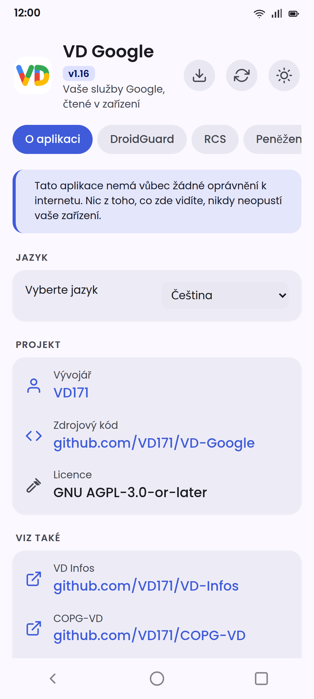
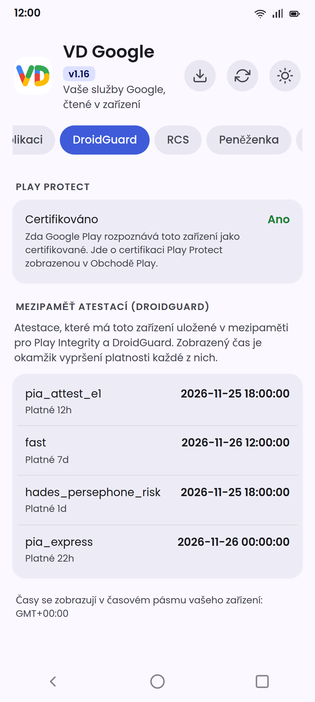
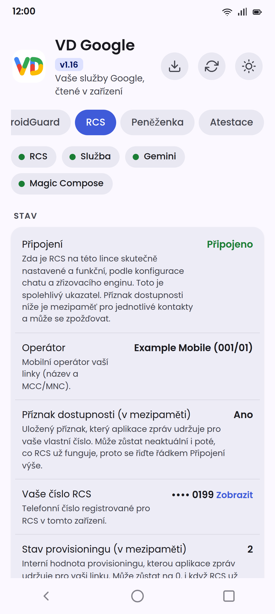
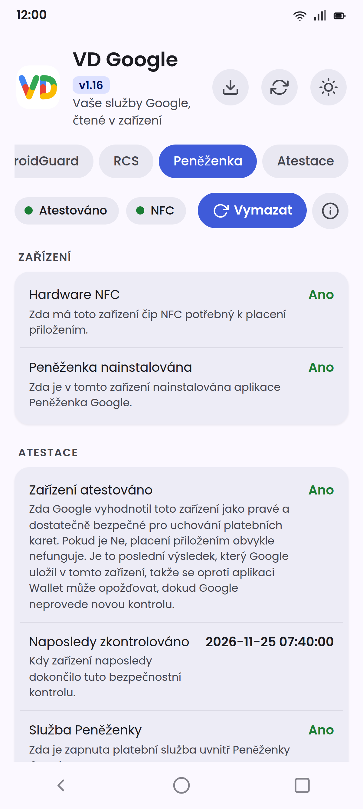
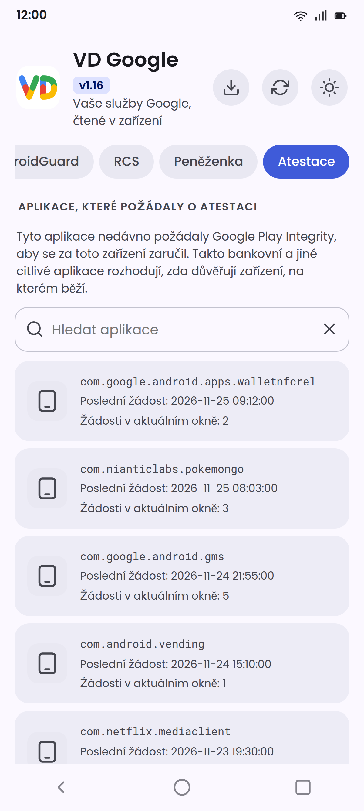

<!--
  ======================================================================
   VD GOOGLE  ::  your Google services, read on-device
   RCS, Google Wallet and Play Integrity attestations: local, no internet.

   Copyright (C) 2026  VD171
   SPDX-License-Identifier: AGPL-3.0-or-later

   Free software under the GNU AGPL v3 or later. NETWORK COPYLEFT: run a
   modified version, even as a service, and you MUST offer its source.

   Site           : https://vd171.ru
   Site           : https://vd.priv8.ru
   Source         : https://github.com/VD171/VD-Google
   GitHub         : @VD171 https://github.com/VD171
   XDA-Developers : @VD171 https://xdaforums.com/m/vd171.4699873/
   XDA thread     : https://xdaforums.com/t/VD-Google.4803837/
   Telegram       : @VD_Priv8 https://t.me/VD_Priv8
   Channel        : @Priv8_VD https://t.me/Priv8_VD
   Discord        : @VD.Priv8 https://discord.com/users/1296831918989639721
   E-mail         : vd.priv8@pm.me
  ======================================================================
-->

# VD Google

  

  
  
  
  

  <b>Vaše služby Google, čtené v zařízení. Nikdy internet.</b> 
  VD Google vám ukáže, co si sám Google ve vašem telefonu zaznamenává o třech věcech, a vysvětlí, co jednotlivé položky znamenají, aniž by cokoli kamkoli posílal.

  <a href="https://github.com/VD171/VD-Google/releases">Releases</a> ·
  <a href="https://github.com/VD171/VD-Google/wiki/cs-Home">Wiki</a> ·
  <a href="https://github.com/VD171/VD-Google/wiki/cs-USER-GUIDE">Uživatelská příručka</a> ·
  <a href="https://github.com/VD171/VD-Google/wiki/cs-ARCHITECTURE">Architektura</a> ·
  <a href="https://github.com/VD171/VD-Google/wiki/cs-PRIVACY">Soukromí</a> ·
  <a href="https://github.com/VD171/VD-Google/wiki/cs-BINARIES">Přibalené binární soubory</a> ·
  <a href="https://github.com/VD171/VD-Google/wiki/cs-FILE-STRUCTURE">Struktura souborů</a> ·
  <a href="CHANGELOG.md">Changelog</a> ·
  <a href="https://xdaforums.com/t/VD-Google.4803837/">XDA thread</a>

> **Languages:** [English](README.md) · [العربية](README.ar.md) · Čeština · [Deutsch](README.de.md) · [Español](README.es.md) · [فارسی](README.fa.md) · [Français](README.fr.md) · [हिन्दी](README.hi.md) · [Bahasa Indonesia](README.id.md) · [Italiano](README.it.md) · [日本語](README.ja.md) · [한국어](README.ko.md) · [Nederlands](README.nl.md) · [Polski](README.pl.md) · [Português](README.pt.md) · [Русский](README.ru.md) · [Svenska](README.sv.md) · [ไทย](README.th.md) · [Türkçe](README.tr.md) · [Українська](README.uk.md) · [Tiếng Việt](README.vi.md) · [中文](README.zh.md)

  
  
  
  
  

---

## Aplikace nebo WebUI

Každé vydání je dostupné ve dvou podobách a obě čtou totéž ve vašem zařízení, bez internetu:

- **App**: soubor `.apk`, běžná aplikace pro Android.
- **WebUI**: soubor `.zip`, modul, který nainstalujete ve svém správci rootu (KernelSU, APatch nebo Magisk) a odtud jej otevřete.

V obou případech je vyžadován root.

## Co zobrazuje

### RCS
Zda je RCS dostupné pro vaši linku, vaše číslo RCS, stav RCS, verze konfigurace, kolik vašich kontaktů podporuje RCS, oprávnění operátora, přítomnost (UCE) a související časové značky (provisioning, synchronizace, poslední zpráva, vypršení tokenu a další). Také ukazuje, zda je Gemini v Google Messages připraven: Magic Compose (pomoc Gemini s psaním), engine umělé inteligence v zařízení (AICore, na kterém běží Gemini Nano) a chat s Gemini, který je doručován přes RCS.

### Google Wallet
Zda je vaše zařízení atestováno pro platby, zda má hardware NFC, zda je Wallet nainstalován, stav platební služby a placení přiložením, zda je váš zámek obrazovky přijat a zda byla někdy přidána karta.

### DroidGuard
Zda Google Play rozpoznává toto zařízení jako certifikované. Jde o certifikaci Play Protect zobrazenou v Obchodě Play. Atestace, které má toto zařízení uložené v mezipaměti pro Play Integrity a DroidGuard. Zobrazený čas je okamžik vypršení platnosti každé z nich.

### Atestace (Play Integrity)
Aplikace, které nedávno požádaly Google Play Integrity, aby se za vaše zařízení zaručil, každá se svou ikonou, názvem, úplným časem poslední žádosti a počtem žádostí v aktuálním okně.

Každá položka obsahuje krátké vysvětlení srozumitelným jazykem, co skutečně znamená.

## Soukromí: žádný internet

VD Google nedeklaruje **vůbec žádná oprávnění**, dokonce ani přístup k internetu. Nic z toho, co čte, nikdy neopustí vaše zařízení. Můžete si to ověřit v manifestu a ve zdrojovém kódu.

## Požadavky

- Android 8.0 (API 26) nebo novější.
- Běží na zařízeních arm, arm64, x86 a x86_64: telefony, tablety, emulátory a ChromeOS.
- **Je vyžadován root.** Výše uvedené informace se nacházejí v chráněných oblastech Androidu přístupných pouze systému. VD Google je čte s přístupem superuživatele a nic jiného s nimi nedělá. Bez rootu aplikace pouze zobrazí obrazovku vysvětlující, proč je root potřeba.

## Časové značky

Všechny časy se zobrazují v aktuálním časovém pásmu vašeho zařízení a pásmo je vždy uvedeno.

## AI agenti

VD Google zapisuje jediný **export** JSON: strukturovaný, strojově čitelný snímek toho, co Google ve vašem zařízení zaznamenává o RCS, Wallet a Play Integrity, bez jakýchkoli osobních údajů. Agent provádějící audit zařízení přečte tento jediný soubor místo ručního procházení několika aplikací a databází Googlu. Aplikace a WebUI vytvářejí přesně stejné schéma a ani jedna se nedotýká sítě. Viz [docs/AI-AGENTS.md](docs/AI-AGENTS.md).

## Build

Vždy release, nikdy debug. Aplikace pro Android se sestavuje z `VDGoogle/` příkazem `./gradlew assembleRelease`, modul WebUI se balí pomocí `webui/package.sh`. Jediným nativním binárním souborem je `sqlite3`, stažený z repozitáře Termux i s uzávěrem knihoven a zaznamenaný se svým SHA-256. Viz [Přispívání](CONTRIBUTING.md), [Přibalené binární soubory](https://github.com/VD171/VD-Google/wiki/BINARIES) a [wiki](https://github.com/VD171/VD-Google/wiki).

## Dokumentace

- **[Wiki](https://github.com/VD171/VD-Google/wiki/cs-Home)**: veškerá dokumentace, k procházení online.
- **[Uživatelská příručka](https://github.com/VD171/VD-Google/wiki/cs-USER-GUIDE)**: co každá obrazovka zobrazuje a co každý výsledek znamená.
- **[Architektura](https://github.com/VD171/VD-Google/wiki/cs-ARCHITECTURE)** a **[Struktura souborů](https://github.com/VD171/VD-Google/wiki/cs-FILE-STRUCTURE)**: jak to funguje a kde se co nachází.
- **[Soukromí](https://github.com/VD171/VD-Google/wiki/cs-PRIVACY)**: žádné oprávnění k internetu, každé čtení probíhá přes root, nic nikdy neopustí zařízení.
- **[Přibalené binární soubory](https://github.com/VD171/VD-Google/wiki/cs-BINARIES)**: původ a SHA-256 každého předkompilovaného binárního souboru, pro úplný audit.
- **[Přispívání](https://github.com/VD171/VD-Google/wiki/cs-CONTRIBUTING)** a **[Zabezpečení](https://github.com/VD171/VD-Google/wiki/cs-SECURITY)**.
- **[Changelog](CHANGELOG.md)** a **[Kodex chování](https://github.com/VD171/VD-Google/wiki/cs-CODE_OF_CONDUCT)**.

<!-- /vd-docs -->

## Viz také

- **[COPG-VD](https://github.com/VD171/COPG-VD)**: globální spoofing fingerprintu zařízení / Play Integrity, pro celé zařízení s rozsahem podle aplikace a WebUI.
- **[VDBackup](https://github.com/VD171/VD-Backup)**: úplné zálohování a obnova aplikací a dat jako root, ovládané zcela z WebUI.
- **[VD-dropbear](https://github.com/VD171/VD-dropbear)**: samostatný SSH démon běžící pod rootem (Dropbear).
- **[VDInstaller](https://github.com/VD171/VD-Installer)**: bezproblémový rootový sideload instalátor pro jednotlivé, dávkové a rozdělené APK, s přepínačem ověřování Play Protect a podvržením zdroje instalace.
- **[VDInfos](https://github.com/VD171/VD-Infos)**: debugger metod zařízení, který čte každou položku všemi metodami, které ji dokážou přečíst, a porovnává je vedle sebe.
- **[VDLiveUpdate](https://github.com/VD171/VDLiveUpdate)**: bezflashový, inkrementální engine pro samoaktualizaci, vestavěný do modulů KernelSU/APatch/Magisk.
- **[VD-Modules](https://github.com/VD171/VD-Modules)**: náš repozitář modulů MMRL/WebUI-X (nainstaluj je všechny ze svého root správce).
- **[@VictorGabriel7Dev/build.prop](https://github.com/VictorGabriel7Dev/build.prop)**: datová sada fingerprintů `build.prop` z Pixelů (fork @T3SL4).
- **[@VictorGabriel7Dev/mtproto-store](https://github.com/VictorGabriel7Dev/mtproto-store)**: použij Telegram jako object store z malého Go CLI.

## Kontakty

- https://vd171.ru
- https://vd.priv8.ru
- **Telegram:** @VD_Priv8 https://t.me/VD_Priv8
- **Channel:** @Priv8_VD https://t.me/Priv8_VD
- **Discord:** @VD.Priv8 https://discord.com/users/1296831918989639721
- **E-mail:** vd.priv8@pm.me
- **XDA-Developers:** @VD171 https://xdaforums.com/m/vd171.4699873/
- **XDA thread:** https://xdaforums.com/t/VD-Google.4803837/
- **GitHub:** @VD171 https://github.com/VD171

## Licence

**GNU AGPL-3.0-or-later**: viz [LICENSE](LICENSE). Copyleft včetně síťové klauzule: kdo provozuje upravenou verzi (i jako službu), musí nabídnout její zdrojový kód. Zvoleno záměrně, aby forky zůstaly otevřené.

## Ochranné známky

VD Google je nezávislý, neoficiální projekt. Není spojen se společností Google LLC, není jí podporován ani sponzorován. „Google", „Google Wallet", „Google Play", „Play Integrity", „Android" a související názvy a loga jsou ochranné známky společnosti Google LLC. VD Google čte pouze to, co již ve vašem zařízení je, a nikam nic neposílá.

## Tags

`android` `privacy` `security` `rcs` `google-wallet` `play-integrity` `attestation` `nfc` `tap-to-pay` `no-internet` `root` `kernelsu` `magisk` `lsposed` `on-device` `kotlin` `jetpack-compose` `material3` `vdgoogle`

---

📣 **Připojte se ke kanálu pro aktualizace:** @Priv8_VD https://t.me/Priv8_VD
