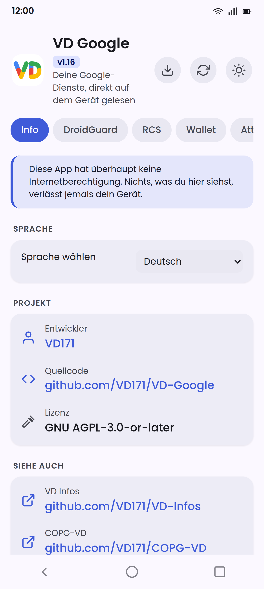
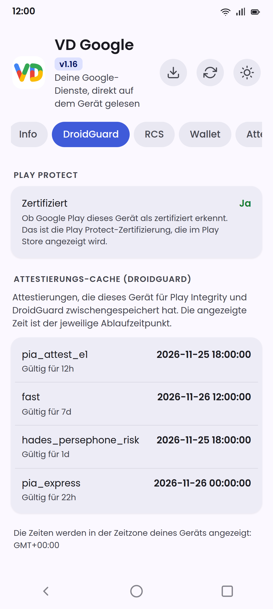
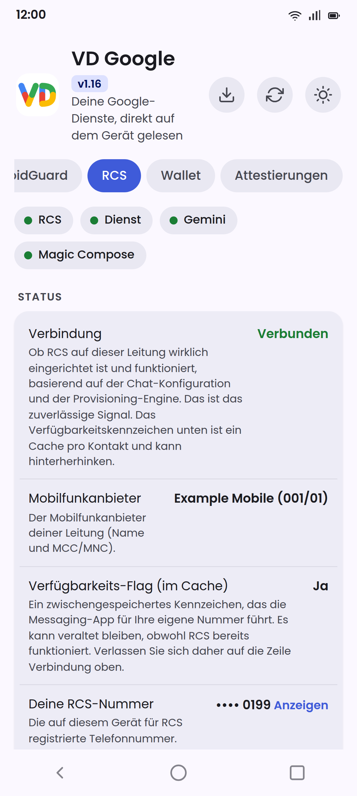
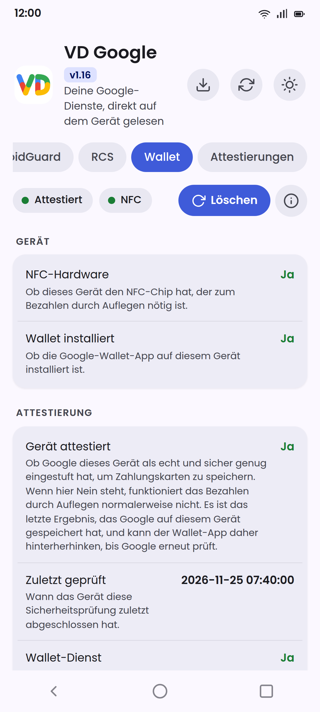
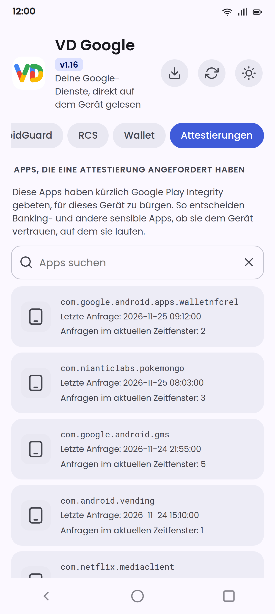

<!--
  ======================================================================
   VD GOOGLE  ::  your Google services, read on-device
   RCS, Google Wallet and Play Integrity attestations: local, no internet.

   Copyright (C) 2026  VD171
   SPDX-License-Identifier: AGPL-3.0-or-later

   Free software under the GNU AGPL v3 or later. NETWORK COPYLEFT: run a
   modified version, even as a service, and you MUST offer its source.

   Site           : https://vd171.ru
   Site           : https://vd.priv8.ru
   Source         : https://github.com/VD171/VD-Google
   GitHub         : @VD171 https://github.com/VD171
   XDA-Developers : @VD171 https://xdaforums.com/m/vd171.4699873/
   XDA thread     : https://xdaforums.com/t/VD-Google.4803837/
   Telegram       : @VD_Priv8 https://t.me/VD_Priv8
   Channel        : @Priv8_VD https://t.me/Priv8_VD
   Discord        : @VD.Priv8 https://discord.com/users/1296831918989639721
   E-mail         : vd.priv8@pm.me
  ======================================================================
-->

# VD Google

  

  
  
  
  

  <b>Deine Google-Dienste, direkt auf dem Gerät gelesen. Niemals Internet.</b> 
  VD Google zeigt dir, was Google selbst auf deinem Telefon zu drei Dingen festhält, und erklärt, was jeder Punkt bedeutet, ohne irgendetwas irgendwohin zu senden.

  <a href="https://github.com/VD171/VD-Google/releases">Releases</a> ·
  <a href="https://github.com/VD171/VD-Google/wiki/de-Home">Wiki</a> ·
  <a href="https://github.com/VD171/VD-Google/wiki/de-USER-GUIDE">Benutzerhandbuch</a> ·
  <a href="https://github.com/VD171/VD-Google/wiki/de-ARCHITECTURE">Architektur</a> ·
  <a href="https://github.com/VD171/VD-Google/wiki/de-PRIVACY">Datenschutz</a> ·
  <a href="https://github.com/VD171/VD-Google/wiki/de-BINARIES">Mitgelieferte Binärdateien</a> ·
  <a href="https://github.com/VD171/VD-Google/wiki/de-FILE-STRUCTURE">Dateistruktur</a> ·
  <a href="CHANGELOG.md">Changelog</a> ·
  <a href="https://xdaforums.com/t/VD-Google.4803837/">XDA thread</a>

> **Languages:** [English](README.md) · [العربية](README.ar.md) · [Čeština](README.cs.md) · Deutsch · [Español](README.es.md) · [فارسی](README.fa.md) · [Français](README.fr.md) · [हिन्दी](README.hi.md) · [Bahasa Indonesia](README.id.md) · [Italiano](README.it.md) · [日本語](README.ja.md) · [한국어](README.ko.md) · [Nederlands](README.nl.md) · [Polski](README.pl.md) · [Português](README.pt.md) · [Русский](README.ru.md) · [Svenska](README.sv.md) · [ไทย](README.th.md) · [Türkçe](README.tr.md) · [Українська](README.uk.md) · [Tiếng Việt](README.vi.md) · [中文](README.zh.md)

  
  
  
  
  

---

## App oder WebUI

Jede Version gibt es in zwei Formen, und beide lesen dieselben Dinge auf deinem Gerät, ohne Internet:

- **App**: die `.apk`, eine normale Android-App.
- **WebUI**: die `.zip`, ein Modul, das du in deinem Root-Manager (KernelSU, APatch oder Magisk) flashst und von dort öffnest.

In beiden Fällen ist Root erforderlich.

## Was es anzeigt

### RCS
Ob RCS für deine Leitung verfügbar ist, deine RCS-Nummer, der RCS-Zustand, die Konfigurationsversion, wie viele deiner Kontakte RCS unterstützen, die Anbieter-Berechtigung, die Präsenz (UCE) und die zugehörigen Zeitstempel (Bereitstellung, Synchronisierung, letzte Nachricht, Token-Ablauf und mehr). Zeigt auch, ob Gemini in Google Messages bereit ist: Magic Compose (Geminis Schreibhilfe), die KI-Engine auf dem Gerät (AICore, auf dem Gemini Nano läuft) und der Gemini-Chat, der über RCS bereitgestellt wird.

### Google Wallet
Ob dein Gerät für Zahlungen attestiert ist, ob es NFC-Hardware hat, ob Wallet installiert ist, der Zustand des Zahlungsdienstes und des Bezahlens durch Auflegen, ob deine Bildschirmsperre akzeptiert wird und ob jemals eine Karte hinzugefügt wurde.

### DroidGuard
Ob Google Play dieses Gerät als zertifiziert erkennt. Das ist die Play Protect-Zertifizierung, die im Play Store angezeigt wird. Attestierungen, die dieses Gerät für Play Integrity und DroidGuard zwischengespeichert hat. Die angezeigte Zeit ist der jeweilige Ablaufzeitpunkt.

### Attestierungen (Play Integrity)
Die Apps, die kürzlich Google Play Integrity gebeten haben, für dein Gerät zu bürgen, jeweils mit Symbol, Name, der vollständigen Zeit der letzten Anfrage und der Anzahl der Anfragen im aktuellen Zeitfenster.

Jeder Punkt enthält eine kurze, verständliche Erklärung, was er wirklich bedeutet.

## Datenschutz: kein Internet

VD Google deklariert **überhaupt keine Berechtigungen**, nicht einmal Internetzugriff. Nichts, was es liest, verlässt jemals dein Gerät. Du kannst das im Manifest und im Quellcode überprüfen.

## Voraussetzungen

- Android 8.0 (API 26) oder neuer.
- Läuft auf arm-, arm64-, x86- und x86_64-Geräten: Smartphones, Tablets, Emulatoren und ChromeOS.
- **Root ist erforderlich.** Die obigen Informationen liegen in geschützten, nur für das System zugänglichen Bereichen von Android. VD Google liest sie mit Superuser-Zugriff und tut sonst nichts damit. Ohne Root zeigt die App nur einen Bildschirm, der erklärt, warum Root nötig ist.

## Zeitstempel

Alle Zeiten werden in der aktuellen Zeitzone deines Geräts angezeigt, und die Zeitzone wird immer angegeben.

## KI-Agenten

VD Google schreibt einen einzigen JSON-**Export**: eine strukturierte, maschinenlesbare Momentaufnahme dessen, was Google auf deinem Gerät über RCS, Wallet und Play Integrity festhält, ohne personenbezogene Daten darin. Ein Agent, der ein Gerät prüft, liest diese eine Datei, statt mehrere Google-Apps und Datenbanken von Hand zu durchsuchen. Die App und die WebUI erzeugen genau dasselbe Schema, und keine von beiden berührt das Netzwerk. Siehe [docs/AI-AGENTS.md](docs/AI-AGENTS.md).

## Build

Immer Release, nie Debug. Die Android-App wird aus `VDGoogle/` mit `./gradlew assembleRelease` gebaut, das WebUI-Modul wird mit `webui/package.sh` paketiert. Das einzige native Binary ist `sqlite3`, aus dem Termux-Repository samt Bibliotheks-Closure geholt und mit seinem SHA-256 festgehalten. Siehe [Mitwirken](CONTRIBUTING.md), [Mitgelieferte Binaries](https://github.com/VD171/VD-Google/wiki/BINARIES) und die [Wiki](https://github.com/VD171/VD-Google/wiki).

## Dokumentation

- **[Wiki](https://github.com/VD171/VD-Google/wiki/de-Home)**: die gesamte Dokumentation, online durchsuchbar.
- **[Benutzerhandbuch](https://github.com/VD171/VD-Google/wiki/de-USER-GUIDE)**: was jeder Bildschirm anzeigt und was jedes Ergebnis bedeutet.
- **[Architektur](https://github.com/VD171/VD-Google/wiki/de-ARCHITECTURE)** und **[Dateistruktur](https://github.com/VD171/VD-Google/wiki/de-FILE-STRUCTURE)**: wie es funktioniert und wo alles liegt.
- **[Datenschutz](https://github.com/VD171/VD-Google/wiki/de-PRIVACY)**: keine Internetberechtigung, jede Lesung läuft über Root, nichts verlässt jemals das Gerät.
- **[Mitgelieferte Binärdateien](https://github.com/VD171/VD-Google/wiki/de-BINARIES)**: Herkunft und SHA-256 jeder vorkompilierten Binärdatei, für eine vollständige Prüfung.
- **[Mitwirken](https://github.com/VD171/VD-Google/wiki/de-CONTRIBUTING)** und **[Sicherheit](https://github.com/VD171/VD-Google/wiki/de-SECURITY)**.
- **[Changelog](CHANGELOG.md)** und **[Verhaltenskodex](https://github.com/VD171/VD-Google/wiki/de-CODE_OF_CONDUCT)**.

<!-- /vd-docs -->

## Siehe auch

- **[COPG-VD](https://github.com/VD171/COPG-VD)**: globales Spoofing von Geräte-Fingerprint / Play Integrity, geräteweit mit App-spezifischem Geltungsbereich und einer WebUI.
- **[VDBackup](https://github.com/VD171/VD-Backup)**: vollständige Sicherung und Wiederherstellung von Apps und Daten als Root, komplett über eine WebUI gesteuert.
- **[VD-dropbear](https://github.com/VD171/VD-dropbear)**: ein eigenständiger SSH-Daemon (Dropbear) mit Root.
- **[VDInstaller](https://github.com/VD171/VD-Installer)**: ein reibungsloser Root-Sideload-Installer für einzelne, Batch- und Split-APKs, mit einem Play-Protect-Verifier-Schalter und Fälschung der Installationsquelle.
- **[VDInfos](https://github.com/VD171/VD-Infos)**: ein Geräte-Methoden-Debugger, der jeden Punkt über jede Methode liest, die ihn lesen kann, und sie nebeneinander vergleicht.
- **[VDLiveUpdate](https://github.com/VD171/VDLiveUpdate)**: eine flashlose, inkrementelle Selbstaktualisierungs-Engine, eingebettet in KernelSU/APatch/Magisk-Module.
- **[VD-Modules](https://github.com/VD171/VD-Modules)**: unser MMRL/WebUI-X-Modul-Repository (installiere sie alle über deinen Root-Manager).
- **[@VictorGabriel7Dev/build.prop](https://github.com/VictorGabriel7Dev/build.prop)**: ein Datensatz von Pixel-`build.prop`-Fingerprints (Fork von @T3SL4).
- **[@VictorGabriel7Dev/mtproto-store](https://github.com/VictorGabriel7Dev/mtproto-store)**: nutze Telegram als Object Store über eine winzige Go-CLI.

## Kontakte

- https://vd171.ru
- https://vd.priv8.ru
- **Telegram:** @VD_Priv8 https://t.me/VD_Priv8
- **Channel:** @Priv8_VD https://t.me/Priv8_VD
- **Discord:** @VD.Priv8 https://discord.com/users/1296831918989639721
- **E-mail:** vd.priv8@pm.me
- **XDA-Developers:** @VD171 https://xdaforums.com/m/vd171.4699873/
- **XDA thread:** https://xdaforums.com/t/VD-Google.4803837/
- **GitHub:** @VD171 https://github.com/VD171

## Lizenz

**GNU AGPL-3.0-or-later**: siehe [LICENSE](LICENSE). Copyleft, einschließlich der Netzwerk-Klausel: wer eine modifizierte Version betreibt (auch als Dienst), muss ihren Quellcode anbieten. Bewusst gewählt, um Forks offen zu halten.

## Markenzeichen

VD Google ist ein unabhängiges, inoffizielles Projekt. Es steht in keiner Verbindung zu Google LLC und wird von Google LLC weder unterstützt noch gefördert. „Google", „Google Wallet", „Google Play", „Play Integrity", „Android" und zugehörige Namen und Logos sind Marken von Google LLC. VD Google liest nur das, was bereits auf deinem Gerät vorhanden ist, und sendet nichts irgendwohin.

## Tags

`android` `privacy` `security` `rcs` `google-wallet` `play-integrity` `attestation` `nfc` `tap-to-pay` `no-internet` `root` `kernelsu` `magisk` `lsposed` `on-device` `kotlin` `jetpack-compose` `material3` `vdgoogle`

---

📣 **Tritt dem Kanal für Updates bei:** @Priv8_VD https://t.me/Priv8_VD
