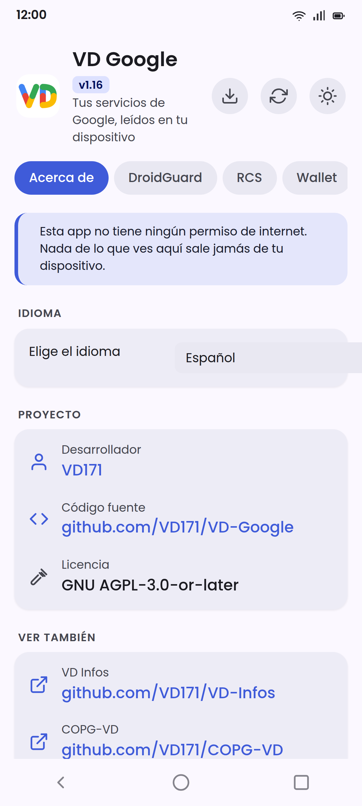
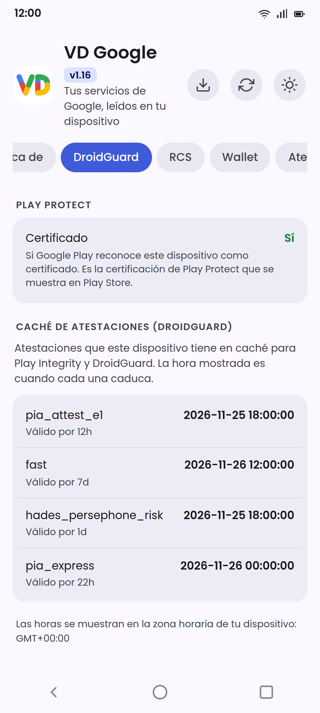
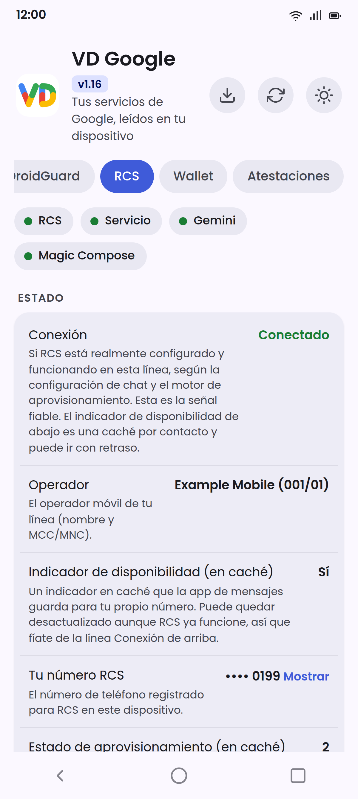
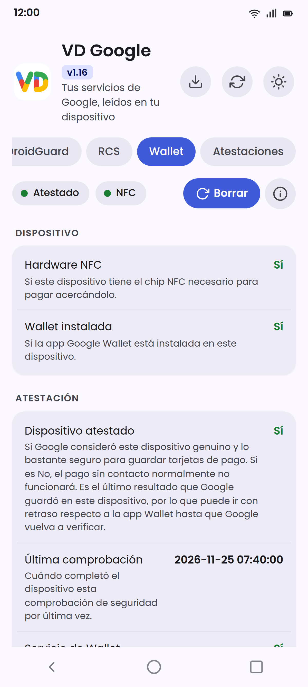
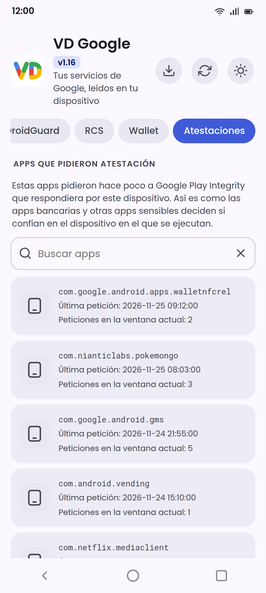

<!--
  ======================================================================
   VD GOOGLE  ::  your Google services, read on-device
   RCS, Google Wallet and Play Integrity attestations: local, no internet.

   Copyright (C) 2026  VD171
   SPDX-License-Identifier: AGPL-3.0-or-later

   Free software under the GNU AGPL v3 or later. NETWORK COPYLEFT: run a
   modified version, even as a service, and you MUST offer its source.

   Site           : https://vd171.ru
   Site           : https://vd.priv8.ru
   Source         : https://github.com/VD171/VD-Google
   GitHub         : @VD171 https://github.com/VD171
   XDA-Developers : @VD171 https://xdaforums.com/m/vd171.4699873/
   XDA thread     : https://xdaforums.com/t/VD-Google.4803837/
   Telegram       : @VD_Priv8 https://t.me/VD_Priv8
   Channel        : @Priv8_VD https://t.me/Priv8_VD
   Discord        : @VD.Priv8 https://discord.com/users/1296831918989639721
   E-mail         : vd.priv8@pm.me
  ======================================================================
-->

# VD Google

  

  
  
  
  

  <b>Tus servicios de Google, leídos en tu dispositivo. Sin internet, nunca.</b> 
  VD Google te muestra lo que el propio Google registra en tu teléfono sobre RCS, Wallet y Play Integrity, y explica qué significa cada dato, sin enviar nada a ninguna parte.

  <a href="https://github.com/VD171/VD-Google/releases">Releases</a> ·
  <a href="https://github.com/VD171/VD-Google/wiki/es-Home">Wiki</a> ·
  <a href="https://github.com/VD171/VD-Google/wiki/es-USER-GUIDE">Guía de usuario</a> ·
  <a href="https://github.com/VD171/VD-Google/wiki/es-ARCHITECTURE">Arquitectura</a> ·
  <a href="https://github.com/VD171/VD-Google/wiki/es-PRIVACY">Privacidad</a> ·
  <a href="https://github.com/VD171/VD-Google/wiki/es-BINARIES">Binarios incluidos</a> ·
  <a href="https://github.com/VD171/VD-Google/wiki/es-FILE-STRUCTURE">Estructura de archivos</a> ·
  <a href="CHANGELOG.md">Changelog</a> ·
  <a href="https://xdaforums.com/t/VD-Google.4803837/">XDA thread</a>

> **Languages:** [English](README.md) · [العربية](README.ar.md) · [Čeština](README.cs.md) · [Deutsch](README.de.md) · Español · [فارسی](README.fa.md) · [Français](README.fr.md) · [हिन्दी](README.hi.md) · [Bahasa Indonesia](README.id.md) · [Italiano](README.it.md) · [日本語](README.ja.md) · [한국어](README.ko.md) · [Nederlands](README.nl.md) · [Polski](README.pl.md) · [Português](README.pt.md) · [Русский](README.ru.md) · [Svenska](README.sv.md) · [ไทย](README.th.md) · [Türkçe](README.tr.md) · [Українська](README.uk.md) · [Tiếng Việt](README.vi.md) · [中文](README.zh.md)

  
  
  
  
  

---

## App o WebUI

Cada versión viene de dos formas, y ambas leen lo mismo en tu dispositivo, sin internet:

- **App**: el `.apk`, una aplicación de Android normal.
- **WebUI**: el `.zip`, un módulo que instalas en tu gestor de root (KernelSU, APatch o Magisk) y abres desde ahí.

En cualquier caso, se requiere root.

## Qué muestra

### RCS
Si RCS está disponible para tu línea, tu número RCS, el estado de RCS, la versión de la configuración, cuántos de tus contactos admiten RCS, la autorización del operador, la presencia (UCE) y las marcas de tiempo relacionadas (aprovisionamiento, sincronización, último mensaje, caducidad del token y más). También muestra si Gemini en Google Messages está listo: Magic Compose (la ayuda de escritura de Gemini), el modelo en el dispositivo (AICore, que ejecuta Gemini Nano) y el chat de Gemini, que se entrega por RCS.

### Google Wallet
Si tu dispositivo está atestado para pagos, si tiene hardware NFC, si Wallet está instalada, el estado del servicio de pago y del pago sin contacto, si tu bloqueo de pantalla se acepta y si alguna vez se ha añadido una tarjeta.

### DroidGuard
Si Google Play reconoce este dispositivo como certificado. Es la certificación de Play Protect que se muestra en Play Store. Atestaciones que este dispositivo tiene en caché para Play Integrity y DroidGuard. La hora mostrada es cuando cada una caduca.

### Atestaciones (Play Integrity)
Las apps que pidieron hace poco a Google Play Integrity que respondiera por tu dispositivo, cada una con su icono, su nombre, la hora completa de su última petición y cuántas peticiones hizo en la ventana actual.

Cada dato incluye una explicación breve, en lenguaje sencillo, de lo que realmente significa.

## Privacidad: sin internet

VD Google no declara **ningún permiso**, ni siquiera acceso a internet. Nada de lo que lee sale jamás de tu dispositivo. Puedes comprobarlo en el manifiesto y en el código fuente.

## Requisitos

- Android 8.0 (API 26) o posterior.
- Funciona en dispositivos arm, arm64, x86 y x86_64: teléfonos, tablets, emuladores y ChromeOS.
- **Se necesita root.** La información anterior reside en zonas protegidas de Android, accesibles solo para el sistema. VD Google la lee con acceso de superusuario y no hace nada más con ella. Sin root, la app solo muestra una pantalla que explica por qué se necesita root.

## Marcas de tiempo

Todas las horas se muestran en la zona horaria actual de tu dispositivo, y la zona horaria siempre se indica.

## Agentes de IA

VD Google escribe una única **exportación** JSON: una instantánea estructurada y legible por máquina de lo que Google registra en tu dispositivo sobre RCS, Wallet y Play Integrity, sin ningún dato personal. Un agente que audita un dispositivo lee ese único archivo en lugar de rastrear varias apps y bases de datos de Google a mano. La App y la WebUI producen exactamente el mismo esquema, y ninguna toca la red. Consulta [docs/AI-AGENTS.md](docs/AI-AGENTS.md).

## Compilación

Siempre release, nunca debug. La app de Android se compila desde `VDGoogle/` con `./gradlew assembleRelease`, el módulo WebUI se empaqueta con `webui/package.sh`. El único binario nativo es `sqlite3`, obtenido del repositorio de Termux con su cierre de bibliotecas y registrado con su SHA-256. Consulta [Contribuir](CONTRIBUTING.md), [Binarios incluidos](https://github.com/VD171/VD-Google/wiki/BINARIES) y la [wiki](https://github.com/VD171/VD-Google/wiki).

## Documentación

- **[Wiki](https://github.com/VD171/VD-Google/wiki/es-Home)**: toda la documentación, consultable en línea.
- **[Guía de usuario](https://github.com/VD171/VD-Google/wiki/es-USER-GUIDE)**: qué muestra cada pantalla y qué significa cada resultado.
- **[Arquitectura](https://github.com/VD171/VD-Google/wiki/es-ARCHITECTURE)** y **[Estructura de archivos](https://github.com/VD171/VD-Google/wiki/es-FILE-STRUCTURE)**: cómo funciona y dónde está cada cosa.
- **[Privacidad](https://github.com/VD171/VD-Google/wiki/es-PRIVACY)**: sin permiso de internet, cada lectura pasa por root, nada sale jamás del dispositivo.
- **[Binarios incluidos](https://github.com/VD171/VD-Google/wiki/es-BINARIES)**: procedencia y SHA-256 de cada binario precompilado, para una auditoría completa.
- **[Contribuir](https://github.com/VD171/VD-Google/wiki/es-CONTRIBUTING)** y **[Seguridad](https://github.com/VD171/VD-Google/wiki/es-SECURITY)**.
- **[Changelog](CHANGELOG.md)** y **[Código de conducta](https://github.com/VD171/VD-Google/wiki/es-CODE_OF_CONDUCT)**.

<!-- /vd-docs -->

## Ver también

- **[COPG-VD](https://github.com/VD171/COPG-VD)**: spoofing global del fingerprint del dispositivo / Play Integrity, en todo el dispositivo con alcance por app y una WebUI.
- **[VDBackup](https://github.com/VD171/VD-Backup)**: copia de seguridad y restauración completas de apps y datos como root, gestionadas por completo desde una WebUI.
- **[VD-dropbear](https://github.com/VD171/VD-dropbear)**: un demonio SSH autónomo con root (Dropbear).
- **[VDInstaller](https://github.com/VD171/VD-Installer)**: un instalador sideload con root y sin fricción para APK individuales, por lotes y divididos, con un interruptor para el verificador de Play Protect y suplantación del origen de instalación.
- **[VDInfos](https://github.com/VD171/VD-Infos)**: un depurador de métodos del dispositivo que lee cada dato con todos los métodos que pueden leerlo y los compara lado a lado.
- **[VDLiveUpdate](https://github.com/VD171/VDLiveUpdate)**: un motor de autoactualización incremental y sin flasheo, integrado en módulos KernelSU/APatch/Magisk.
- **[VD-Modules](https://github.com/VD171/VD-Modules)**: nuestro repositorio de módulos MMRL/WebUI-X (instala todos ellos desde tu gestor root).
- **[@VictorGabriel7Dev/build.prop](https://github.com/VictorGabriel7Dev/build.prop)**: un conjunto de datos de fingerprints `build.prop` de Pixel (fork de @T3SL4).
- **[@VictorGabriel7Dev/mtproto-store](https://github.com/VictorGabriel7Dev/mtproto-store)**: usa Telegram como object store desde una CLI de Go diminuta.

## Contactos

- https://vd171.ru
- https://vd.priv8.ru
- **Telegram:** @VD_Priv8 https://t.me/VD_Priv8
- **Channel:** @Priv8_VD https://t.me/Priv8_VD
- **Discord:** @VD.Priv8 https://discord.com/users/1296831918989639721
- **E-mail:** vd.priv8@pm.me
- **XDA-Developers:** @VD171 https://xdaforums.com/m/vd171.4699873/
- **XDA thread:** https://xdaforums.com/t/VD-Google.4803837/
- **GitHub:** @VD171 https://github.com/VD171

## Licencia

**GNU AGPL-3.0-or-later**: consulta [LICENSE](LICENSE). Copyleft, incluida la cláusula de red: quien ejecute una versión modificada (incluso como servicio) debe ofrecer su código fuente. Elegida a propósito para mantener los forks abiertos.

## Marcas comerciales

VD Google es un proyecto independiente y no oficial. No está afiliado a Google LLC ni cuenta con su respaldo o patrocinio. "Google", "Google Wallet", "Google Play", "Play Integrity", "Android" y los nombres y logotipos relacionados son marcas comerciales de Google LLC. VD Google solo lee lo que ya está en tu dispositivo y no envía nada a ninguna parte.

## Tags

`android` `privacy` `security` `rcs` `google-wallet` `play-integrity` `attestation` `nfc` `tap-to-pay` `no-internet` `root` `kernelsu` `magisk` `lsposed` `on-device` `kotlin` `jetpack-compose` `material3` `vdgoogle`

---

📣 **Únete al canal para las actualizaciones:** @Priv8_VD https://t.me/Priv8_VD
