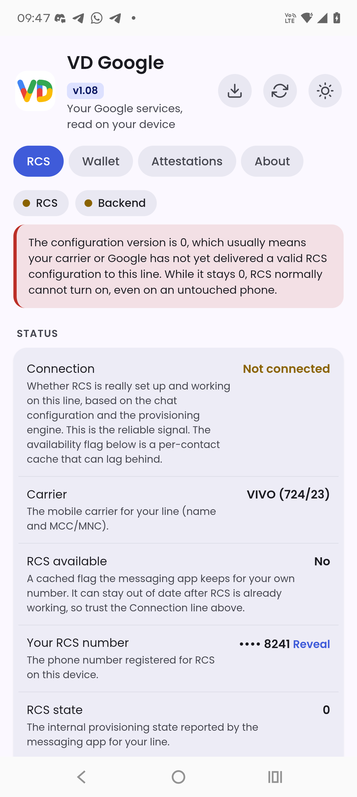
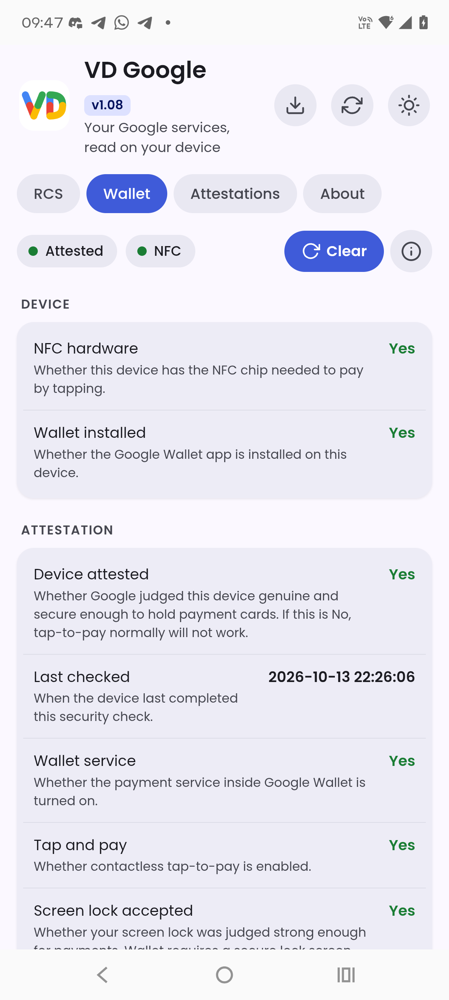
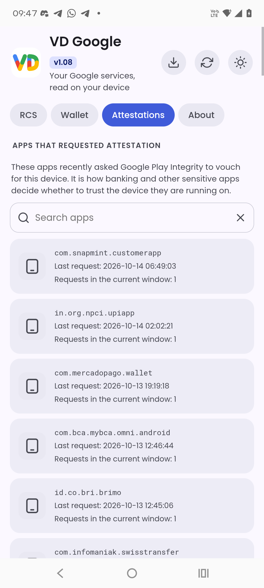
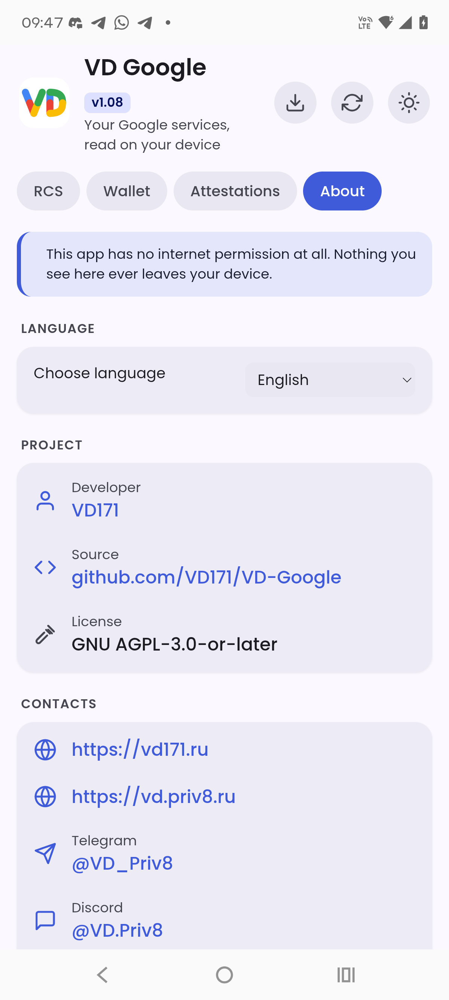
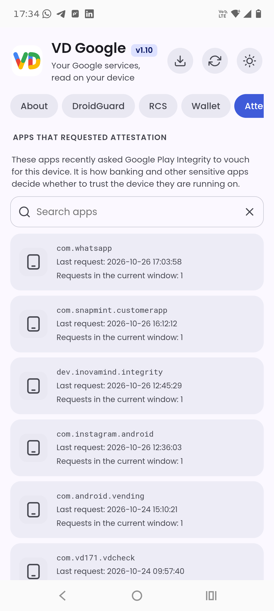

<!--
  VD GOOGLE - RCS, Google Wallet y atestaciones de Play Integrity, leídos en el dispositivo.
  Copyright (C) 2026  VD171 - SPDX-License-Identifier: AGPL-3.0-or-later
-->

# VD Google

  

  
  
  
  

  <b>Tus servicios de Google, leídos en tu dispositivo. Sin internet, nunca.</b> 
  VD Google te muestra lo que el propio Google registra en tu teléfono sobre RCS, Wallet y Play Integrity, y explica qué significa cada dato, sin enviar nada a ninguna parte.

  <a href="https://github.com/VD171/VD-Google/releases">Releases</a> ·
  <a href="https://github.com/VD171/VD-Google/wiki">Wiki</a> ·
  <a href="https://github.com/VD171/VD-Google/wiki/USER-GUIDE">User guide</a> ·
  <a href="https://github.com/VD171/VD-Google/wiki/ARCHITECTURE">Architecture</a> ·
  <a href="https://github.com/VD171/VD-Google/wiki/PRIVACY">Privacy</a> ·
  <a href="https://github.com/VD171/VD-Google/wiki/BINARIES">Bundled binaries</a> ·
  <a href="https://github.com/VD171/VD-Google/wiki/FILE-STRUCTURE">File structure</a> ·
  <a href="CHANGELOG.md">Changelog</a> ·
  <a href="https://xdaforums.com/t/VD-Google.4803837/">XDA thread</a>

> **Languages:** [English](README.md) · [العربية](README.ar.md) · [Čeština](README.cs.md) · [Deutsch](README.de.md) · [Español](README.es.md) · [فارسی](README.fa.md) · [Français](README.fr.md) · [हिन्दी](README.hi.md) · [Bahasa Indonesia](README.in.md) · [Italiano](README.it.md) · [日本語](README.ja.md) · [한국어](README.ko.md) · [Nederlands](README.nl.md) · [Polski](README.pl.md) · [Português](README.pt.md) · [Русский](README.ru.md) · [Svenska](README.sv.md) · [ไทย](README.th.md) · [Türkçe](README.tr.md) · [Українська](README.uk.md) · [Tiếng Việt](README.vi.md) · [中文](README.zh.md)

  
  
  
  
  

---

## App o WebUI

Cada versión viene de dos formas, y ambas leen lo mismo en tu dispositivo, sin internet:

- **App** - el `.apk`, una aplicación de Android normal.
- **WebUI** - el `.zip`, un módulo que instalas en tu gestor de root (KernelSU, Magisk o APatch) y abres desde ahí.

En cualquier caso, se requiere root.

## Qué muestra

### RCS
Si RCS está disponible para tu línea, tu número RCS, el estado de RCS, la versión de la configuración, cuántos de tus contactos admiten RCS, la autorización del operador, la presencia (UCE) y las marcas de tiempo relacionadas (aprovisionamiento, sincronización, último mensaje, caducidad del token y más). También muestra si Gemini en Google Messages está listo: Magic Compose (la ayuda de escritura de Gemini), el modelo en el dispositivo (AICore, que ejecuta Gemini Nano) y el chat de Gemini, que se entrega por RCS.

### Google Wallet
Si tu dispositivo está atestado para pagos, si tiene hardware NFC, si Wallet está instalada, el estado del servicio de pago y del pago sin contacto, si tu bloqueo de pantalla se acepta y si alguna vez se ha añadido una tarjeta.

### DroidGuard
Si Google Play reconoce este dispositivo como certificado. Es la certificación de Play Protect que se muestra en Play Store. Atestaciones que este dispositivo tiene en caché para Play Integrity y DroidGuard. La hora mostrada es cuando cada una caduca.

### Atestaciones (Play Integrity)
Las apps que pidieron hace poco a Google Play Integrity que respondiera por tu dispositivo, cada una con su icono, su nombre, la hora completa de su última petición y cuántas peticiones hizo en la ventana actual.

Cada dato incluye una explicación breve, en lenguaje sencillo, de lo que realmente significa.

## Privacidad: sin internet

VD Google no declara **ningún permiso**, ni siquiera acceso a internet. Nada de lo que lee sale jamás de tu dispositivo. Puedes comprobarlo en el manifiesto y en el código fuente.

## Requisitos

- Android 8.0 (API 26) o posterior.
- **Se necesita root.** La información anterior reside en zonas protegidas de Android, accesibles solo para el sistema. VD Google la lee con acceso de superusuario y no hace nada más con ella. Sin root, la app solo muestra una pantalla que explica por qué se necesita root.

## Marcas de tiempo

Todas las horas se muestran en la zona horaria actual de tu dispositivo, y la zona horaria siempre se indica.

## Ver también

Proyectos hermanos del mismo autor:

- **[VDInfos](https://github.com/VD171/VD-Infos)**: un depurador de métodos del dispositivo que lee cada dato con todos los métodos que pueden leerlo y los compara lado a lado.
- **[VDBackup](https://github.com/VD171/VD-Backup)**: copia de seguridad y restauración completas de apps y datos como root, gestionadas por completo desde una WebUI.
- **[COPG-VD](https://github.com/VD171/COPG-VD)**: un spoofer de dispositivo que convierte una huella nueva en un perfil coherente y consistente.

## Contactos

* https://vd171.ru
* https://vd.priv8.ru
* **Telegram:** @VD_Priv8 https://t.me/VD_Priv8
* **Channel:** @Priv8_VD https://t.me/Priv8_VD
* **Discord:** @VD.Priv8 https://discord.com/users/1296831918989639721
* **E-mail:** vd.priv8@pm.me
* **XDA-Developers:** @VD171 https://xdaforums.com/m/vd171.4699873/
* **XDA thread:** https://xdaforums.com/t/VD-Google.4803837/
* **GitHub:** @VD171 https://github.com/VD171

## Licencia

**GNU AGPL-3.0-or-later** - consulta [LICENSE](LICENSE). Copyleft, incluida la cláusula de red: quien ejecute una versión modificada (incluso como servicio) debe ofrecer su código fuente. Elegida a propósito para mantener los forks abiertos.

## Marcas comerciales

VD Google es un proyecto independiente y no oficial. No está afiliado a Google LLC ni cuenta con su respaldo o patrocinio. "Google", "Google Wallet", "Google Play", "Play Integrity", "Android" y los nombres y logotipos relacionados son marcas comerciales de Google LLC. VD Google solo lee lo que ya está en tu dispositivo y no envía nada a ninguna parte.

## Tags

`android` `privacy` `security` `rcs` `google-wallet` `play-integrity` `attestation` `nfc` `tap-to-pay` `no-internet` `root` `kernelsu` `magisk` `lsposed` `on-device` `kotlin` `jetpack-compose` `material3` `vdgoogle`
