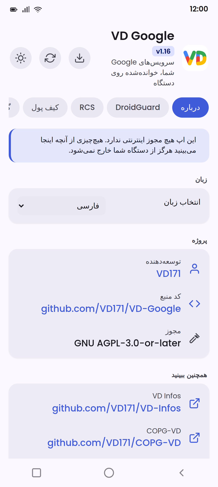
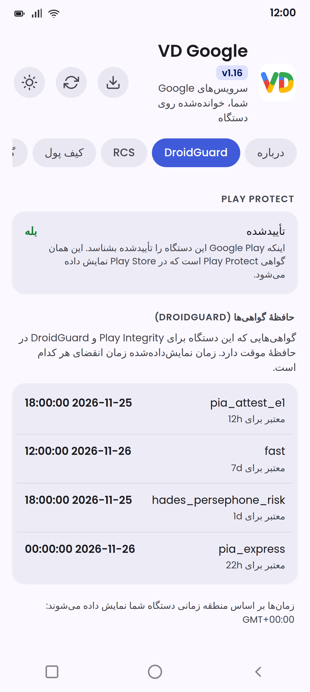
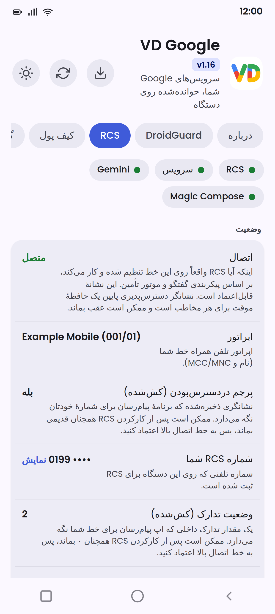
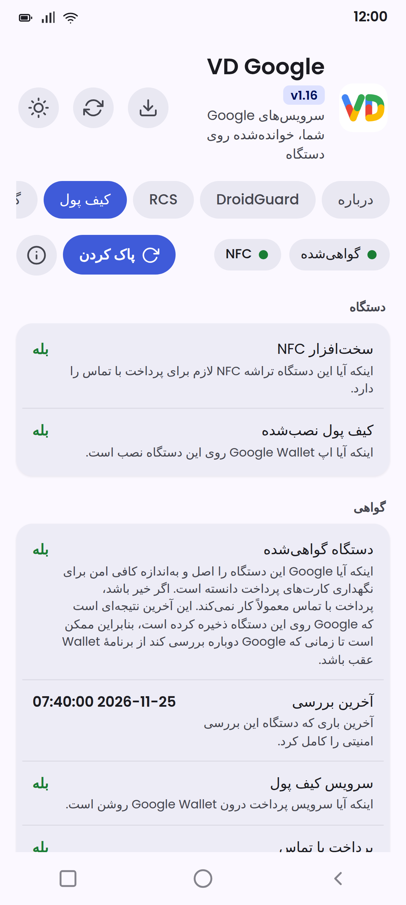
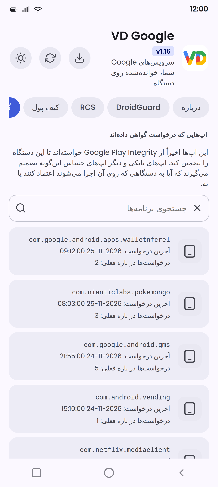

<!--
  ======================================================================
   VD GOOGLE  ::  your Google services, read on-device
   RCS, Google Wallet and Play Integrity attestations: local, no internet.

   Copyright (C) 2026  VD171
   SPDX-License-Identifier: AGPL-3.0-or-later

   Free software under the GNU AGPL v3 or later. NETWORK COPYLEFT: run a
   modified version, even as a service, and you MUST offer its source.

   Site           : https://vd171.ru
   Site           : https://vd.priv8.ru
   Source         : https://github.com/VD171/VD-Google
   GitHub         : @VD171 https://github.com/VD171
   XDA-Developers : @VD171 https://xdaforums.com/m/vd171.4699873/
   XDA thread     : https://xdaforums.com/t/VD-Google.4803837/
   Telegram       : @VD_Priv8 https://t.me/VD_Priv8
   Channel        : @Priv8_VD https://t.me/Priv8_VD
   Discord        : @VD.Priv8 https://discord.com/users/1296831918989639721
   E-mail         : vd.priv8@pm.me
  ======================================================================
-->

# VD Google

  

  
  
  
  

  <b>سرویس‌های Google شما، خوانده‌شده روی دستگاه. هرگز اینترنت.</b> 
  VD Google به شما نشان می‌دهد که خود Google درباره RCS، Wallet و Play Integrity روی گوشی شما چه چیزی ثبت می‌کند و توضیح می‌دهد هر مورد چه معنایی دارد، بدون ارسال هیچ‌چیز به هیچ‌کجا.

  <a href="https://github.com/VD171/VD-Google/releases">Releases</a> ·
  <a href="https://github.com/VD171/VD-Google/wiki/fa-Home">Wiki</a> ·
  <a href="https://github.com/VD171/VD-Google/wiki/fa-USER-GUIDE">راهنمای کاربر</a> ·
  <a href="https://github.com/VD171/VD-Google/wiki/fa-ARCHITECTURE">معماری</a> ·
  <a href="https://github.com/VD171/VD-Google/wiki/fa-PRIVACY">حریم خصوصی</a> ·
  <a href="https://github.com/VD171/VD-Google/wiki/fa-BINARIES">باینری‌های همراه</a> ·
  <a href="https://github.com/VD171/VD-Google/wiki/fa-FILE-STRUCTURE">ساختار فایل‌ها</a> ·
  <a href="CHANGELOG.md">Changelog</a> ·
  <a href="https://xdaforums.com/t/VD-Google.4803837/">XDA thread</a>

> **Languages:** [English](README.md) · [العربية](README.ar.md) · [Čeština](README.cs.md) · [Deutsch](README.de.md) · [Español](README.es.md) · [فارسی](README.fa.md) · [Français](README.fr.md) · [हिन्दी](README.hi.md) · [Bahasa Indonesia](README.id.md) · [Italiano](README.it.md) · [日本語](README.ja.md) · [한국어](README.ko.md) · [Nederlands](README.nl.md) · [Polski](README.pl.md) · [Português](README.pt.md) · [Русский](README.ru.md) · [Svenska](README.sv.md) · [ไทย](README.th.md) · [Türkçe](README.tr.md) · [Українська](README.uk.md) · [Tiếng Việt](README.vi.md) · [中文](README.zh.md)

  
  
  
  
  

---

## اپلیکیشن یا WebUI

هر نسخه به دو شکل عرضه می‌شود و هر دو همان اطلاعات را روی دستگاه شما و بدون اینترنت می‌خوانند:

- **App**: فایل `.apk`، یک برنامهٔ عادی اندروید.
- **WebUI**: فایل `.zip`، ماژولی که در مدیر روت خود (KernelSU، APatch یا Magisk) فلش می‌کنید و از همان‌جا باز می‌کنید.

در هر دو حالت، روت لازم است.

## چه چیزی نمایش می‌دهد

### RCS
اینکه آیا RCS برای خط شما در دسترس است، شماره RCS شما، وضعیت RCS، نسخه پیکربندی، چند نفر از مخاطبان شما از RCS پشتیبانی می‌کنند، اجازه اپراتور، حضور (UCE) و برچسب‌های زمانی مرتبط (تدارک، همگام‌سازی، آخرین پیام، انقضای توکن و موارد دیگر). همچنین نشان می‌دهد که آیا Gemini در Google Messages آماده است: Magic Compose (کمک نگارشی Gemini)، موتور هوش مصنوعی روی دستگاه (AICore که Gemini Nano را اجرا می‌کند) و گفتگوی Gemini که از طریق RCS ارائه می‌شود.

### Google Wallet
اینکه آیا دستگاه شما برای پرداخت گواهی‌شده است، آیا سخت‌افزار NFC دارد، آیا Wallet نصب است، وضعیت سرویس پرداخت و پرداخت با تماس، آیا قفل صفحه شما پذیرفته شده و آیا تا کنون کارتی افزوده شده است.

### DroidGuard
اینکه Google Play این دستگاه را تأییدشده بشناسد. این همان گواهی Play Protect است که در Play Store نمایش داده می‌شود. گواهی‌هایی که این دستگاه برای Play Integrity و DroidGuard در حافظهٔ موقت دارد. زمان نمایش‌داده‌شده زمان انقضای هر کدام است.

### گواهی‌ها (Play Integrity)
اپ‌هایی که اخیراً از Google Play Integrity خواسته‌اند دستگاه شما را تضمین کند، هرکدام با نماد، نام، زمان کامل آخرین درخواست و تعداد درخواست‌ها در بازه فعلی.

هر مورد همراه با توضیحی کوتاه و به زبان ساده درباره معنای واقعی آن است.

## حریم خصوصی: بدون اینترنت

VD Google **هیچ مجوزی** اعلام نمی‌کند، حتی دسترسی به اینترنت. هیچ‌چیزی از آنچه می‌خواند هرگز از دستگاه شما خارج نمی‌شود. می‌توانید این را در مانیفست و در کد منبع بررسی کنید.

## پیش‌نیازها

- Android 8.0 (API 26) یا جدیدتر.
- روی دستگاه‌های arm، arm64، x86 و x86_64 اجرا می‌شود: تلفن‌ها، تبلت‌ها، شبیه‌سازها و ChromeOS.
- **روت لازم است.** اطلاعات بالا در نواحی محافظت‌شده Android قرار دارند که فقط سیستم به آن‌ها دسترسی دارد. VD Google آن‌ها را با دسترسی اَبَرکاربر می‌خواند و کار دیگری با آن‌ها نمی‌کند. بدون روت، اپ فقط صفحه‌ای نمایش می‌دهد که توضیح می‌دهد چرا روت لازم است.

## برچسب‌های زمانی

همه زمان‌ها بر اساس منطقه زمانی فعلی دستگاه شما نمایش داده می‌شوند و منطقه زمانی همیشه ذکر می‌شود.

## عامل‌های هوش مصنوعی

VD Google یک **خروجی** JSON واحد می‌نویسد: یک نمای فوری ساختارمند و قابل‌خواندن توسط ماشین از آنچه Google روی دستگاه شما درباره RCS، Wallet و Play Integrity ثبت می‌کند، بدون هیچ داده شخصی در آن. عاملی که یک دستگاه را بازرسی می‌کند همان یک فایل را می‌خواند، به‌جای جست‌وجوی دستی در چند برنامه و پایگاه‌داده Google. برنامه و WebUI دقیقاً همان طرح‌واره را تولید می‌کنند و هیچ‌کدام به شبکه دست نمی‌زنند. به [docs/AI-AGENTS.md](docs/AI-AGENTS.md) مراجعه کنید.

## ساخت

همیشه release، هرگز debug. برنامه Android از `VDGoogle/` با `./gradlew assembleRelease` ساخته می‌شود؛ ماژول WebUI با `webui/package.sh` بسته‌بندی می‌شود. تنها فایل باینری بومی `sqlite3` است که از مخزن Termux همراه با بستار کتابخانه‌هایش گرفته می‌شود و با SHA-256 آن ثبت می‌شود. به [مشارکت](CONTRIBUTING.md)، [باینری‌های همراه](https://github.com/VD171/VD-Google/wiki/BINARIES) و [ویکی](https://github.com/VD171/VD-Google/wiki) مراجعه کنید.

## مستندات

- **[Wiki](https://github.com/VD171/VD-Google/wiki/fa-Home)**: همه مستندات، قابل مرور به‌صورت آنلاین.
- **[راهنمای کاربر](https://github.com/VD171/VD-Google/wiki/fa-USER-GUIDE)**: اینکه هر صفحه چه چیزی را نشان می‌دهد و هر نتیجه چه معنایی دارد.
- **[معماری](https://github.com/VD171/VD-Google/wiki/fa-ARCHITECTURE)** و **[ساختار فایل‌ها](https://github.com/VD171/VD-Google/wiki/fa-FILE-STRUCTURE)**: اینکه چگونه کار می‌کند و هر چیز کجاست.
- **[حریم خصوصی](https://github.com/VD171/VD-Google/wiki/fa-PRIVACY)**: بدون مجوز اینترنت، هر خواندن از طریق روت انجام می‌شود و هیچ‌چیز هرگز از دستگاه خارج نمی‌شود.
- **[باینری‌های همراه](https://github.com/VD171/VD-Google/wiki/fa-BINARIES)**: منشأ و SHA-256 هر باینری از پیش‌کامپایل‌شده، برای بررسی کامل.
- **[مشارکت](https://github.com/VD171/VD-Google/wiki/fa-CONTRIBUTING)** و **[امنیت](https://github.com/VD171/VD-Google/wiki/fa-SECURITY)**.
- **[Changelog](CHANGELOG.md)** و **[آیین‌نامه رفتار](https://github.com/VD171/VD-Google/wiki/fa-CODE_OF_CONDUCT)**.

<!-- /vd-docs -->

## همچنین ببینید

- **[COPG-VD](https://github.com/VD171/COPG-VD)**: جعل سراسری اثرانگشت دستگاه / Play Integrity، روی کل دستگاه با دامنه‌ی هر اپ و یک WebUI.
- **[VDBackup](https://github.com/VD171/VD-Backup)**: پشتیبان‌گیری و بازیابی کامل برنامه‌ها و داده‌ها به‌صورت روت، که به‌طور کامل از یک WebUI هدایت می‌شود.
- **[VD-dropbear](https://github.com/VD171/VD-dropbear)**: یک دیمون SSH مستقل که به‌صورت روت اجرا می‌شود (Dropbear).
- **[VDInstaller](https://github.com/VD171/VD-Installer)**: یک نصب‌کنندهٔ ساید‌لود روت‌شدهٔ بدون‌اصطکاک برای APKهای تکی، دسته‌ای و تقسیم‌شده، همراه با کلید تأییدکنندهٔ Play Protect و جعل منبع نصب.
- **[VDInfos](https://github.com/VD171/VD-Infos)**: یک اشکال‌زدای روش‌های دستگاه که هر مورد را با همه روش‌هایی که می‌توانند آن را بخوانند می‌خواند و آن‌ها را کنار هم مقایسه می‌کند.
- **[VDLiveUpdate](https://github.com/VD171/VDLiveUpdate)**: یک موتور خودبه‌روزرسانی افزایشی و بدون فلش، تعبیه‌شده در ماژول‌های KernelSU/APatch/Magisk.
- **[VD-Modules](https://github.com/VD171/VD-Modules)**: مخزن ماژول‌های MMRL/WebUI-X ما (همه‌ی آن‌ها را از مدیر root خود نصب کنید).
- **[@VictorGabriel7Dev/build.prop](https://github.com/VictorGabriel7Dev/build.prop)**: یک مجموعه‌داده از اثرانگشت‌های `build.prop` پیکسل (فورک از @T3SL4).
- **[@VictorGabriel7Dev/mtproto-store](https://github.com/VictorGabriel7Dev/mtproto-store)**: از Telegram به‌عنوان ذخیره‌گاه شیء از طریق یک Go CLI کوچک استفاده کنید.

## راه‌های ارتباط

- https://vd171.ru
- https://vd.priv8.ru
- **Telegram:** @VD_Priv8 https://t.me/VD_Priv8
- **Channel:** @Priv8_VD https://t.me/Priv8_VD
- **Discord:** @VD.Priv8 https://discord.com/users/1296831918989639721
- **E-mail:** vd.priv8@pm.me
- **XDA-Developers:** @VD171 https://xdaforums.com/m/vd171.4699873/
- **XDA thread:** https://xdaforums.com/t/VD-Google.4803837/
- **GitHub:** @VD171 https://github.com/VD171

## مجوز

**GNU AGPL-3.0-or-later**: به [LICENSE](LICENSE) مراجعه کنید. کپی‌لفت شامل بند شبکه: هر کسی نسخه‌ای تغییریافته را (حتی به‌عنوان سرویس) اجرا کند باید کد منبع آن را ارائه دهد. عمداً انتخاب شده تا فورک‌ها باز بمانند.

## علائم تجاری

VD Google یک پروژه مستقل و غیررسمی است. وابسته به Google LLC نیست و توسط آن تأیید یا حمایت مالی نمی‌شود. «Google»، «Google Wallet»، «Google Play»، «Play Integrity»، «Android» و نام‌ها و نشان‌های مرتبط، علائم تجاری Google LLC هستند. VD Google فقط آنچه را که از پیش روی دستگاه شماست می‌خواند و هیچ‌چیزی به هیچ‌کجا ارسال نمی‌کند.

## Tags

`android` `privacy` `security` `rcs` `google-wallet` `play-integrity` `attestation` `nfc` `tap-to-pay` `no-internet` `root` `kernelsu` `magisk` `lsposed` `on-device` `kotlin` `jetpack-compose` `material3` `vdgoogle`

---

📣 **برای دریافت به‌روزرسانی‌ها به کانال بپیوندید:** @Priv8_VD https://t.me/Priv8_VD
