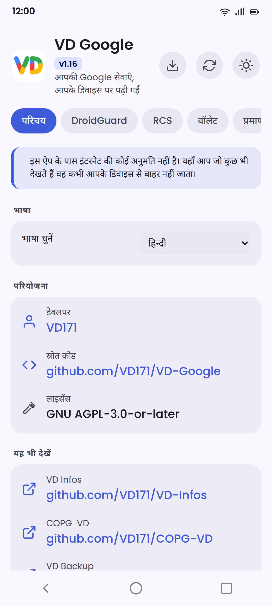
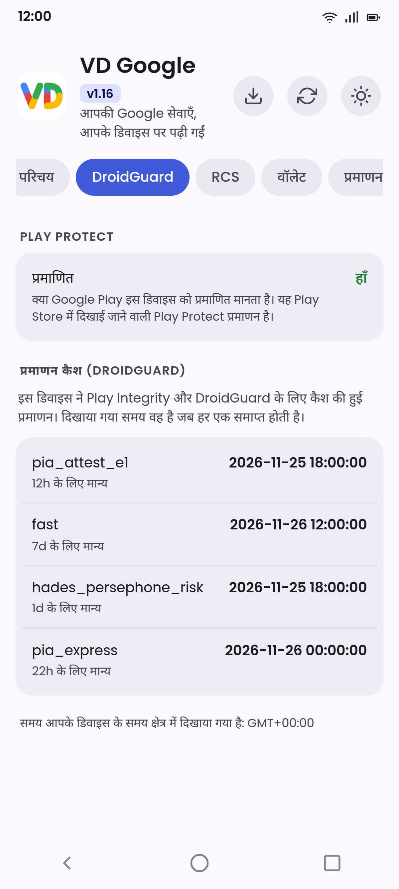
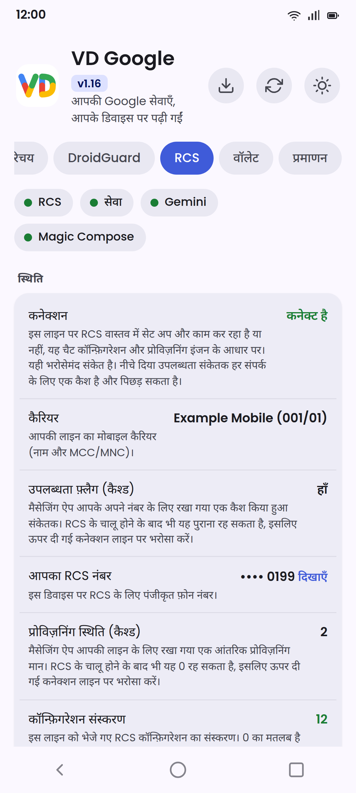
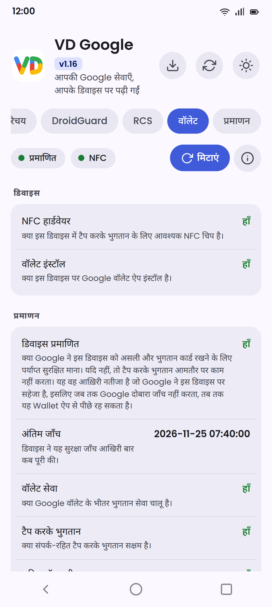
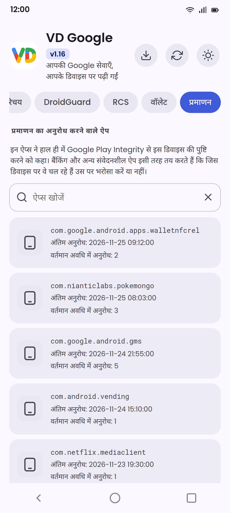

<!--
  ======================================================================
   VD GOOGLE  ::  your Google services, read on-device
   RCS, Google Wallet and Play Integrity attestations: local, no internet.

   Copyright (C) 2026  VD171
   SPDX-License-Identifier: AGPL-3.0-or-later

   Free software under the GNU AGPL v3 or later. NETWORK COPYLEFT: run a
   modified version, even as a service, and you MUST offer its source.

   Site           : https://vd171.ru
   Site           : https://vd.priv8.ru
   Source         : https://github.com/VD171/VD-Google
   GitHub         : @VD171 https://github.com/VD171
   XDA-Developers : @VD171 https://xdaforums.com/m/vd171.4699873/
   XDA thread     : https://xdaforums.com/t/VD-Google.4803837/
   Telegram       : @VD_Priv8 https://t.me/VD_Priv8
   Channel        : @Priv8_VD https://t.me/Priv8_VD
   Discord        : @VD.Priv8 https://discord.com/users/1296831918989639721
   E-mail         : vd.priv8@pm.me
  ======================================================================
-->

# VD Google

  

  
  
  
  

  <b>आपकी Google सेवाएँ, आपके डिवाइस पर पढ़ी गईं। कभी इंटरनेट नहीं।</b> 
  VD Google आपको दिखाता है कि Google स्वयं आपके फ़ोन पर RCS, Wallet और Play Integrity के बारे में क्या दर्ज करता है, और बताता है कि हर आइटम का क्या मतलब है, कुछ भी कहीं भेजे बिना।

  <a href="https://github.com/VD171/VD-Google/releases">Releases</a> ·
  <a href="https://github.com/VD171/VD-Google/wiki/hi-Home">Wiki</a> ·
  <a href="https://github.com/VD171/VD-Google/wiki/hi-USER-GUIDE">उपयोगकर्ता मार्गदर्शिका</a> ·
  <a href="https://github.com/VD171/VD-Google/wiki/hi-ARCHITECTURE">आर्किटेक्चर</a> ·
  <a href="https://github.com/VD171/VD-Google/wiki/hi-PRIVACY">गोपनीयता</a> ·
  <a href="https://github.com/VD171/VD-Google/wiki/hi-BINARIES">शामिल बाइनरी</a> ·
  <a href="https://github.com/VD171/VD-Google/wiki/hi-FILE-STRUCTURE">फ़ाइल संरचना</a> ·
  <a href="CHANGELOG.md">Changelog</a> ·
  <a href="https://xdaforums.com/t/VD-Google.4803837/">XDA thread</a>

> **Languages:** [English](README.md) · [العربية](README.ar.md) · [Čeština](README.cs.md) · [Deutsch](README.de.md) · [Español](README.es.md) · [فارسی](README.fa.md) · [Français](README.fr.md) · [हिन्दी](README.hi.md) · [Bahasa Indonesia](README.id.md) · [Italiano](README.it.md) · [日本語](README.ja.md) · [한국어](README.ko.md) · [Nederlands](README.nl.md) · [Polski](README.pl.md) · [Português](README.pt.md) · [Русский](README.ru.md) · [Svenska](README.sv.md) · [ไทย](README.th.md) · [Türkçe](README.tr.md) · [Українська](README.uk.md) · [Tiếng Việt](README.vi.md) · [中文](README.zh.md)

  
  
  
  
  

---

## ऐप या WebUI

हर रिलीज़ दो रूपों में आती है, और दोनों आपके डिवाइस पर बिना इंटरनेट के वही जानकारी पढ़ती हैं:

- **App**: `.apk`, एक सामान्य Android ऐप।
- **WebUI**: `.zip`, एक मॉड्यूल जिसे आप अपने root मैनेजर (KernelSU, APatch या Magisk) में फ़्लैश करके वहीं से खोलते हैं।

दोनों ही स्थितियों में root आवश्यक है।

## यह क्या दिखाता है

### RCS
क्या आपकी लाइन के लिए RCS उपलब्ध है, आपका RCS नंबर, RCS स्थिति, कॉन्फ़िगरेशन संस्करण, आपके कितने संपर्क RCS का समर्थन करते हैं, कैरियर अधिकार, उपस्थिति (UCE), और संबंधित समय-चिह्न (प्रोविज़निंग, समन्वयन, अंतिम संदेश, टोकन समाप्ति आदि)। यह भी दिखाता है कि Google Messages में Gemini तैयार है या नहीं: Magic Compose (Gemini की लेखन सहायता), डिवाइस पर AI इंजन (AICore, जो Gemini Nano चलाता है), और Gemini चैट, जो RCS के ज़रिए दी जाती है।

### Google वॉलेट
क्या आपका डिवाइस भुगतान के लिए प्रमाणित है, क्या इसमें NFC हार्डवेयर है, क्या वॉलेट इंस्टॉल है, भुगतान सेवा और टैप करके भुगतान की स्थिति, क्या आपका स्क्रीन लॉक स्वीकृत है, और क्या कभी कोई कार्ड जोड़ा गया है।

### DroidGuard
क्या Google Play इस डिवाइस को प्रमाणित मानता है। यह Play Store में दिखाई जाने वाली Play Protect प्रमाणन है। इस डिवाइस ने Play Integrity और DroidGuard के लिए कैश की हुई प्रमाणन। दिखाया गया समय वह है जब हर एक समाप्त होती है।

### प्रमाणन (Play Integrity)
वे ऐप जिन्होंने हाल ही में Google Play Integrity से आपके डिवाइस की पुष्टि करने को कहा, प्रत्येक अपने आइकन, नाम, अपने अंतिम अनुरोध के पूरे समय और वर्तमान अवधि में किए गए अनुरोधों की संख्या के साथ।

हर आइटम के साथ एक छोटा, सरल भाषा में स्पष्टीकरण होता है कि इसका वास्तव में क्या मतलब है।

## गोपनीयता: कोई इंटरनेट नहीं

VD Google **कोई भी अनुमति** घोषित नहीं करता, इंटरनेट पहुँच तक नहीं। यह जो कुछ भी पढ़ता है वह कभी आपके डिवाइस से बाहर नहीं जाता। आप इसे मैनिफ़ेस्ट और स्रोत कोड में सत्यापित कर सकते हैं।

## आवश्यकताएँ

- Android 8.0 (API 26) या नया।
- arm, arm64, x86 और x86_64 डिवाइसों पर चलता है: फ़ोन, टैबलेट, एमुलेटर और ChromeOS।
- **रूट आवश्यक है।** उपरोक्त जानकारी Android के सुरक्षित, केवल सिस्टम-सुलभ क्षेत्रों में रहती है। VD Google इसे सुपरयूज़र पहुँच से पढ़ता है और इसके साथ और कुछ नहीं करता। रूट के बिना, ऐप केवल एक स्क्रीन दिखाता है जो बताती है कि रूट क्यों आवश्यक है।

## समय-चिह्न

सभी समय आपके डिवाइस के वर्तमान समय क्षेत्र में दिखाए जाते हैं, और समय क्षेत्र हमेशा अंकित रहता है।

## AI एजेंट

VD Google एक अकेला JSON **निर्यात** लिखता है: इस बात का एक संरचित, मशीन-पठनीय स्नैपशॉट कि Google आपके डिवाइस पर RCS, Wallet और Play Integrity के बारे में क्या दर्ज करता है, जिसमें कोई व्यक्तिगत डेटा नहीं होता। किसी डिवाइस का ऑडिट करने वाला एजेंट कई Google ऐप और डेटाबेस को हाथ से खंगालने के बजाय वही एक फ़ाइल पढ़ता है। ऐप और WebUI बिल्कुल एक ही स्कीमा बनाते हैं, और इनमें से कोई भी नेटवर्क को नहीं छूता। देखें [docs/AI-AGENTS.md](docs/AI-AGENTS.md)।

## बिल्ड

हमेशा release, कभी debug नहीं। Android ऐप `VDGoogle/` से `./gradlew assembleRelease` के साथ बनता है, WebUI मॉड्यूल `webui/package.sh` से पैकेज होता है। एकमात्र नेटिव बाइनरी `sqlite3` है, जो Termux रिपॉज़िटरी से उसके लाइब्रेरी क्लोज़र सहित लाई जाती है और उसके SHA-256 के साथ दर्ज की जाती है। देखें [योगदान](CONTRIBUTING.md), [संलग्न बाइनरी](https://github.com/VD171/VD-Google/wiki/BINARIES) और [विकी](https://github.com/VD171/VD-Google/wiki)।

## दस्तावेज़ीकरण

- **[Wiki](https://github.com/VD171/VD-Google/wiki/hi-Home)**: सारे दस्तावेज़, ऑनलाइन ब्राउज़ करने योग्य।
- **[उपयोगकर्ता मार्गदर्शिका](https://github.com/VD171/VD-Google/wiki/hi-USER-GUIDE)**: हर स्क्रीन क्या दिखाती है और हर परिणाम का क्या मतलब है।
- **[आर्किटेक्चर](https://github.com/VD171/VD-Google/wiki/hi-ARCHITECTURE)** और **[फ़ाइल संरचना](https://github.com/VD171/VD-Google/wiki/hi-FILE-STRUCTURE)**: यह कैसे काम करता है और सब कुछ कहाँ है।
- **[गोपनीयता](https://github.com/VD171/VD-Google/wiki/hi-PRIVACY)**: कोई इंटरनेट अनुमति नहीं, हर पठन root के ज़रिए होता है, कुछ भी कभी डिवाइस से बाहर नहीं जाता।
- **[शामिल बाइनरी](https://github.com/VD171/VD-Google/wiki/hi-BINARIES)**: हर पूर्व-संकलित बाइनरी की उत्पत्ति और SHA-256, पूर्ण ऑडिट के लिए।
- **[योगदान](https://github.com/VD171/VD-Google/wiki/hi-CONTRIBUTING)** और **[सुरक्षा](https://github.com/VD171/VD-Google/wiki/hi-SECURITY)**।
- **[Changelog](CHANGELOG.md)** और **[आचार संहिता](https://github.com/VD171/VD-Google/wiki/hi-CODE_OF_CONDUCT)**।

<!-- /vd-docs -->

## यह भी देखें

- **[COPG-VD](https://github.com/VD171/COPG-VD)**: डिवाइस fingerprint / Play Integrity का ग्लोबल स्पूफ़िंग, पूरे डिवाइस पर प्रति-ऐप स्कोप और एक WebUI के साथ।
- **[VDBackup](https://github.com/VD171/VD-Backup)**: root के रूप में ऐप्स और डेटा का पूर्ण बैकअप और पुनर्स्थापना, पूरी तरह एक WebUI से संचालित।
- **[VD-dropbear](https://github.com/VD171/VD-dropbear)**: root के रूप में चलने वाला एक स्वतंत्र SSH डेमन (Dropbear)।
- **[VDInstaller](https://github.com/VD171/VD-Installer)**: एकल, बैच और स्प्लिट APK के लिए एक घर्षण-रहित रूट साइडलोड इंस्टॉलर, जिसमें Play Protect वेरिफायर टॉगल और इंस्टॉल-सोर्स स्पूफिंग शामिल है।
- **[VDInfos](https://github.com/VD171/VD-Infos)**: एक डिवाइस मेथड डिबगर जो हर आइटम को उन सभी मेथड से पढ़ता है जो उसे पढ़ सकती हैं और उनकी तुलना साथ-साथ करता है।
- **[VDLiveUpdate](https://github.com/VD171/VDLiveUpdate)**: KernelSU/APatch/Magisk मॉड्यूल में एम्बेडेड एक फ्लैशलेस, इंक्रीमेंटल सेल्फ-अपडेट इंजन।
- **[VD-Modules](https://github.com/VD171/VD-Modules)**: हमारा MMRL/WebUI-X मॉड्यूल रिपॉज़िटरी (इन सभी को अपने root मैनेजर से इंस्टॉल करें)।
- **[@VictorGabriel7Dev/build.prop](https://github.com/VictorGabriel7Dev/build.prop)**: Pixel `build.prop` fingerprints का एक डेटासेट (@T3SL4 का फ़ोर्क)।
- **[@VictorGabriel7Dev/mtproto-store](https://github.com/VictorGabriel7Dev/mtproto-store)**: एक छोटे-से Go CLI से Telegram को ऑब्जेक्ट स्टोर के रूप में उपयोग करें।

## संपर्क

- https://vd171.ru
- https://vd.priv8.ru
- **Telegram:** @VD_Priv8 https://t.me/VD_Priv8
- **Channel:** @Priv8_VD https://t.me/Priv8_VD
- **Discord:** @VD.Priv8 https://discord.com/users/1296831918989639721
- **E-mail:** vd.priv8@pm.me
- **XDA-Developers:** @VD171 https://xdaforums.com/m/vd171.4699873/
- **XDA thread:** https://xdaforums.com/t/VD-Google.4803837/
- **GitHub:** @VD171 https://github.com/VD171

## लाइसेंस

**GNU AGPL-3.0-or-later**: [LICENSE](LICENSE) देखें। नेटवर्क क्लॉज़ सहित कॉपीलेफ्ट: जो कोई संशोधित संस्करण चलाता है (सेवा के रूप में भी) उसे उसका सोर्स देना होगा। फोर्क खुले रखने के लिए जानबूझकर चुना गया।

## ट्रेडमार्क

VD Google एक स्वतंत्र, अनौपचारिक परियोजना है। यह Google LLC से संबद्ध, समर्थित या प्रायोजित नहीं है। "Google", "Google Wallet", "Google Play", "Play Integrity", "Android" और संबंधित नाम तथा लोगो Google LLC के ट्रेडमार्क हैं। VD Google केवल वही पढ़ता है जो पहले से आपके डिवाइस पर है और कहीं कुछ नहीं भेजता।

## Tags

`android` `privacy` `security` `rcs` `google-wallet` `play-integrity` `attestation` `nfc` `tap-to-pay` `no-internet` `root` `kernelsu` `magisk` `lsposed` `on-device` `kotlin` `jetpack-compose` `material3` `vdgoogle`

---

📣 **अपडेट के लिए चैनल से जुड़ें:** @Priv8_VD https://t.me/Priv8_VD
