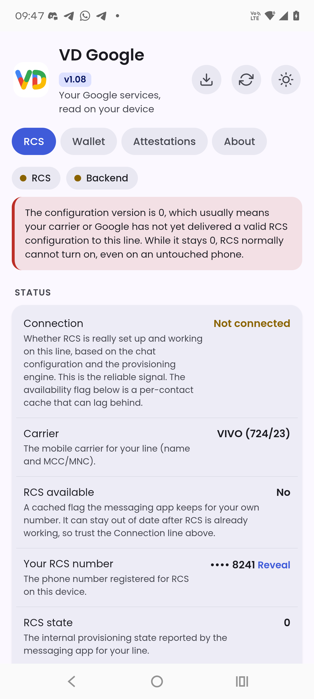
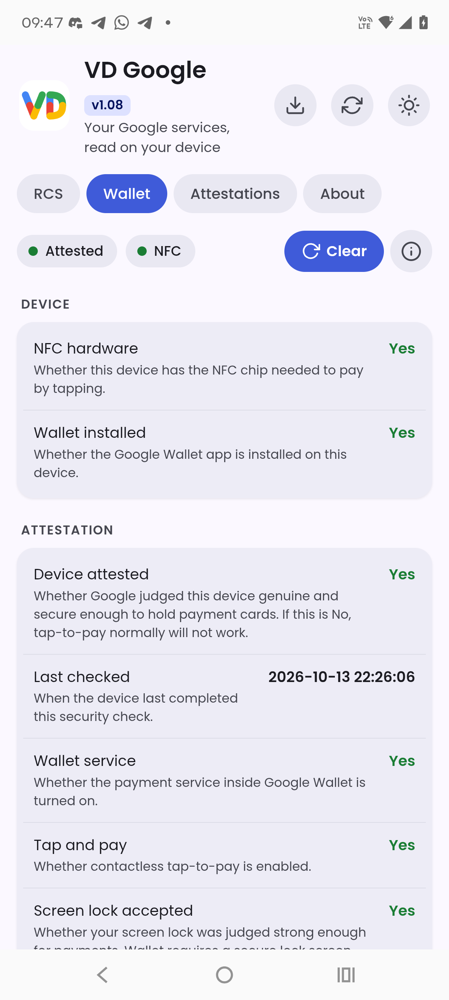
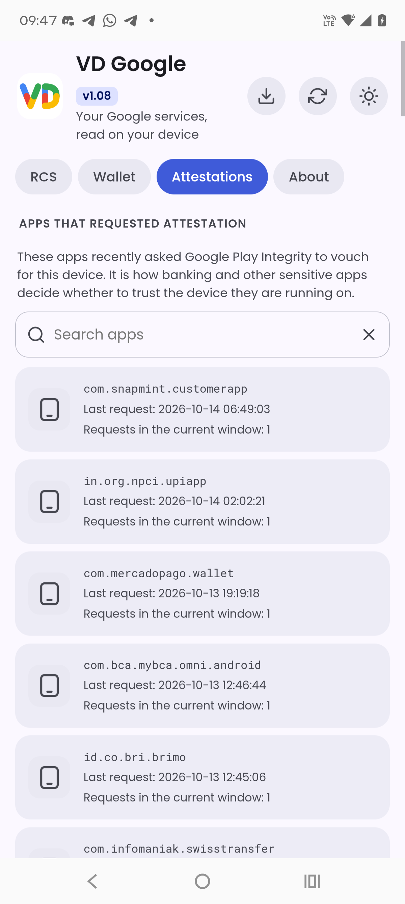
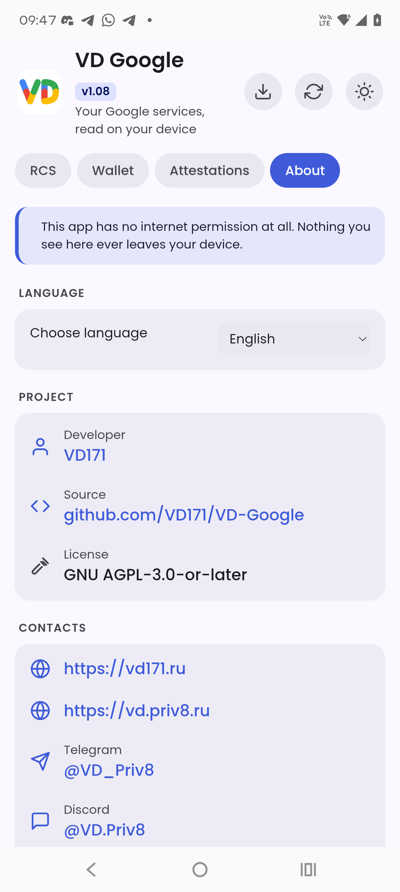
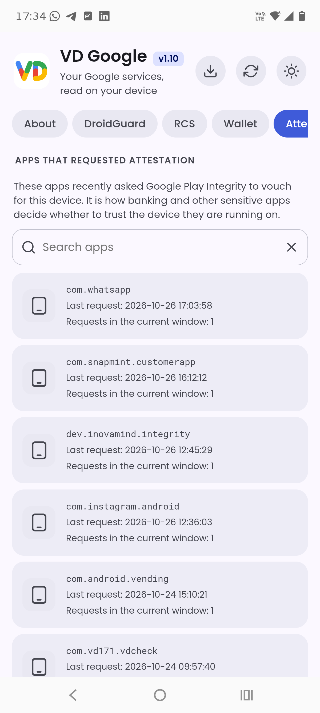

<!--
  VD GOOGLE: RCS, Google Wallet dan atestasi Play Integrity, dibaca di perangkat.
  Copyright (C) 2026  VD171. SPDX-License-Identifier: AGPL-3.0-or-later
-->

# VD Google

  

  
  
  
  

  <b>Layanan Google Anda, dibaca di perangkat. Tidak pernah internet.</b> 
  VD Google menunjukkan apa yang dicatat Google sendiri di ponsel Anda tentang RCS, Wallet, dan Play Integrity, dan menjelaskan arti setiap item, tanpa mengirim apa pun ke mana pun.

  <a href="https://github.com/VD171/VD-Google/releases">Releases</a> ·
  <a href="https://github.com/VD171/VD-Google/wiki/id-Home">Wiki</a> ·
  <a href="https://github.com/VD171/VD-Google/wiki/id-USER-GUIDE">Panduan pengguna</a> ·
  <a href="https://github.com/VD171/VD-Google/wiki/id-ARCHITECTURE">Arsitektur</a> ·
  <a href="https://github.com/VD171/VD-Google/wiki/id-PRIVACY">Privasi</a> ·
  <a href="https://github.com/VD171/VD-Google/wiki/id-BINARIES">Biner yang disertakan</a> ·
  <a href="https://github.com/VD171/VD-Google/wiki/id-FILE-STRUCTURE">Struktur berkas</a> ·
  <a href="CHANGELOG.md">Changelog</a> ·
  <a href="https://xdaforums.com/t/VD-Google.4803837/">XDA thread</a>

> **Languages:** [English](README.md) · [العربية](README.ar.md) · [Čeština](README.cs.md) · [Deutsch](README.de.md) · [Español](README.es.md) · [فارسی](README.fa.md) · [Français](README.fr.md) · [हिन्दी](README.hi.md) · [Bahasa Indonesia](README.id.md) · [Italiano](README.it.md) · [日本語](README.ja.md) · [한국어](README.ko.md) · [Nederlands](README.nl.md) · [Polski](README.pl.md) · [Português](README.pt.md) · [Русский](README.ru.md) · [Svenska](README.sv.md) · [ไทย](README.th.md) · [Türkçe](README.tr.md) · [Українська](README.uk.md) · [Tiếng Việt](README.vi.md) · [中文](README.zh.md)

  
  
  
  
  

---

## Aplikasi atau WebUI

Setiap rilis hadir dalam dua bentuk, dan keduanya membaca hal yang sama di perangkat Anda, tanpa internet:

- **App**: berkas `.apk`, aplikasi Android biasa.
- **WebUI**: berkas `.zip`, modul yang Anda pasang di pengelola root (KernelSU, APatch, atau Magisk) dan buka dari sana.

Keduanya memerlukan root.

## Apa yang ditampilkan

### RCS
Apakah RCS tersedia untuk jalur Anda, nomor RCS Anda, status RCS, versi konfigurasi, berapa banyak kontak Anda yang mendukung RCS, hak operator, kehadiran (UCE), dan stempel waktu terkait (provisioning, sinkronisasi, pesan terakhir, kedaluwarsa token, dan lainnya). Juga menampilkan apakah Gemini di Google Messages siap: Magic Compose (bantuan menulis dari Gemini), mesin AI di perangkat (AICore, yang menjalankan Gemini Nano), dan chat Gemini, yang dikirim melalui RCS.

### Google Wallet
Apakah perangkat Anda teratestasi untuk pembayaran, apakah memiliki perangkat keras NFC, apakah Wallet terpasang, status layanan pembayaran dan bayar dengan menempelkan, apakah kunci layar Anda diterima, dan apakah kartu pernah ditambahkan.

### DroidGuard
Apakah Google Play mengenali perangkat ini sebagai bersertifikat. Ini adalah sertifikasi Play Protect yang ditampilkan di Play Store. Atestasi yang disimpan perangkat ini dalam cache untuk Play Integrity dan DroidGuard. Waktu yang ditampilkan adalah saat masing-masing kedaluwarsa.

### Atestasi (Play Integrity)
Aplikasi yang baru-baru ini meminta Google Play Integrity untuk menjamin perangkat Anda, masing-masing dengan ikon, nama, waktu lengkap permintaan terakhir, dan berapa banyak permintaan yang dibuatnya dalam jendela saat ini.

Setiap item disertai penjelasan singkat dengan bahasa sederhana tentang apa artinya sebenarnya.

## Privasi: tanpa internet

VD Google tidak mendeklarasikan **izin apa pun**, bahkan akses internet. Tidak ada yang dibacanya yang pernah meninggalkan perangkat Anda. Anda dapat memastikannya di manifes dan di kode sumber.

## Persyaratan

- Android 8.0 (API 26) atau lebih baru.
- Berjalan pada perangkat arm, arm64, x86, dan x86_64 - ponsel, tablet, emulator, dan ChromeOS.
- **Root diperlukan.** Informasi di atas berada di area terlindungi Android yang hanya dapat diakses sistem. VD Google membacanya dengan akses superuser dan tidak melakukan hal lain dengannya. Tanpa root, aplikasi hanya menampilkan layar yang menjelaskan mengapa root diperlukan.

## Stempel waktu

Semua waktu ditampilkan dalam zona waktu perangkat Anda saat ini, dan zona waktu selalu dicantumkan.

## Agen AI

VD Google menulis satu **ekspor** JSON: cuplikan terstruktur dan terbaca mesin tentang apa yang Google catat di perangkat Anda mengenai RCS, Wallet, dan Play Integrity, tanpa data pribadi di dalamnya. Agen yang mengaudit perangkat membaca satu berkas itu alih-alih mengorek beberapa aplikasi dan basis data Google secara manual. Aplikasi dan WebUI menghasilkan skema yang persis sama, dan keduanya tidak menyentuh jaringan. Lihat [docs/AI-AGENTS.md](docs/AI-AGENTS.md).

## Build

Selalu release, tidak pernah debug. Aplikasi Android dibangun dari `VDGoogle/` dengan `./gradlew assembleRelease`; modul WebUI dikemas dengan `webui/package.sh`. Satu-satunya biner native adalah `sqlite3`, diambil dari repositori Termux beserta penutup pustakanya dan dicatat dengan SHA-256-nya. Lihat [Berkontribusi](CONTRIBUTING.md), [Biner bawaan](https://github.com/VD171/VD-Google/wiki/BINARIES), dan [wiki](https://github.com/VD171/VD-Google/wiki).

## Dokumentasi

- **[Wiki](https://github.com/VD171/VD-Google/wiki/id-Home)**: semua dokumentasi, dapat dijelajahi secara online.
- **[Panduan pengguna](https://github.com/VD171/VD-Google/wiki/id-USER-GUIDE)**: apa yang dibaca setiap layar dan apa arti setiap hasilnya.
- **[Arsitektur](https://github.com/VD171/VD-Google/wiki/id-ARCHITECTURE)** dan **[Struktur berkas](https://github.com/VD171/VD-Google/wiki/id-FILE-STRUCTURE)**: cara kerjanya dan di mana semuanya berada.
- **[Privasi](https://github.com/VD171/VD-Google/wiki/id-PRIVACY)**: tanpa izin internet, setiap pembacaan melewati root, tidak ada yang pernah keluar dari perangkat.
- **[Biner yang disertakan](https://github.com/VD171/VD-Google/wiki/id-BINARIES)**: asal-usul dan SHA-256 dari setiap biner prakompilasi, untuk audit penuh.
- **[Berkontribusi](https://github.com/VD171/VD-Google/wiki/id-CONTRIBUTING)** dan **[Keamanan](https://github.com/VD171/VD-Google/wiki/id-SECURITY)**.
- **[Changelog](CHANGELOG.md)** dan **[Kode etik](https://github.com/VD171/VD-Google/wiki/id-CODE_OF_CONDUCT)**.

<!-- /vd-docs -->

## Lihat juga

- **[COPG-VD](https://github.com/VD171/COPG-VD)**: spoofing global fingerprint perangkat / Play Integrity, untuk seluruh perangkat dengan cakupan per aplikasi dan sebuah WebUI.
- **[VDBackup](https://github.com/VD171/VD-Backup)**: pencadangan dan pemulihan penuh aplikasi dan data sebagai root, dijalankan sepenuhnya dari WebUI.
- **[VD-dropbear](https://github.com/VD171/VD-dropbear)**: daemon SSH mandiri yang berjalan sebagai root (Dropbear).
- **[VDInstaller](https://github.com/VD171/VD-Installer)**: sebuah pemasang sideload ber-root tanpa hambatan untuk APK tunggal, batch, dan split, dengan sakelar verifier Play Protect dan pemalsuan sumber pemasangan.
- **[VDInfos](https://github.com/VD171/VD-Infos)**: debugger metode perangkat yang membaca setiap item melalui setiap metode yang dapat membacanya dan membandingkannya secara berdampingan.
- **[VDLiveUpdate](https://github.com/VD171/VDLiveUpdate)**: sebuah mesin pembaruan-mandiri inkremental tanpa flash, tertanam di dalam modul KernelSU/APatch/Magisk.
- **[VD-Modules](https://github.com/VD171/VD-Modules)**: repositori modul MMRL/WebUI-X kami (instal semuanya dari manajer root Anda).
- **[@VictorGabriel7Dev/build.prop](https://github.com/VictorGabriel7Dev/build.prop)**: sebuah dataset fingerprint `build.prop` Pixel (fork dari @T3SL4).
- **[@VictorGabriel7Dev/mtproto-store](https://github.com/VictorGabriel7Dev/mtproto-store)**: gunakan Telegram sebagai object store dari sebuah CLI Go mungil.

## Kontak

- Site           : https://vd171.ru
- Site           : https://vd.priv8.ru
- Source         : https://github.com/VD171/VD-Google
- GitHub         : [@VD171](https://github.com/VD171)
- XDA-Developers : [@VD171](https://xdaforums.com/m/vd171.4699873/)
- XDA thread     : [VD-Google](https://xdaforums.com/t/VD-Google.4803837/)
- Telegram       : [@VD_Priv8](https://t.me/VD_Priv8)
- Channel        : [@Priv8_VD](https://t.me/Priv8_VD)
- Discord        : [@VD.Priv8](https://discord.com/users/1296831918989639721)
- E-mail         : vd.priv8@pm.me

## Lisensi

**GNU AGPL-3.0-or-later**: lihat [LICENSE](LICENSE). Copyleft, termasuk klausul jaringan: siapa pun yang menjalankan versi modifikasi (bahkan sebagai layanan) harus menyediakan kode sumbernya. Dipilih dengan sengaja agar fork tetap terbuka.

## Merek dagang

VD Google adalah proyek independen dan tidak resmi. Proyek ini tidak berafiliasi dengan, didukung oleh, atau disponsori oleh Google LLC. "Google", "Google Wallet", "Google Play", "Play Integrity", "Android" serta nama dan logo terkait adalah merek dagang dari Google LLC. VD Google hanya membaca apa yang sudah ada di perangkat Anda dan tidak mengirim apa pun ke mana pun.

## Tags

`android` `privacy` `security` `rcs` `google-wallet` `play-integrity` `attestation` `nfc` `tap-to-pay` `no-internet` `root` `kernelsu` `magisk` `lsposed` `on-device` `kotlin` `jetpack-compose` `material3` `vdgoogle`
