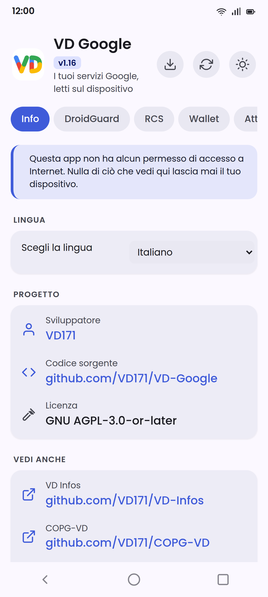
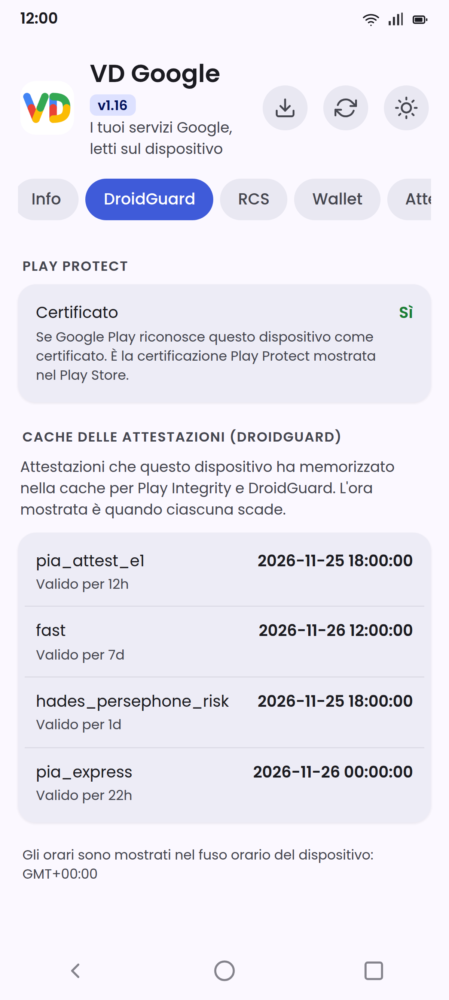
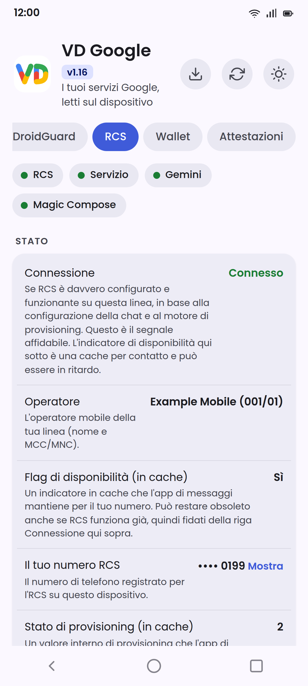
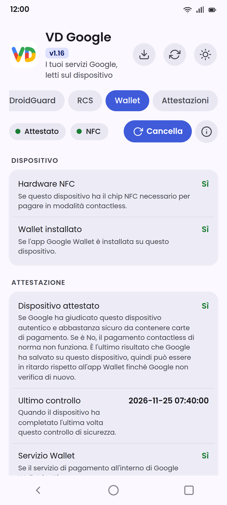
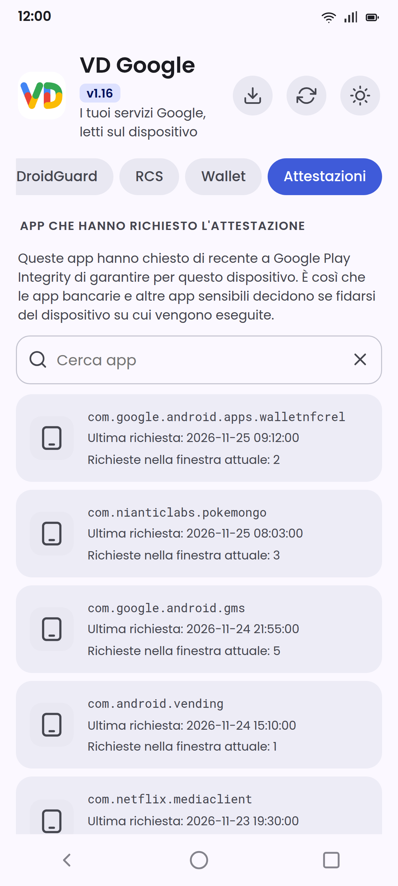

<!--
  ======================================================================
   VD GOOGLE  ::  your Google services, read on-device
   RCS, Google Wallet and Play Integrity attestations: local, no internet.

   Copyright (C) 2026  VD171
   SPDX-License-Identifier: AGPL-3.0-or-later

   Free software under the GNU AGPL v3 or later. NETWORK COPYLEFT: run a
   modified version, even as a service, and you MUST offer its source.

   Site           : https://vd171.ru
   Site           : https://vd.priv8.ru
   Source         : https://github.com/VD171/VD-Google
   GitHub         : @VD171 https://github.com/VD171
   XDA-Developers : @VD171 https://xdaforums.com/m/vd171.4699873/
   XDA thread     : https://xdaforums.com/t/VD-Google.4803837/
   Telegram       : @VD_Priv8 https://t.me/VD_Priv8
   Channel        : @Priv8_VD https://t.me/Priv8_VD
   Discord        : @VD.Priv8 https://discord.com/users/1296831918989639721
   E-mail         : vd.priv8@pm.me
  ======================================================================
-->

# VD Google

  

  
  
  
  

  <b>I tuoi servizi Google, letti sul dispositivo. Mai Internet.</b> 
  VD Google ti mostra ciò che Google stesso registra sul tuo telefono riguardo a RCS, Wallet e Play Integrity, e spiega cosa significa ogni voce, senza inviare nulla da nessuna parte.

  <a href="https://github.com/VD171/VD-Google/releases">Releases</a> ·
  <a href="https://github.com/VD171/VD-Google/wiki/it-Home">Wiki</a> ·
  <a href="https://github.com/VD171/VD-Google/wiki/it-USER-GUIDE">Guida utente</a> ·
  <a href="https://github.com/VD171/VD-Google/wiki/it-ARCHITECTURE">Architettura</a> ·
  <a href="https://github.com/VD171/VD-Google/wiki/it-PRIVACY">Privacy</a> ·
  <a href="https://github.com/VD171/VD-Google/wiki/it-BINARIES">Binari inclusi</a> ·
  <a href="https://github.com/VD171/VD-Google/wiki/it-FILE-STRUCTURE">Struttura dei file</a> ·
  <a href="CHANGELOG.md">Changelog</a> ·
  <a href="https://xdaforums.com/t/VD-Google.4803837/">XDA thread</a>

> **Languages:** [English](README.md) · [العربية](README.ar.md) · [Čeština](README.cs.md) · [Deutsch](README.de.md) · [Español](README.es.md) · [فارسی](README.fa.md) · [Français](README.fr.md) · [हिन्दी](README.hi.md) · [Bahasa Indonesia](README.id.md) · [Italiano](README.it.md) · [日本語](README.ja.md) · [한국어](README.ko.md) · [Nederlands](README.nl.md) · [Polski](README.pl.md) · [Português](README.pt.md) · [Русский](README.ru.md) · [Svenska](README.sv.md) · [ไทย](README.th.md) · [Türkçe](README.tr.md) · [Українська](README.uk.md) · [Tiếng Việt](README.vi.md) · [中文](README.zh.md)

  
  
  
  
  

---

## App o WebUI

Ogni versione è disponibile in due forme, ed entrambe leggono le stesse informazioni sul tuo dispositivo, senza internet:

- **App**: l'`.apk`, una normale app Android.
- **WebUI**: lo `.zip`, un modulo che installi nel tuo gestore root (KernelSU, APatch o Magisk) e apri da lì.

In entrambi i casi è necessario il root.

## Cosa mostra

### RCS
Se l'RCS è disponibile per la tua linea, il tuo numero RCS, lo stato RCS, la versione della configurazione, quanti dei tuoi contatti supportano l'RCS, l'abilitazione dell'operatore, la presenza (UCE) e le date e orari correlati (provisioning, sincronizzazione, ultimo messaggio, scadenza del token e altro). Mostra anche se Gemini in Google Messages è pronto: Magic Compose (l'aiuto alla scrittura di Gemini), il motore IA sul dispositivo (AICore, che esegue Gemini Nano) e la chat con Gemini, che viene fornita tramite RCS.

### Google Wallet
Se il tuo dispositivo è attestato per i pagamenti, se dispone di hardware NFC, se Wallet è installato, lo stato del servizio di pagamento e del pagamento contactless, se il tuo blocco schermo è accettato e se è mai stata aggiunta una carta.

### DroidGuard
Se Google Play riconosce questo dispositivo come certificato. È la certificazione Play Protect mostrata nel Play Store. Attestazioni che questo dispositivo ha memorizzato nella cache per Play Integrity e DroidGuard. L'ora mostrata è quando ciascuna scade.

### Attestazioni (Play Integrity)
Le app che hanno chiesto di recente a Google Play Integrity di garantire per il tuo dispositivo, ciascuna con la propria icona, il nome, l'orario completo dell'ultima richiesta e quante richieste ha effettuato nella finestra attuale.

Ogni voce è accompagnata da una breve spiegazione, in linguaggio semplice, di cosa significa davvero.

## Privacy: niente Internet

VD Google non dichiara **alcun permesso**, nemmeno l'accesso a Internet. Nulla di ciò che legge lascia mai il tuo dispositivo. Puoi verificarlo nel manifest e nel codice sorgente.

## Requisiti

- Android 8.0 (API 26) o più recente.
- Funziona su dispositivi arm, arm64, x86 e x86_64: telefoni, tablet, emulatori e ChromeOS.
- **È necessario il root.** Le informazioni sopra risiedono in aree protette di Android, accessibili solo al sistema. VD Google le legge con accesso da superutente e non ne fa nient'altro. Senza root, l'app mostra solo una schermata che spiega perché serve il root.

## Date e orari

Tutti gli orari sono mostrati nel fuso orario attuale del dispositivo, e il fuso è sempre indicato.

## Agenti AI

VD Google scrive un unico **export** JSON: un'istantanea strutturata e leggibile dalla macchina di ciò che Google registra sul tuo dispositivo riguardo a RCS, Wallet e Play Integrity, senza alcun dato personale. Un agente che verifica un dispositivo legge quel singolo file invece di setacciare a mano diverse app e database di Google. L'app e la WebUI producono esattamente lo stesso schema, e nessuna delle due tocca la rete. Vedi [docs/AI-AGENTS.md](docs/AI-AGENTS.md).

## Build

Sempre release, mai debug. L'app Android si compila da `VDGoogle/` con `./gradlew assembleRelease`, il modulo WebUI si impacchetta con `webui/package.sh`. L'unico binario nativo è `sqlite3`, prelevato dal repository di Termux con la sua chiusura di librerie e registrato con il suo SHA-256. Vedi [Contribuire](CONTRIBUTING.md), [Binari inclusi](https://github.com/VD171/VD-Google/wiki/BINARIES) e la [wiki](https://github.com/VD171/VD-Google/wiki).

## Documentazione

- **[Wiki](https://github.com/VD171/VD-Google/wiki/it-Home)**: tutta la documentazione, consultabile online.
- **[Guida utente](https://github.com/VD171/VD-Google/wiki/it-USER-GUIDE)**: cosa legge ogni schermata e cosa significa ogni risultato.
- **[Architettura](https://github.com/VD171/VD-Google/wiki/it-ARCHITECTURE)** e **[Struttura dei file](https://github.com/VD171/VD-Google/wiki/it-FILE-STRUCTURE)**: come funziona e dove si trova ogni cosa.
- **[Privacy](https://github.com/VD171/VD-Google/wiki/it-PRIVACY)**: nessun permesso di accesso a Internet, ogni lettura passa dal root, niente lascia mai il dispositivo.
- **[Binari inclusi](https://github.com/VD171/VD-Google/wiki/it-BINARIES)**: provenienza e SHA-256 di ogni binario precompilato, per una verifica completa.
- **[Contribuire](https://github.com/VD171/VD-Google/wiki/it-CONTRIBUTING)** e **[Sicurezza](https://github.com/VD171/VD-Google/wiki/it-SECURITY)**.
- **[Changelog](CHANGELOG.md)** e **[Codice di condotta](https://github.com/VD171/VD-Google/wiki/it-CODE_OF_CONDUCT)**.

<!-- /vd-docs -->

## Vedi anche

- **[COPG-VD](https://github.com/VD171/COPG-VD)**: spoofing globale del fingerprint del dispositivo / Play Integrity, sull'intero dispositivo con ambito per app e una WebUI.
- **[VDBackup](https://github.com/VD171/VD-Backup)**: backup e ripristino completi di app e dati come root, gestiti interamente da una WebUI.
- **[VD-dropbear](https://github.com/VD171/VD-dropbear)**: un demone SSH autonomo con root (Dropbear).
- **[VDInstaller](https://github.com/VD171/VD-Installer)**: un installer sideload con root e senza attriti per APK singoli, in batch e split, con un interruttore per il verificatore Play Protect e lo spoofing della sorgente di installazione.
- **[VDInfos](https://github.com/VD171/VD-Infos)**: un debugger di metodi del dispositivo che legge ogni voce attraverso ogni metodo in grado di leggerla e li confronta fianco a fianco.
- **[VDLiveUpdate](https://github.com/VD171/VDLiveUpdate)**: un motore di autoaggiornamento incrementale e senza flash, integrato nei moduli KernelSU/APatch/Magisk.
- **[VD-Modules](https://github.com/VD171/VD-Modules)**: il nostro repository di moduli MMRL/WebUI-X (installali tutti dal tuo gestore root).
- **[@VictorGabriel7Dev/build.prop](https://github.com/VictorGabriel7Dev/build.prop)**: un set di dati di fingerprint `build.prop` di Pixel (fork di @T3SL4).
- **[@VictorGabriel7Dev/mtproto-store](https://github.com/VictorGabriel7Dev/mtproto-store)**: usa Telegram come object store da una minuscola CLI Go.

## Contatti

- https://vd171.ru
- https://vd.priv8.ru
- **Telegram:** @VD_Priv8 https://t.me/VD_Priv8
- **Channel:** @Priv8_VD https://t.me/Priv8_VD
- **Discord:** @VD.Priv8 https://discord.com/users/1296831918989639721
- **E-mail:** vd.priv8@pm.me
- **XDA-Developers:** @VD171 https://xdaforums.com/m/vd171.4699873/
- **XDA thread:** https://xdaforums.com/t/VD-Google.4803837/
- **GitHub:** @VD171 https://github.com/VD171

## Licenza

**GNU AGPL-3.0-or-later**: vedi [LICENSE](LICENSE). Copyleft, inclusa la clausola di rete: chiunque esegua una versione modificata (anche come servizio) deve offrirne il codice sorgente. Scelta di proposito per mantenere i fork aperti.

## Marchi

VD Google è un progetto indipendente e non ufficiale. Non è affiliato, approvato o sponsorizzato da Google LLC. "Google", "Google Wallet", "Google Play", "Play Integrity", "Android" e i nomi e loghi correlati sono marchi di Google LLC. VD Google legge solo ciò che è già presente sul tuo dispositivo e non invia nulla da nessuna parte.

## Tags

`android` `privacy` `security` `rcs` `google-wallet` `play-integrity` `attestation` `nfc` `tap-to-pay` `no-internet` `root` `kernelsu` `magisk` `lsposed` `on-device` `kotlin` `jetpack-compose` `material3` `vdgoogle`

---

📣 **Unisciti al canale per gli aggiornamenti:** @Priv8_VD https://t.me/Priv8_VD
