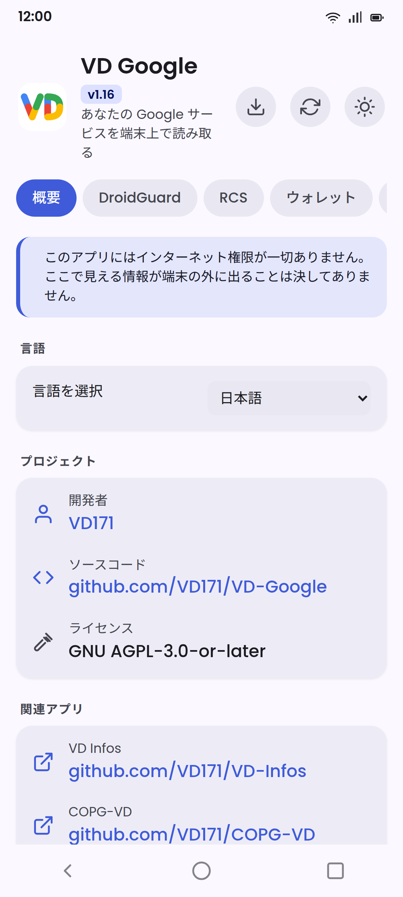
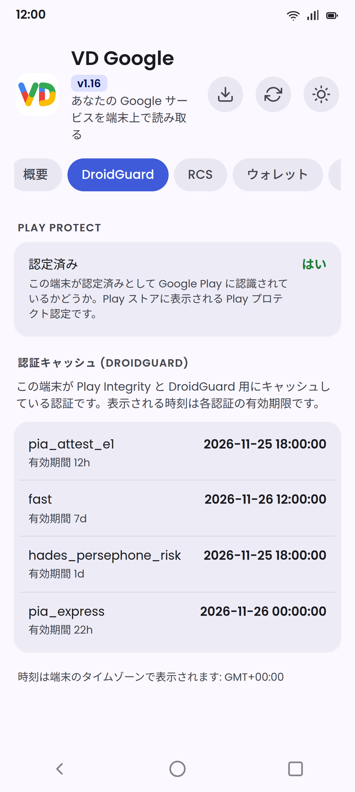
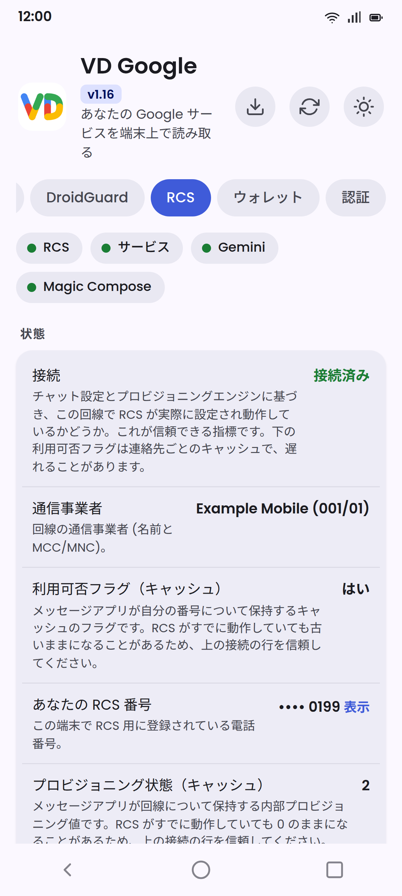
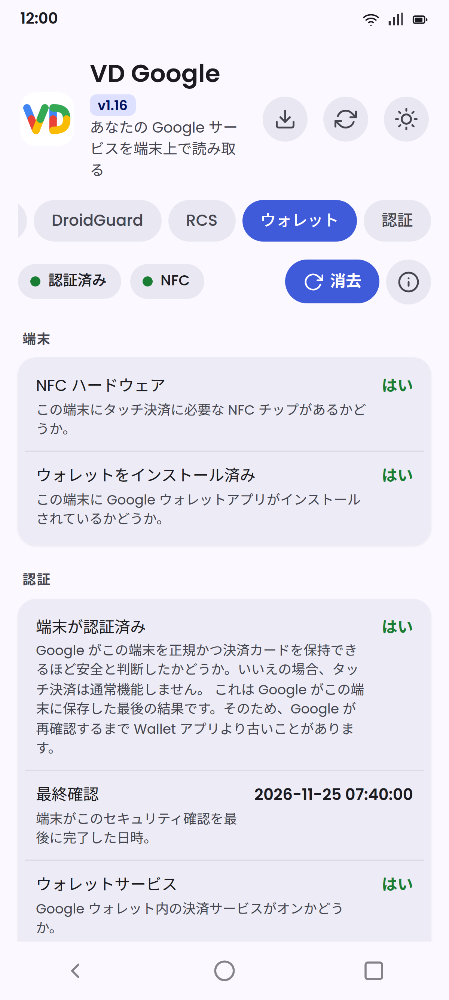
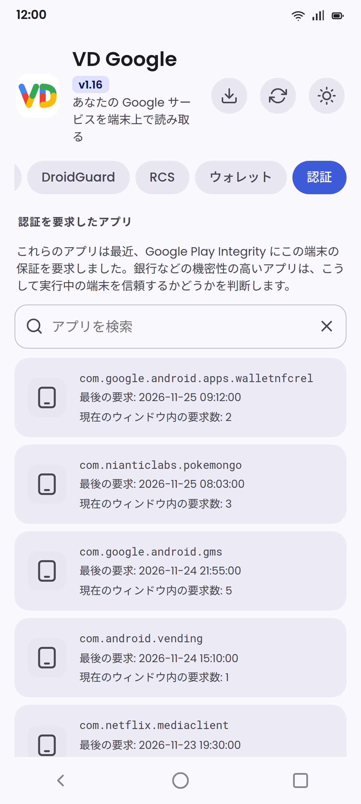

<!--
  ======================================================================
   VD GOOGLE  ::  your Google services, read on-device
   RCS, Google Wallet and Play Integrity attestations: local, no internet.

   Copyright (C) 2026  VD171
   SPDX-License-Identifier: AGPL-3.0-or-later

   Free software under the GNU AGPL v3 or later. NETWORK COPYLEFT: run a
   modified version, even as a service, and you MUST offer its source.

   Site           : https://vd171.ru
   Site           : https://vd.priv8.ru
   Source         : https://github.com/VD171/VD-Google
   GitHub         : @VD171 https://github.com/VD171
   XDA-Developers : @VD171 https://xdaforums.com/m/vd171.4699873/
   XDA thread     : https://xdaforums.com/t/VD-Google.4803837/
   Telegram       : @VD_Priv8 https://t.me/VD_Priv8
   Channel        : @Priv8_VD https://t.me/Priv8_VD
   Discord        : @VD.Priv8 https://discord.com/users/1296831918989639721
   E-mail         : vd.priv8@pm.me
  ======================================================================
-->

# VD Google

  

  
  
  
  

  <b>あなたの Google サービスを端末上で読み取る。ネット接続は一切なし。</b> 
  VD Google は、Google 自身があなたの端末に RCS、ウォレット、Play Integrity について記録している内容を表示し、各項目を説明します。どこにも何も送信しません。

  <a href="https://github.com/VD171/VD-Google/releases">Releases</a> ·
  <a href="https://github.com/VD171/VD-Google/wiki/ja-Home">Wiki</a> ·
  <a href="https://github.com/VD171/VD-Google/wiki/ja-USER-GUIDE">ユーザーガイド</a> ·
  <a href="https://github.com/VD171/VD-Google/wiki/ja-ARCHITECTURE">アーキテクチャ</a> ·
  <a href="https://github.com/VD171/VD-Google/wiki/ja-PRIVACY">プライバシー</a> ·
  <a href="https://github.com/VD171/VD-Google/wiki/ja-BINARIES">同梱バイナリ</a> ·
  <a href="https://github.com/VD171/VD-Google/wiki/ja-FILE-STRUCTURE">ファイル構成</a> ·
  <a href="CHANGELOG.md">Changelog</a> ·
  <a href="https://xdaforums.com/t/VD-Google.4803837/">XDA thread</a>

> **Languages:** [English](README.md) · [العربية](README.ar.md) · [Čeština](README.cs.md) · [Deutsch](README.de.md) · [Español](README.es.md) · [فارسی](README.fa.md) · [Français](README.fr.md) · [हिन्दी](README.hi.md) · [Bahasa Indonesia](README.id.md) · [Italiano](README.it.md) · [日本語](README.ja.md) · [한국어](README.ko.md) · [Nederlands](README.nl.md) · [Polski](README.pl.md) · [Português](README.pt.md) · [Русский](README.ru.md) · [Svenska](README.sv.md) · [ไทย](README.th.md) · [Türkçe](README.tr.md) · [Українська](README.uk.md) · [Tiếng Việt](README.vi.md) · [中文](README.zh.md)

  
  
  
  
  

---

## アプリまたは WebUI

各リリースには2つの形式があり、どちらもインターネットを使わず、端末上で同じ情報を読み取ります。

- **App**: `.apk`。通常の Android アプリです。
- **WebUI**: `.zip`。root マネージャー（KernelSU、APatch、Magisk）で書き込み、そこから開くモジュールです。

どちらの場合も root が必要です。

## 表示する内容

### RCS
回線で RCS が利用可能か、あなたの RCS 番号、RCS の状態、構成バージョン、RCS に対応している連絡先の数、通信事業者の権限、プレゼンス (UCE)、および関連するタイムスタンプ (プロビジョニング、同期、最後のメッセージ、トークンの有効期限など)。 さらに、Google Messages の Gemini が利用可能かどうかも表示します。Magic Compose (Gemini の文章作成アシスト)、端末上の AI エンジン (Gemini Nano を実行する AICore)、そして RCS 経由で提供される Gemini チャット。

### Google ウォレット
端末が決済用に認証されているか、NFC ハードウェアがあるか、ウォレットがインストールされているか、決済サービスとタッチ決済の状態、画面ロックが承認されているか、これまでにカードが追加されたことがあるか。

### DroidGuard
この端末が認定済みとして Google Play に認識されているかどうか。Play ストアに表示される Play プロテクト認定です。 この端末が Play Integrity と DroidGuard 用にキャッシュしている認証です。表示される時刻は各認証の有効期限です。

### 認証 (Play Integrity)
最近 Google Play Integrity に端末の保証を要求したアプリ。それぞれのアイコン、名前、最後の要求の完全な時刻、現在のウィンドウ内での要求回数を表示します。

各項目には、それが実際に何を意味するかをわかりやすい言葉で説明した短い解説が付いています。

## プライバシー: ネット接続なし

VD Google は**いかなる権限も宣言しません**。インターネットアクセスさえありません。読み取った情報が端末の外に出ることは決してありません。マニフェストとソースコードで確認できます。

## 必要条件

- Android 8.0 (API 26) 以降。
- arm、arm64、x86、x86_64 のデバイスで動作します：スマートフォン、タブレット、エミュレーター、ChromeOS。
- **Root が必要です。** 上記の情報は、システムのみがアクセスできる Android の保護領域にあります。VD Google はスーパーユーザー権限でそれを読み取り、それ以外のことは一切しません。root がない場合、アプリはなぜ root が必要かを説明する画面を表示するだけです。

## タイムスタンプ

すべての時刻は端末の現在のタイムゾーンで表示され、タイムゾーンは常に明記されます。

## AI エージェント

VD Google は単一の JSON **エクスポート**を書き出します。これは、Google がデバイス上に RCS、Wallet、Play Integrity について記録している内容の、構造化された機械可読なスナップショットで、個人データは一切含みません。デバイスを監査するエージェントは、複数の Google アプリやデータベースを手作業で調べる代わりに、この 1 つのファイルを読みます。アプリと WebUI はまったく同じスキーマを生成し、どちらもネットワークに触れません。[docs/AI-AGENTS.md](docs/AI-AGENTS.md) を参照してください。

## ビルド

常にリリース、デバッグは不可。Android アプリは `VDGoogle/` から `./gradlew assembleRelease` でビルドします。WebUI モジュールは `webui/package.sh` でパッケージ化します。唯一のネイティブバイナリは `sqlite3` で、Termux リポジトリからライブラリのクロージャとともに取得し、その SHA-256 とともに記録します。[コントリビュート](CONTRIBUTING.md)、[同梱バイナリ](https://github.com/VD171/VD-Google/wiki/BINARIES)、[wiki](https://github.com/VD171/VD-Google/wiki) を参照してください。

## ドキュメント

- **[Wiki](https://github.com/VD171/VD-Google/wiki/ja-Home)**: すべてのドキュメントをオンラインで閲覧できます。
- **[ユーザーガイド](https://github.com/VD171/VD-Google/wiki/ja-USER-GUIDE)**: 各画面が何を読み取り、それぞれの結果が何を意味するか。
- **[アーキテクチャ](https://github.com/VD171/VD-Google/wiki/ja-ARCHITECTURE)** と **[ファイル構成](https://github.com/VD171/VD-Google/wiki/ja-FILE-STRUCTURE)**: どう動作し、どこに何があるか。
- **[プライバシー](https://github.com/VD171/VD-Google/wiki/ja-PRIVACY)**: インターネット権限なし、すべての読み取りは root を介し、何も端末の外に出ません。
- **[同梱バイナリ](https://github.com/VD171/VD-Google/wiki/ja-BINARIES)**: すべてのビルド済みバイナリの由来と SHA-256。完全に監査できます。
- **[貢献する](https://github.com/VD171/VD-Google/wiki/ja-CONTRIBUTING)** と **[セキュリティ](https://github.com/VD171/VD-Google/wiki/ja-SECURITY)**。
- **[Changelog](CHANGELOG.md)** と **[行動規範](https://github.com/VD171/VD-Google/wiki/ja-CODE_OF_CONDUCT)**。

<!-- /vd-docs -->

## 関連プロジェクト

- **[COPG-VD](https://github.com/VD171/COPG-VD)**: デバイスの fingerprint / Play Integrity のグローバルなスプーフィング。端末全体を対象に、アプリ単位のスコープと WebUI を備えます。
- **[VDBackup](https://github.com/VD171/VD-Backup)**: root でアプリとデータを完全にバックアップ・復元し、すべて WebUI から操作。
- **[VD-dropbear](https://github.com/VD171/VD-dropbear)**: root 向けの単体で動くスタンドアロン SSH デーモン（Dropbear）。
- **[VDInstaller](https://github.com/VD171/VD-Installer)**: 単一・バッチ・分割 APK に対応した、摩擦のない root サイドロードインストーラーで、Play Protect 検証のトグルとインストール元の偽装を備えます。
- **[VDInfos](https://github.com/VD171/VD-Infos)**: 各項目を、それを読み取れるすべてのメソッドで読み取り、並べて比較する端末メソッドデバッガー。
- **[VDLiveUpdate](https://github.com/VD171/VDLiveUpdate)**: フラッシュ不要の増分セルフアップデートエンジンで、KernelSU/APatch/Magisk モジュールに組み込まれます。
- **[VD-Modules](https://github.com/VD171/VD-Modules)**: 私たちの MMRL/WebUI-X モジュールリポジトリ（これらすべてを root マネージャーからインストールできます）。
- **[@VictorGabriel7Dev/build.prop](https://github.com/VictorGabriel7Dev/build.prop)**: Pixel の `build.prop` fingerprint のデータセット（@T3SL4 のフォーク）。
- **[@VictorGabriel7Dev/mtproto-store](https://github.com/VictorGabriel7Dev/mtproto-store)**: 小さな Go CLI から Telegram をオブジェクトストアとして使います。

## 連絡先

- https://vd171.ru
- https://vd.priv8.ru
- **Telegram:** @VD_Priv8 https://t.me/VD_Priv8
- **Channel:** @Priv8_VD https://t.me/Priv8_VD
- **Discord:** @VD.Priv8 https://discord.com/users/1296831918989639721
- **E-mail:** vd.priv8@pm.me
- **XDA-Developers:** @VD171 https://xdaforums.com/m/vd171.4699873/
- **XDA thread:** https://xdaforums.com/t/VD-Google.4803837/
- **GitHub:** @VD171 https://github.com/VD171

## ライセンス

**GNU AGPL-3.0-or-later**: [LICENSE](LICENSE) を参照。ネットワーク条項を含むコピーレフト：改変版を（サービスとしてでも）実行する者は、そのソースを提供しなければなりません。フォークをオープンに保つため意図的に選びました。

## 商標

VD Google は独立した非公式プロジェクトです。Google LLC との提携、承認、スポンサー関係はありません。「Google」「Google Wallet」「Google Play」「Play Integrity」「Android」および関連する名称とロゴは Google LLC の商標です。VD Google は、すでに端末上にあるものを読み取るだけで、どこにも何も送信しません。

## タグ

`android` `privacy` `security` `rcs` `google-wallet` `play-integrity` `attestation` `nfc` `tap-to-pay` `no-internet` `root` `kernelsu` `magisk` `lsposed` `on-device` `kotlin` `jetpack-compose` `material3` `vdgoogle`

---

📣 **更新はチャンネルに参加してください：** @Priv8_VD https://t.me/Priv8_VD
