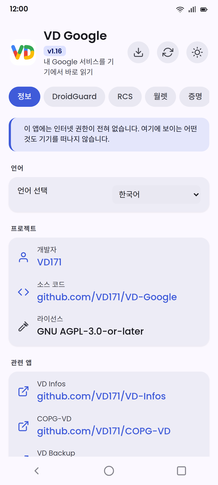
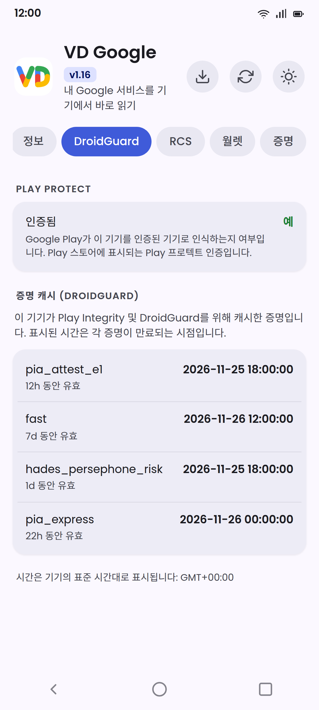
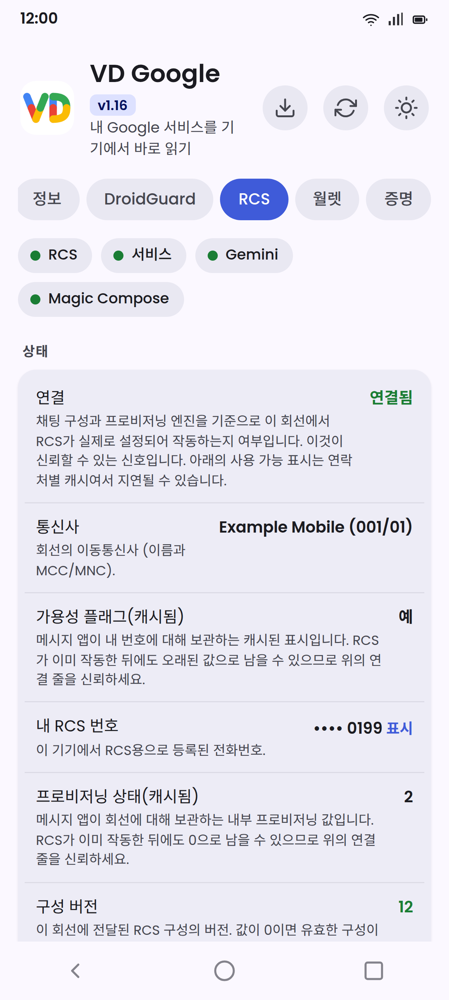
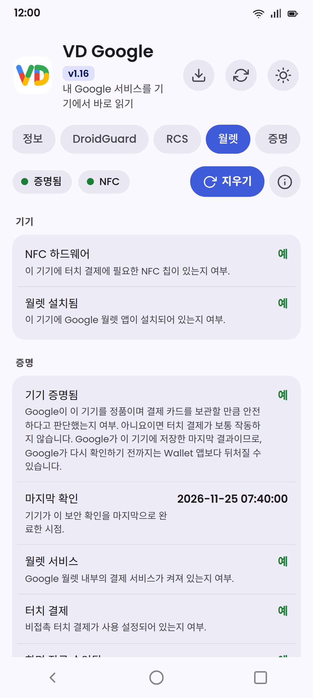
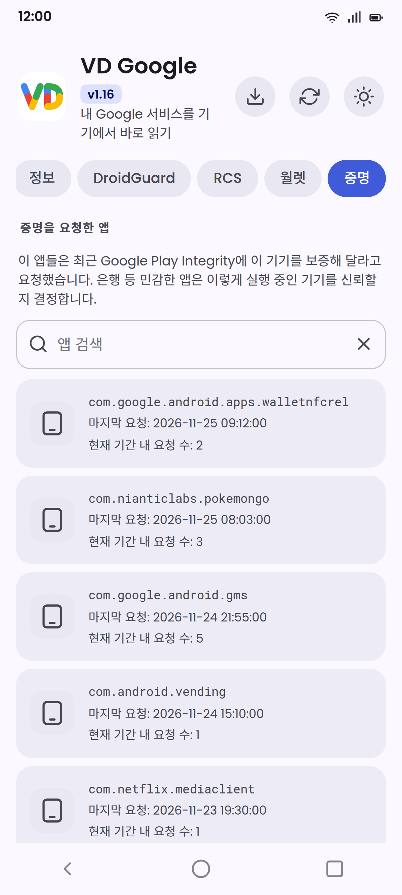

<!--
  ======================================================================
   VD GOOGLE  ::  your Google services, read on-device
   RCS, Google Wallet and Play Integrity attestations: local, no internet.

   Copyright (C) 2026  VD171
   SPDX-License-Identifier: AGPL-3.0-or-later

   Free software under the GNU AGPL v3 or later. NETWORK COPYLEFT: run a
   modified version, even as a service, and you MUST offer its source.

   Site           : https://vd171.ru
   Site           : https://vd.priv8.ru
   Source         : https://github.com/VD171/VD-Google
   GitHub         : @VD171 https://github.com/VD171
   XDA-Developers : @VD171 https://xdaforums.com/m/vd171.4699873/
   XDA thread     : https://xdaforums.com/t/VD-Google.4803837/
   Telegram       : @VD_Priv8 https://t.me/VD_Priv8
   Channel        : @Priv8_VD https://t.me/Priv8_VD
   Discord        : @VD.Priv8 https://discord.com/users/1296831918989639721
   E-mail         : vd.priv8@pm.me
  ======================================================================
-->

# VD Google

  

  
  
  
  

  <b>내 Google 서비스를 기기에서 바로 읽기. 인터넷은 절대 사용하지 않음.</b> 
  VD Google은 Google이 직접 휴대폰에 RCS, 월렛, Play Integrity에 대해 기록하는 내용을 보여주고, 각 항목을 설명하며, 어떤 것도 어디로도 보내지 않습니다.

  <a href="https://github.com/VD171/VD-Google/releases">Releases</a> ·
  <a href="https://github.com/VD171/VD-Google/wiki/ko-Home">Wiki</a> ·
  <a href="https://github.com/VD171/VD-Google/wiki/ko-USER-GUIDE">사용자 가이드</a> ·
  <a href="https://github.com/VD171/VD-Google/wiki/ko-ARCHITECTURE">아키텍처</a> ·
  <a href="https://github.com/VD171/VD-Google/wiki/ko-PRIVACY">프라이버시</a> ·
  <a href="https://github.com/VD171/VD-Google/wiki/ko-BINARIES">내장 바이너리</a> ·
  <a href="https://github.com/VD171/VD-Google/wiki/ko-FILE-STRUCTURE">파일 구조</a> ·
  <a href="CHANGELOG.md">Changelog</a> ·
  <a href="https://xdaforums.com/t/VD-Google.4803837/">XDA thread</a>

> **Languages:** [English](README.md) · [العربية](README.ar.md) · [Čeština](README.cs.md) · [Deutsch](README.de.md) · [Español](README.es.md) · [فارسی](README.fa.md) · [Français](README.fr.md) · [हिन्दी](README.hi.md) · [Bahasa Indonesia](README.id.md) · [Italiano](README.it.md) · [日本語](README.ja.md) · [한국어](README.ko.md) · [Nederlands](README.nl.md) · [Polski](README.pl.md) · [Português](README.pt.md) · [Русский](README.ru.md) · [Svenska](README.sv.md) · [ไทย](README.th.md) · [Türkçe](README.tr.md) · [Українська](README.uk.md) · [Tiếng Việt](README.vi.md) · [中文](README.zh.md)

  
  
  
  
  

---

## 앱 또는 WebUI

모든 릴리스는 두 가지 형태로 제공되며, 둘 다 인터넷 없이 기기에서 동일한 정보를 읽습니다.

- **App**: `.apk`, 일반 Android 앱입니다.
- **WebUI**: `.zip`, 루트 관리자(KernelSU, APatch 또는 Magisk)에 플래시하여 거기서 여는 모듈입니다.

두 경우 모두 루트가 필요합니다.

## 무엇을 보여주나요

### RCS
회선에서 RCS를 사용할 수 있는지, 내 RCS 번호, RCS 상태, 구성 버전, 연락처 중 몇 명이 RCS를 지원하는지, 통신사 권한, 프레즌스(UCE), 그리고 관련 타임스탬프(프로비저닝, 동기화, 마지막 메시지, 토큰 만료 등). 또한 Google Messages의 Gemini 사용 준비 여부도 표시합니다: Magic Compose(Gemini의 작성 도우미), 기기 내 AI 엔진(Gemini Nano를 실행하는 AICore), 그리고 RCS를 통해 제공되는 Gemini 채팅.

### Google 월렛
기기가 결제용으로 증명되었는지, NFC 하드웨어가 있는지, 월렛이 설치되어 있는지, 결제 서비스와 터치 결제 상태, 화면 잠금이 승인되었는지, 그리고 카드를 추가한 적이 있는지.

### DroidGuard
Google Play가 이 기기를 인증된 기기로 인식하는지 여부입니다. Play 스토어에 표시되는 Play 프로텍트 인증입니다. 이 기기가 Play Integrity 및 DroidGuard를 위해 캐시한 증명입니다. 표시된 시간은 각 증명이 만료되는 시점입니다.

### 증명 (Play Integrity)
최근 Google Play Integrity에 기기 보증을 요청한 앱들로, 각각 아이콘, 이름, 마지막 요청의 전체 시간, 현재 기간 내 요청 횟수가 함께 표시됩니다.

각 항목에는 실제로 무엇을 의미하는지 쉬운 말로 설명한 짧은 안내가 붙어 있습니다.

## 개인정보: 인터넷 없음

VD Google은 **어떤 권한도 선언하지 않습니다**. 인터넷 접근 권한조차 없습니다. 이 앱이 읽는 어떤 것도 기기를 떠나지 않습니다. 매니페스트와 소스 코드에서 확인할 수 있습니다.

## 요구 사항

- Android 8.0 (API 26) 이상.
- arm, arm64, x86, x86_64 기기에서 작동합니다: 휴대폰, 태블릿, 에뮬레이터, ChromeOS.
- **Root가 필요합니다.** 위 정보는 시스템만 접근할 수 있는 Android의 보호된 영역에 있습니다. VD Google은 슈퍼유저 권한으로 이를 읽을 뿐 그 밖의 어떤 일도 하지 않습니다. root가 없으면 앱은 root가 왜 필요한지 설명하는 화면만 표시합니다.

## 타임스탬프

모든 시간은 기기의 현재 표준 시간대로 표시되며, 표준 시간대는 항상 함께 표기됩니다.

## AI 에이전트

VD Google은 단일 JSON **내보내기**를 작성합니다. 이는 Google이 기기에 RCS, Wallet, Play Integrity에 대해 기록하는 내용을 구조화된 기계 판독 가능 스냅샷으로 담은 것이며, 개인 데이터는 전혀 포함하지 않습니다. 기기를 감사하는 에이전트는 여러 Google 앱과 데이터베이스를 손으로 긁어모으는 대신 그 하나의 파일을 읽습니다. 앱과 WebUI는 정확히 같은 스키마를 생성하며, 둘 다 네트워크에 접근하지 않습니다. [docs/AI-AGENTS.md](docs/AI-AGENTS.md)를 참조하세요.

## 빌드

항상 릴리스, 디버그는 안 됩니다. Android 앱은 `VDGoogle/`에서 `./gradlew assembleRelease`로 빌드합니다. WebUI 모듈은 `webui/package.sh`로 패키징합니다. 유일한 네이티브 바이너리는 `sqlite3`로, Termux 저장소에서 라이브러리 클로저와 함께 가져와 그 SHA-256과 함께 기록합니다. [기여하기](CONTRIBUTING.md), [동봉 바이너리](https://github.com/VD171/VD-Google/wiki/BINARIES), [위키](https://github.com/VD171/VD-Google/wiki)를 참조하세요.

## 문서

- **[Wiki](https://github.com/VD171/VD-Google/wiki/ko-Home)**: 모든 문서를 온라인에서 볼 수 있습니다.
- **[사용자 가이드](https://github.com/VD171/VD-Google/wiki/ko-USER-GUIDE)**: 각 화면이 무엇을 읽고 각 결과가 무엇을 의미하는지.
- **[아키텍처](https://github.com/VD171/VD-Google/wiki/ko-ARCHITECTURE)** 및 **[파일 구조](https://github.com/VD171/VD-Google/wiki/ko-FILE-STRUCTURE)**: 어떻게 작동하고 모든 것이 어디에 있는지.
- **[프라이버시](https://github.com/VD171/VD-Google/wiki/ko-PRIVACY)**: 인터넷 권한 없음, 모든 읽기는 root를 거치며, 아무것도 기기를 떠나지 않습니다.
- **[내장 바이너리](https://github.com/VD171/VD-Google/wiki/ko-BINARIES)**: 모든 사전 빌드된 바이너리의 출처와 SHA-256으로, 완전한 감사가 가능합니다.
- **[기여하기](https://github.com/VD171/VD-Google/wiki/ko-CONTRIBUTING)** 및 **[보안](https://github.com/VD171/VD-Google/wiki/ko-SECURITY)**.
- **[Changelog](CHANGELOG.md)** 및 **[행동 강령](https://github.com/VD171/VD-Google/wiki/ko-CODE_OF_CONDUCT)**.

<!-- /vd-docs -->

## 함께 보기

- **[COPG-VD](https://github.com/VD171/COPG-VD)**: 기기 fingerprint / Play Integrity의 전역 스푸핑. 앱별 범위와 WebUI를 갖추고 기기 전체에 적용됩니다.
- **[VDBackup](https://github.com/VD171/VD-Backup)**: root로 앱과 데이터를 완전히 백업하고 복원하며, 전부 WebUI에서 실행.
- **[VD-dropbear](https://github.com/VD171/VD-dropbear)**: 독립 실행형 루트 SSH 데몬(Dropbear).
- **[VDInstaller](https://github.com/VD171/VD-Installer)**: 단일, 배치, 분할 APK 를 위한 마찰 없는 root 사이드로드 설치기로, Play Protect 검사기 토글과 설치 출처 위장을 갖추고 있습니다.
- **[VDInfos](https://github.com/VD171/VD-Infos)**: 각 항목을 읽을 수 있는 모든 메서드로 읽어 나란히 비교하는 기기 메서드 디버거.
- **[VDLiveUpdate](https://github.com/VD171/VDLiveUpdate)**: KernelSU/APatch/Magisk 모듈에 내장된, 플래시가 필요 없는 증분 자가 업데이트 엔진.
- **[VD-Modules](https://github.com/VD171/VD-Modules)**: 우리의 MMRL/WebUI-X 모듈 저장소 (루트 관리자에서 이 모두를 설치하세요).
- **[@VictorGabriel7Dev/build.prop](https://github.com/VictorGabriel7Dev/build.prop)**: Pixel `build.prop` fingerprint 데이터세트 (@T3SL4의 포크).
- **[@VictorGabriel7Dev/mtproto-store](https://github.com/VictorGabriel7Dev/mtproto-store)**: 작은 Go CLI로 Telegram을 객체 저장소로 사용하세요.

## 연락처

- https://vd171.ru
- https://vd.priv8.ru
- **Telegram:** @VD_Priv8 https://t.me/VD_Priv8
- **Channel:** @Priv8_VD https://t.me/Priv8_VD
- **Discord:** @VD.Priv8 https://discord.com/users/1296831918989639721
- **E-mail:** vd.priv8@pm.me
- **XDA-Developers:** @VD171 https://xdaforums.com/m/vd171.4699873/
- **XDA thread:** https://xdaforums.com/t/VD-Google.4803837/
- **GitHub:** @VD171 https://github.com/VD171

## 라이선스

**GNU AGPL-3.0-or-later**: [LICENSE](LICENSE) 참조. 네트워크 조항을 포함한 카피레프트: 수정된 버전을 (서비스로라도) 실행하는 사람은 그 소스를 제공해야 합니다. 포크를 공개 상태로 유지하기 위해 의도적으로 선택했습니다.

## 상표

VD Google은 독립적인 비공식 프로젝트입니다. Google LLC와 제휴, 보증 또는 후원 관계가 없습니다. "Google", "Google Wallet", "Google Play", "Play Integrity", "Android" 및 관련 이름과 로고는 Google LLC의 상표입니다. VD Google은 이미 기기에 있는 것만 읽으며 어디로도 아무것도 보내지 않습니다.

## 태그

`android` `privacy` `security` `rcs` `google-wallet` `play-integrity` `attestation` `nfc` `tap-to-pay` `no-internet` `root` `kernelsu` `magisk` `lsposed` `on-device` `kotlin` `jetpack-compose` `material3` `vdgoogle`

---

📣 **업데이트를 받으려면 채널에 참여하세요:** @Priv8_VD https://t.me/Priv8_VD
