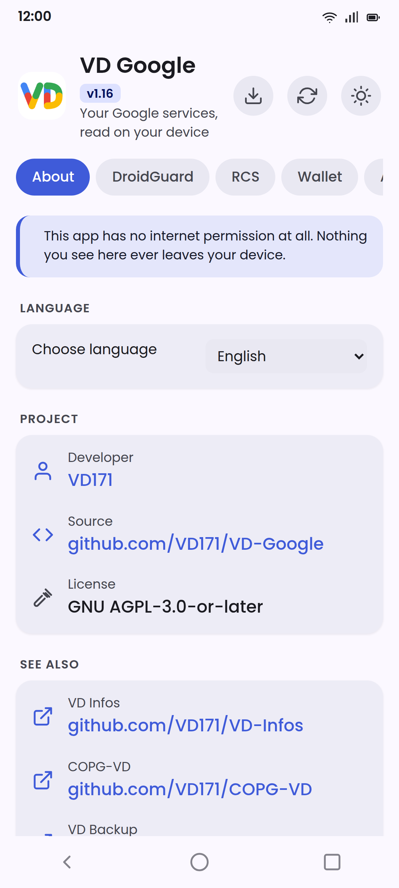
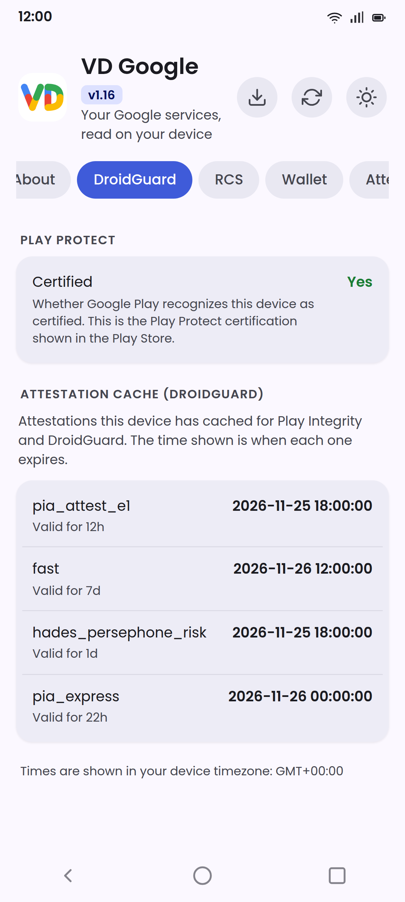
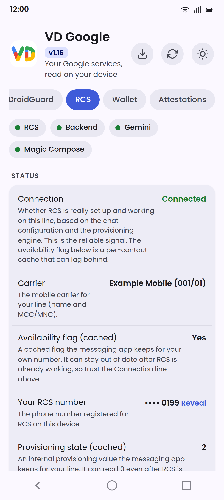
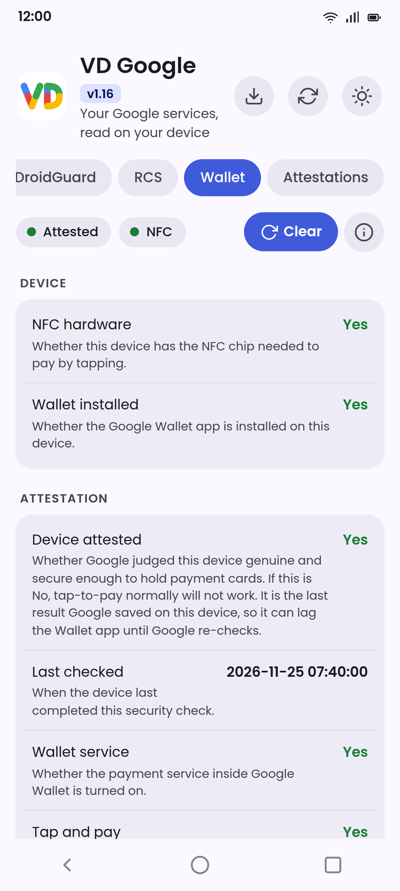
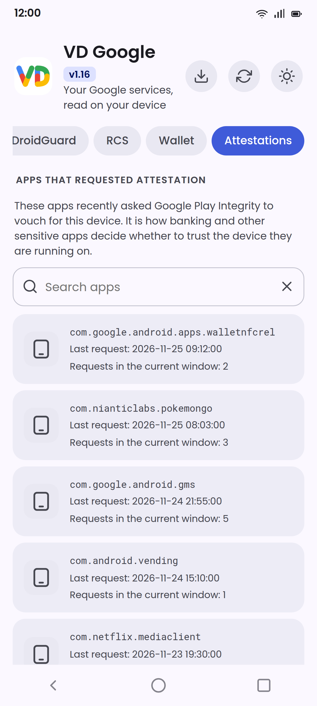

<!--
  ======================================================================
   VD GOOGLE  ::  your Google services, read on-device
   RCS, Google Wallet and Play Integrity attestations: local, no internet.

   Copyright (C) 2026  VD171
   SPDX-License-Identifier: AGPL-3.0-or-later

   Free software under the GNU AGPL v3 or later. NETWORK COPYLEFT: run a
   modified version, even as a service, and you MUST offer its source.

   Site           : https://vd171.ru
   Site           : https://vd.priv8.ru
   Source         : https://github.com/VD171/VD-Google
   GitHub         : @VD171 https://github.com/VD171
   XDA-Developers : @VD171 https://xdaforums.com/m/vd171.4699873/
   XDA thread     : https://xdaforums.com/t/VD-Google.4803837/
   Telegram       : @VD_Priv8 https://t.me/VD_Priv8
   Channel        : @Priv8_VD https://t.me/Priv8_VD
   Discord        : @VD.Priv8 https://discord.com/users/1296831918989639721
   E-mail         : vd.priv8@pm.me
  ======================================================================
-->

# VD Google

  

  
  
  
  

  <b>Your Google services, read on your device. No internet, ever.</b> 
  VD Google shows what Google itself records on your phone about RCS, Wallet and Play Integrity, and explains each item, without sending anything anywhere.

  <a href="https://github.com/VD171/VD-Google/releases">Releases</a> ·
  <a href="https://github.com/VD171/VD-Google/wiki">Wiki</a> ·
  <a href="https://github.com/VD171/VD-Google/wiki/USER-GUIDE">User guide</a> ·
  <a href="https://github.com/VD171/VD-Google/wiki/ARCHITECTURE">Architecture</a> ·
  <a href="https://github.com/VD171/VD-Google/wiki/PRIVACY">Privacy</a> ·
  <a href="https://github.com/VD171/VD-Google/wiki/BINARIES">Bundled binaries</a> ·
  <a href="https://github.com/VD171/VD-Google/wiki/FILE-STRUCTURE">File structure</a> ·
  <a href="CHANGELOG.md">Changelog</a> ·
  <a href="https://xdaforums.com/t/VD-Google.4803837/">XDA thread</a>

> **Languages:** English · [العربية](README.ar.md) · [Čeština](README.cs.md) · [Deutsch](README.de.md) · [Español](README.es.md) · [فارسی](README.fa.md) · [Français](README.fr.md) · [हिन्दी](README.hi.md) · [Bahasa Indonesia](README.id.md) · [Italiano](README.it.md) · [日本語](README.ja.md) · [한국어](README.ko.md) · [Nederlands](README.nl.md) · [Polski](README.pl.md) · [Português](README.pt.md) · [Русский](README.ru.md) · [Svenska](README.sv.md) · [ไทย](README.th.md) · [Türkçe](README.tr.md) · [Українська](README.uk.md) · [Tiếng Việt](README.vi.md) · [中文](README.zh.md)

  
  
  
  
  

---

## App or WebUI

Every release comes two ways, and both read the same things on your device with no internet:

- **App**: the `.apk`, a normal Android app.
- **WebUI**: the `.zip`, a module you flash in your root manager (KernelSU, APatch or Magisk) and open from there.

Either way, root is required.

## What it shows

### RCS
Whether RCS is available for your line, your RCS number, the RCS state, the configuration version, how many of your contacts support RCS, the carrier entitlement, presence (UCE), and the related timestamps (provisioning, sync, last message, token expiry, and more). It also shows whether Gemini in Google Messages is ready: Magic Compose (Gemini's writing help), the on-device AI engine (AICore, which runs Gemini Nano), and Gemini chat, which is delivered over RCS.

### Google Wallet
Whether your device is attested for payments, whether it has NFC hardware, whether Wallet is installed, the payment service and tap-to-pay state, whether your screen lock is accepted, and whether a card has ever been added.

### DroidGuard
Whether Google Play recognizes this device as certified. This is the Play Protect certification shown in the Play Store. Attestations this device has cached for Play Integrity and DroidGuard. The time shown is when each one expires.

### Attestations (Play Integrity)
The apps that recently asked Google Play Integrity to vouch for your device, each with its icon, its name, the full time of its last request, and how many requests it made in the current window.

Every item carries a short, plain-language explanation of what it really means.

## Privacy: no internet

VD Google declares **no permissions at all**, not even internet access. Nothing it reads ever leaves your device. You can confirm this in the manifest and in the source.

## Requirements

- Android 8.0 (API 26) or newer.
- Runs on arm, arm64, x86 and x86_64 devices: phones, tablets, emulators and ChromeOS.
- **Root is required.** The information above lives in protected, system-only areas of Android. VD Google reads it with superuser access and does nothing else with it. Without root, the app only shows a screen explaining why root is needed.

## Timestamps

All times are shown in your device's current timezone, and the timezone is always labelled.

## AI agents

VD Google writes a single JSON **export**: a structured, machine-readable snapshot of what Google records on your device about RCS, Wallet and Play Integrity, with no personal data in it. An agent auditing a device reads that one file instead of scraping several Google apps and databases by hand. The App and the WebUI produce the exact same schema, and neither ever touches the network. See [docs/AI-AGENTS.md](docs/AI-AGENTS.md).

## Build

Always release, never debug. The Android app builds from `VDGoogle/` with `./gradlew assembleRelease`, the WebUI module is packaged with `webui/package.sh`. The only native binary is `sqlite3`, fetched from the Termux repository with its library closure and recorded with its SHA-256. See [Contributing](CONTRIBUTING.md), [Bundled binaries](https://github.com/VD171/VD-Google/wiki/BINARIES) and the [wiki](https://github.com/VD171/VD-Google/wiki).

## Documentation

- **[Wiki](https://github.com/VD171/VD-Google/wiki)**: all the docs, browsable online.
- **[User guide](https://github.com/VD171/VD-Google/wiki/USER-GUIDE)**: what each screen reads and what every result means.
- **[Architecture](https://github.com/VD171/VD-Google/wiki/ARCHITECTURE)** and **[File structure](https://github.com/VD171/VD-Google/wiki/FILE-STRUCTURE)**: how it works and where everything lives.
- **[Privacy](https://github.com/VD171/VD-Google/wiki/PRIVACY)**: no internet permission, every read goes through root, nothing ever leaves the device.
- **[Bundled binaries](https://github.com/VD171/VD-Google/wiki/BINARIES)**: provenance and SHA-256 of every prebuilt binary, for full auditing.
- **[Contributing](https://github.com/VD171/VD-Google/wiki/CONTRIBUTING)** and **[Security](https://github.com/VD171/VD-Google/wiki/SECURITY)**.
- **[Changelog](CHANGELOG.md)** and **[Code of Conduct](https://github.com/VD171/VD-Google/wiki/CODE_OF_CONDUCT)**.

<!-- /vd-docs -->

## See also

- **[COPG-VD](https://github.com/VD171/COPG-VD)**: global device fingerprint / Play Integrity spoofing, whole-device with per-app scope and a WebUI.
- **[VDBackup](https://github.com/VD171/VD-Backup)**: full app and data backup and restore as root, driven entirely from a WebUI.
- **[VD-dropbear](https://github.com/VD171/VD-dropbear)**: a standalone rooted SSH daemon (Dropbear).
- **[VDInstaller](https://github.com/VD171/VD-Installer)**: a frictionless root sideload installer for single, batch and split APKs, with a Play Protect verifier toggle and install-source spoofing.
- **[VDInfos](https://github.com/VD171/VD-Infos)**: a device method debugger that reads each item through every method that can read it and compares them side by side.
- **[VDLiveUpdate](https://github.com/VD171/VDLiveUpdate)**: a flashless, incremental self-update engine embedded into KernelSU/APatch/Magisk modules.
- **[VD-Modules](https://github.com/VD171/VD-Modules)**: our MMRL/WebUI-X module repository (install all of these from your root manager).
- **[@VictorGabriel7Dev/build.prop](https://github.com/VictorGabriel7Dev/build.prop)**: a dataset of Pixel `build.prop` fingerprints (fork of @T3SL4).
- **[@VictorGabriel7Dev/mtproto-store](https://github.com/VictorGabriel7Dev/mtproto-store)**: use Telegram as an object store from a tiny Go CLI.

## Contacts

- https://vd171.ru
- https://vd.priv8.ru
- **Telegram:** @VD_Priv8 https://t.me/VD_Priv8
- **Channel:** @Priv8_VD https://t.me/Priv8_VD
- **Discord:** @VD.Priv8 https://discord.com/users/1296831918989639721
- **E-mail:** vd.priv8@pm.me
- **XDA-Developers:** @VD171 https://xdaforums.com/m/vd171.4699873/
- **XDA thread:** https://xdaforums.com/t/VD-Google.4803837/
- **GitHub:** @VD171 https://github.com/VD171

## License

**GNU AGPL-3.0-or-later**. See [LICENSE](LICENSE). Copyleft, including the network clause: anyone who runs a modified version (even as a service) must offer its source. Chosen deliberately to keep forks open.

## Trademarks

VD Google is an independent, unofficial project. It is not affiliated with, endorsed by, or sponsored by Google LLC. "Google", "Google Wallet", "Google Play", "Play Integrity", "Android" and related names and logos are trademarks of Google LLC. VD Google only reads what is already on your device and sends nothing anywhere.

## Tags

`android` `privacy` `security` `rcs` `google-wallet` `play-integrity` `attestation` `nfc` `tap-to-pay` `no-internet` `root` `kernelsu` `magisk` `lsposed` `on-device` `kotlin` `jetpack-compose` `material3` `vdgoogle`

---

📣 **Join the channel for updates:** @Priv8_VD https://t.me/Priv8_VD
