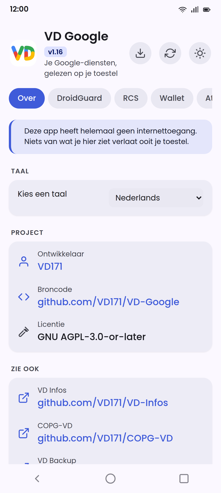
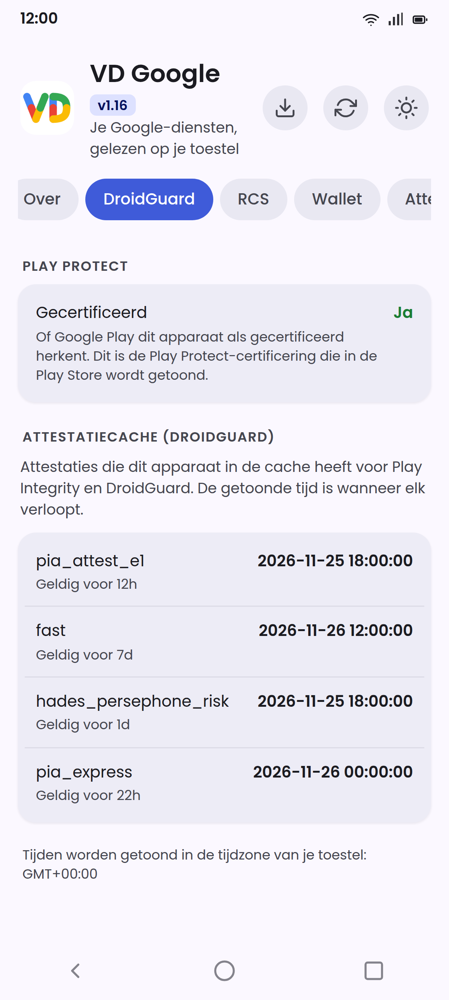
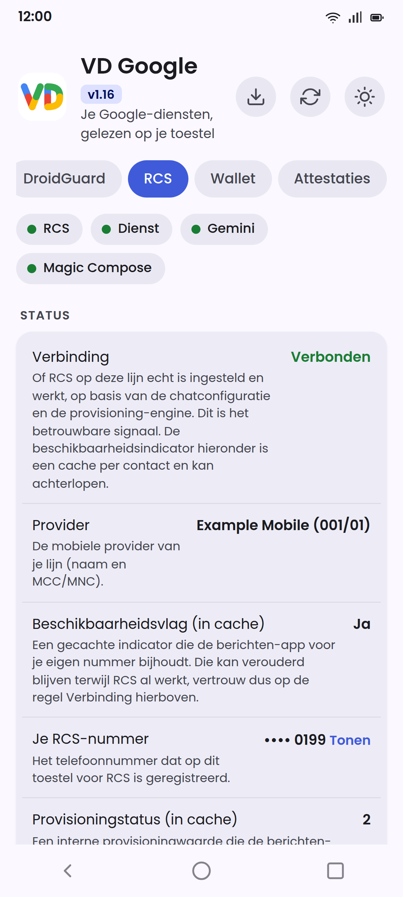
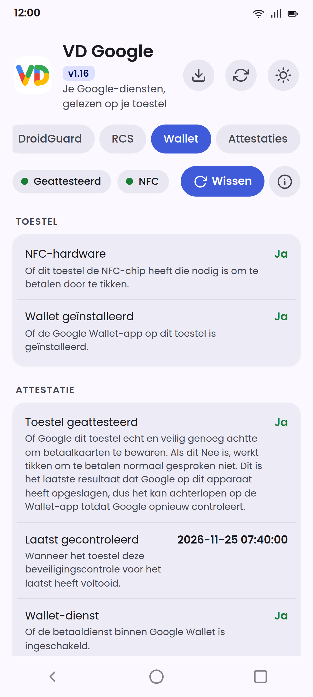
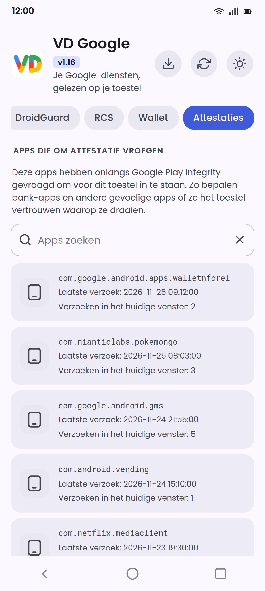

<!--
  ======================================================================
   VD GOOGLE  ::  your Google services, read on-device
   RCS, Google Wallet and Play Integrity attestations: local, no internet.

   Copyright (C) 2026  VD171
   SPDX-License-Identifier: AGPL-3.0-or-later

   Free software under the GNU AGPL v3 or later. NETWORK COPYLEFT: run a
   modified version, even as a service, and you MUST offer its source.

   Site           : https://vd171.ru
   Site           : https://vd.priv8.ru
   Source         : https://github.com/VD171/VD-Google
   GitHub         : @VD171 https://github.com/VD171
   XDA-Developers : @VD171 https://xdaforums.com/m/vd171.4699873/
   XDA thread     : https://xdaforums.com/t/VD-Google.4803837/
   Telegram       : @VD_Priv8 https://t.me/VD_Priv8
   Channel        : @Priv8_VD https://t.me/Priv8_VD
   Discord        : @VD.Priv8 https://discord.com/users/1296831918989639721
   E-mail         : vd.priv8@pm.me
  ======================================================================
-->

# VD Google

  

  
  
  
  

  <b>Je Google-diensten, gelezen op je toestel. Nooit internet.</b> 
  VD Google laat je zien wat Google zelf op je telefoon vastlegt over RCS, Wallet en Play Integrity, en legt uit wat elk item betekent, zonder iets ergens naartoe te sturen.

  <a href="https://github.com/VD171/VD-Google/releases">Releases</a> ·
  <a href="https://github.com/VD171/VD-Google/wiki/nl-Home">Wiki</a> ·
  <a href="https://github.com/VD171/VD-Google/wiki/nl-USER-GUIDE">Gebruikershandleiding</a> ·
  <a href="https://github.com/VD171/VD-Google/wiki/nl-ARCHITECTURE">Architectuur</a> ·
  <a href="https://github.com/VD171/VD-Google/wiki/nl-PRIVACY">Privacy</a> ·
  <a href="https://github.com/VD171/VD-Google/wiki/nl-BINARIES">Meegeleverde binaries</a> ·
  <a href="https://github.com/VD171/VD-Google/wiki/nl-FILE-STRUCTURE">Bestandsstructuur</a> ·
  <a href="CHANGELOG.md">Changelog</a> ·
  <a href="https://xdaforums.com/t/VD-Google.4803837/">XDA thread</a>

> **Languages:** [English](README.md) · [العربية](README.ar.md) · [Čeština](README.cs.md) · [Deutsch](README.de.md) · [Español](README.es.md) · [فارسی](README.fa.md) · [Français](README.fr.md) · [हिन्दी](README.hi.md) · [Bahasa Indonesia](README.id.md) · [Italiano](README.it.md) · [日本語](README.ja.md) · [한국어](README.ko.md) · [Nederlands](README.nl.md) · [Polski](README.pl.md) · [Português](README.pt.md) · [Русский](README.ru.md) · [Svenska](README.sv.md) · [ไทย](README.th.md) · [Türkçe](README.tr.md) · [Українська](README.uk.md) · [Tiếng Việt](README.vi.md) · [中文](README.zh.md)

  
  
  
  
  

---

## App of WebUI

Elke release komt in twee vormen, en beide lezen dezelfde dingen op je apparaat, zonder internet:

- **App**: de `.apk`, een gewone Android-app.
- **WebUI**: de `.zip`, een module die je in je root-manager (KernelSU, APatch of Magisk) flasht en daar opent.

In beide gevallen is root vereist.

## Wat het toont

### RCS
Of RCS beschikbaar is voor je lijn, je RCS-nummer, de RCS-status, de configuratieversie, hoeveel van je contacten RCS ondersteunen, de providerrechten, de aanwezigheid (UCE) en de bijbehorende tijdstempels (provisioning, synchronisatie, laatste bericht, tokenverval en meer). Toont ook of Gemini in Google Messages klaar is: Magic Compose (Gemini's schrijfhulp), de AI-engine op het toestel (AICore, waarop Gemini Nano draait) en de Gemini-chat, die via RCS wordt geleverd.

### Google Wallet
Of je toestel geattesteerd is voor betalingen, of het NFC-hardware heeft, of Wallet geïnstalleerd is, de status van de betaaldienst en van tikken om te betalen, of je schermvergrendeling geaccepteerd is, en of er ooit een kaart is toegevoegd.

### DroidGuard
Of Google Play dit apparaat als gecertificeerd herkent. Dit is de Play Protect-certificering die in de Play Store wordt getoond. Attestaties die dit apparaat in de cache heeft voor Play Integrity en DroidGuard. De getoonde tijd is wanneer elk verloopt.

### Attestaties (Play Integrity)
De apps die onlangs Google Play Integrity hebben gevraagd om voor je toestel in te staan, elk met zijn pictogram, zijn naam, de volledige tijd van het laatste verzoek en hoeveel verzoeken het in het huidige venster deed.

Elk item bevat een korte uitleg in gewone taal van wat het echt betekent.

## Privacy: geen internet

VD Google vraagt **helemaal geen toestemmingen**, zelfs geen internettoegang. Niets van wat het leest verlaat ooit je toestel. Je kunt dit controleren in het manifest en in de broncode.

## Vereisten

- Android 8.0 (API 26) of nieuwer.
- Werkt op arm-, arm64-, x86- en x86_64-toestellen: telefoons, tablets, emulators en ChromeOS.
- **Root is vereist.** De bovenstaande informatie bevindt zich in beschermde, alleen voor het systeem toegankelijke gebieden van Android. VD Google leest ze met superuser-toegang en doet er verder niets mee. Zonder root toont de app alleen een scherm dat uitlegt waarom root nodig is.

## Tijdstempels

Alle tijden worden getoond in de huidige tijdzone van je toestel, en de tijdzone wordt altijd vermeld.

## AI-agents

VD Google schrijft één JSON-**export**: een gestructureerde, machineleesbare momentopname van wat Google op je apparaat vastlegt over RCS, Wallet en Play Integrity, zonder persoonsgegevens erin. Een agent die een apparaat controleert leest dat ene bestand in plaats van meerdere Google-apps en databases met de hand te doorzoeken. De app en de WebUI produceren exact hetzelfde schema, en geen van beide raakt het netwerk aan. Zie [docs/AI-AGENTS.md](docs/AI-AGENTS.md).

## Bouwen

Altijd release, nooit debug. De Android-app bouwt vanuit `VDGoogle/` met `./gradlew assembleRelease`, de WebUI-module wordt verpakt met `webui/package.sh`. Het enige native binary is `sqlite3`, opgehaald uit de Termux-repository met zijn bibliotheek-closure en vastgelegd met zijn SHA-256. Zie [Bijdragen](CONTRIBUTING.md), [Meegeleverde binaries](https://github.com/VD171/VD-Google/wiki/BINARIES) en de [wiki](https://github.com/VD171/VD-Google/wiki).

## Documentatie

- **[Wiki](https://github.com/VD171/VD-Google/wiki/nl-Home)**: alle documentatie, online te doorbladeren.
- **[Gebruikershandleiding](https://github.com/VD171/VD-Google/wiki/nl-USER-GUIDE)**: wat elk scherm leest en wat elk resultaat betekent.
- **[Architectuur](https://github.com/VD171/VD-Google/wiki/nl-ARCHITECTURE)** en **[Bestandsstructuur](https://github.com/VD171/VD-Google/wiki/nl-FILE-STRUCTURE)**: hoe het werkt en waar alles zich bevindt.
- **[Privacy](https://github.com/VD171/VD-Google/wiki/nl-PRIVACY)**: geen internettoestemming, elke leesbewerking gaat via root, er verlaat nooit iets het apparaat.
- **[Meegeleverde binaries](https://github.com/VD171/VD-Google/wiki/nl-BINARIES)**: herkomst en SHA-256 van elke vooraf gebouwde binary, voor volledige controle.
- **[Bijdragen](https://github.com/VD171/VD-Google/wiki/nl-CONTRIBUTING)** en **[Beveiliging](https://github.com/VD171/VD-Google/wiki/nl-SECURITY)**.
- **[Changelog](CHANGELOG.md)** en **[Gedragscode](https://github.com/VD171/VD-Google/wiki/nl-CODE_OF_CONDUCT)**.

<!-- /vd-docs -->

## Zie ook

- **[COPG-VD](https://github.com/VD171/COPG-VD)**: globale spoofing van apparaat-fingerprint / Play Integrity, voor het hele toestel met bereik per app en een WebUI.
- **[VDBackup](https://github.com/VD171/VD-Backup)**: volledige back-up en herstel van apps en gegevens als root, volledig aangestuurd vanuit een WebUI.
- **[VD-dropbear](https://github.com/VD171/VD-dropbear)**: een standalone SSH-daemon (Dropbear) met root.
- **[VDInstaller](https://github.com/VD171/VD-Installer)**: een wrijvingsloze root-sideload-installer voor losse, batch- en split-APK's, met een Play Protect-verifier-schakelaar en vervalsing van de installatiebron.
- **[VDInfos](https://github.com/VD171/VD-Infos)**: een methode-debugger die elk item leest via elke methode die het kan lezen en ze naast elkaar vergelijkt.
- **[VDLiveUpdate](https://github.com/VD171/VDLiveUpdate)**: een flashloze, incrementele zelfupdate-engine, ingebed in KernelSU/APatch/Magisk-modules.
- **[VD-Modules](https://github.com/VD171/VD-Modules)**: onze MMRL/WebUI-X-module-repository (installeer ze allemaal vanuit je root-manager).
- **[@VictorGabriel7Dev/build.prop](https://github.com/VictorGabriel7Dev/build.prop)**: een dataset van Pixel-`build.prop`-fingerprints (fork van @T3SL4).
- **[@VictorGabriel7Dev/mtproto-store](https://github.com/VictorGabriel7Dev/mtproto-store)**: gebruik Telegram als object store vanuit een kleine Go-CLI.

## Contacten

- https://vd171.ru
- https://vd.priv8.ru
- **Telegram:** @VD_Priv8 https://t.me/VD_Priv8
- **Channel:** @Priv8_VD https://t.me/Priv8_VD
- **Discord:** @VD.Priv8 https://discord.com/users/1296831918989639721
- **E-mail:** vd.priv8@pm.me
- **XDA-Developers:** @VD171 https://xdaforums.com/m/vd171.4699873/
- **XDA thread:** https://xdaforums.com/t/VD-Google.4803837/
- **GitHub:** @VD171 https://github.com/VD171

## Licentie

**GNU AGPL-3.0-or-later**: zie [LICENSE](LICENSE). Copyleft, inclusief de netwerkclausule: wie een gewijzigde versie draait (ook als dienst) moet de broncode aanbieden. Bewust gekozen om forks open te houden.

## Handelsmerken

VD Google is een onafhankelijk, niet-officieel project. Het is niet verbonden met, onderschreven door of gesponsord door Google LLC. "Google", "Google Wallet", "Google Play", "Play Integrity", "Android" en verwante namen en logo's zijn handelsmerken van Google LLC. VD Google leest alleen wat al op je toestel staat en stuurt niets ergens naartoe.

## Tags

`android` `privacy` `security` `rcs` `google-wallet` `play-integrity` `attestation` `nfc` `tap-to-pay` `no-internet` `root` `kernelsu` `magisk` `lsposed` `on-device` `kotlin` `jetpack-compose` `material3` `vdgoogle`

---

📣 **Word lid van het kanaal voor updates:** @Priv8_VD https://t.me/Priv8_VD
