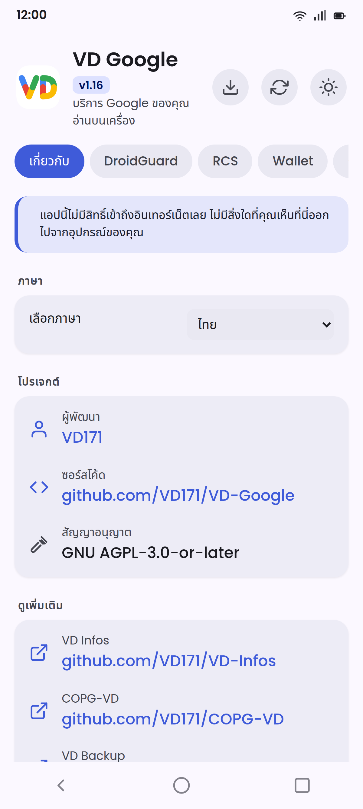
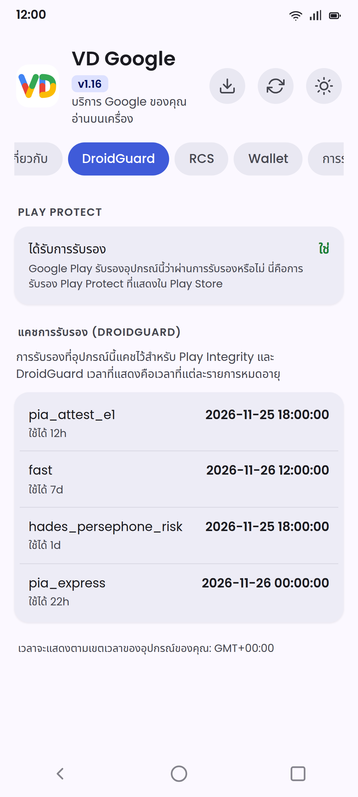
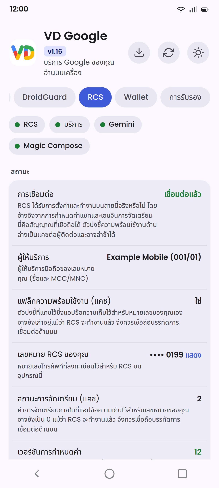
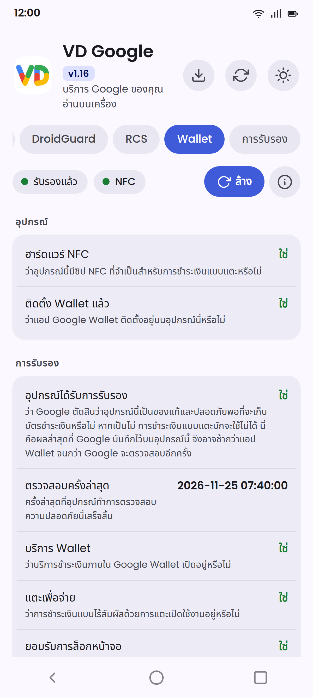
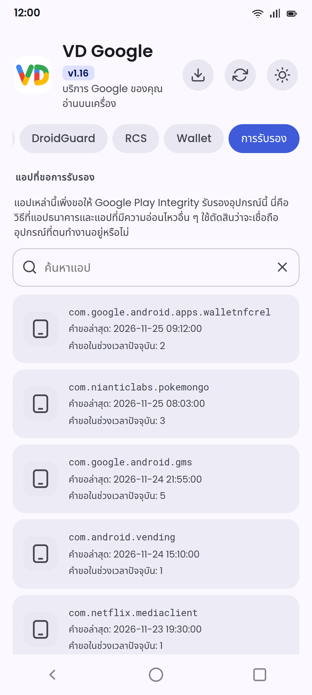

<!--
  ======================================================================
   VD GOOGLE  ::  your Google services, read on-device
   RCS, Google Wallet and Play Integrity attestations: local, no internet.

   Copyright (C) 2026  VD171
   SPDX-License-Identifier: AGPL-3.0-or-later

   Free software under the GNU AGPL v3 or later. NETWORK COPYLEFT: run a
   modified version, even as a service, and you MUST offer its source.

   Site           : https://vd171.ru
   Site           : https://vd.priv8.ru
   Source         : https://github.com/VD171/VD-Google
   GitHub         : @VD171 https://github.com/VD171
   XDA-Developers : @VD171 https://xdaforums.com/m/vd171.4699873/
   XDA thread     : https://xdaforums.com/t/VD-Google.4803837/
   Telegram       : @VD_Priv8 https://t.me/VD_Priv8
   Channel        : @Priv8_VD https://t.me/Priv8_VD
   Discord        : @VD.Priv8 https://discord.com/users/1296831918989639721
   E-mail         : vd.priv8@pm.me
  ======================================================================
-->

# VD Google

  

  
  
  
  

  <b>บริการ Google ของคุณ อ่านบนเครื่อง ไม่ใช้อินเทอร์เน็ตเลย</b> 
  VD Google แสดงให้คุณเห็นสิ่งที่ Google เองบันทึกไว้ในโทรศัพท์ของคุณเกี่ยวกับ RCS, Wallet และ Play Integrity และอธิบายว่าแต่ละรายการหมายถึงอะไร โดยไม่ส่งอะไรไปที่ใดเลย

  <a href="https://github.com/VD171/VD-Google/releases">Releases</a> ·
  <a href="https://github.com/VD171/VD-Google/wiki/th-Home">Wiki</a> ·
  <a href="https://github.com/VD171/VD-Google/wiki/th-USER-GUIDE">คู่มือผู้ใช้</a> ·
  <a href="https://github.com/VD171/VD-Google/wiki/th-ARCHITECTURE">สถาปัตยกรรม</a> ·
  <a href="https://github.com/VD171/VD-Google/wiki/th-PRIVACY">ความเป็นส่วนตัว</a> ·
  <a href="https://github.com/VD171/VD-Google/wiki/th-BINARIES">ไบนารีที่มาพร้อม</a> ·
  <a href="https://github.com/VD171/VD-Google/wiki/th-FILE-STRUCTURE">โครงสร้างไฟล์</a> ·
  <a href="CHANGELOG.md">Changelog</a> ·
  <a href="https://xdaforums.com/t/VD-Google.4803837/">XDA thread</a>

> **Languages:** [English](README.md) · [العربية](README.ar.md) · [Čeština](README.cs.md) · [Deutsch](README.de.md) · [Español](README.es.md) · [فارسی](README.fa.md) · [Français](README.fr.md) · [हिन्दी](README.hi.md) · [Bahasa Indonesia](README.id.md) · [Italiano](README.it.md) · [日本語](README.ja.md) · [한국어](README.ko.md) · [Nederlands](README.nl.md) · [Polski](README.pl.md) · [Português](README.pt.md) · [Русский](README.ru.md) · [Svenska](README.sv.md) · ไทย · [Türkçe](README.tr.md) · [Українська](README.uk.md) · [Tiếng Việt](README.vi.md) · [中文](README.zh.md)

  
  
  
  
  

---

## แอปหรือ WebUI

แต่ละรุ่นมีให้สองแบบ และทั้งสองแบบอ่านข้อมูลเดียวกันบนอุปกรณ์ของคุณโดยไม่ใช้อินเทอร์เน็ต:

- **App**: ไฟล์ `.apk` แอป Android ทั่วไป
- **WebUI**: ไฟล์ `.zip` โมดูลที่คุณแฟลชในตัวจัดการ root (KernelSU, APatch หรือ Magisk) แล้วเปิดจากที่นั่น

ไม่ว่าแบบใดก็ต้องใช้ root

## แสดงอะไรบ้าง

### RCS
ว่า RCS พร้อมใช้งานสำหรับเลขหมายของคุณหรือไม่ เลขหมาย RCS ของคุณ สถานะ RCS เวอร์ชันการกำหนดค่า จำนวนรายชื่อที่รองรับ RCS สิทธิ์จากผู้ให้บริการ การแสดงตน (UCE) และการประทับเวลาที่เกี่ยวข้อง (การจัดเตรียม การซิงค์ ข้อความล่าสุด การหมดอายุของโทเค็น และอื่น ๆ) นอกจากนี้ยังแสดงว่า Gemini ใน Google Messages พร้อมใช้งานหรือไม่: Magic Compose (ตัวช่วยเขียนของ Gemini), เอนจิน AI บนอุปกรณ์ (AICore ที่รัน Gemini Nano) และแชท Gemini ซึ่งส่งผ่าน RCS

### Google Wallet
ว่าอุปกรณ์ของคุณได้รับการรับรองสำหรับการชำระเงินหรือไม่ มีฮาร์ดแวร์ NFC หรือไม่ ติดตั้ง Wallet หรือไม่ สถานะของบริการชำระเงินและการแตะเพื่อจ่าย การล็อกหน้าจอของคุณได้รับการยอมรับหรือไม่ และเคยเพิ่มบัตรหรือไม่

### DroidGuard
Google Play รับรองอุปกรณ์นี้ว่าผ่านการรับรองหรือไม่ นี่คือการรับรอง Play Protect ที่แสดงใน Play Store การรับรองที่อุปกรณ์นี้แคชไว้สำหรับ Play Integrity และ DroidGuard เวลาที่แสดงคือเวลาที่แต่ละรายการหมดอายุ

### การรับรอง (Play Integrity)
แอปที่เพิ่งขอให้ Google Play Integrity รับรองอุปกรณ์ของคุณ แต่ละแอปพร้อมไอคอน ชื่อ เวลาเต็มของคำขอล่าสุด และจำนวนคำขอที่ทำในช่วงเวลาปัจจุบัน

ทุกรายการมาพร้อมคำอธิบายสั้น ๆ ด้วยภาษาที่เข้าใจง่ายว่ามันหมายถึงอะไรจริง ๆ

## ความเป็นส่วนตัว: ไม่มีอินเทอร์เน็ต

VD Google **ไม่ประกาศสิทธิ์ใด ๆ เลย** แม้แต่การเข้าถึงอินเทอร์เน็ต ไม่มีสิ่งใดที่อ่านออกไปจากอุปกรณ์ของคุณ คุณสามารถตรวจสอบได้ในไฟล์ manifest และในซอร์สโค้ด

## ข้อกำหนด

- Android 8.0 (API 26) ขึ้นไป
- ทำงานบนอุปกรณ์ arm, arm64, x86 และ x86_64: โทรศัพท์ แท็บเล็ต อีมูเลเตอร์ และ ChromeOS
- **ต้องมี root** ข้อมูลข้างต้นอยู่ในพื้นที่ที่ได้รับการป้องกันของ Android ซึ่งเข้าถึงได้เฉพาะระบบ VD Google อ่านข้อมูลนี้ด้วยสิทธิ์ผู้ใช้ขั้นสูงและไม่ทำอย่างอื่นกับมัน หากไม่มี root แอปจะแสดงเพียงหน้าจอที่อธิบายว่าทำไมจึงต้องใช้ root

## การประทับเวลา

เวลาทั้งหมดจะแสดงตามเขตเวลาปัจจุบันของอุปกรณ์ของคุณ และจะระบุเขตเวลาเสมอ

## เอเจนต์ AI

VD Google เขียน **ไฟล์ส่งออก** JSON เพียงไฟล์เดียว: ภาพรวมแบบมีโครงสร้างที่เครื่องอ่านได้ของสิ่งที่ Google บันทึกบนอุปกรณ์ของคุณเกี่ยวกับ RCS, Wallet และ Play Integrity โดยไม่มีข้อมูลส่วนบุคคลอยู่ในนั้น เอเจนต์ที่ตรวจสอบอุปกรณ์จะอ่านไฟล์เดียวนั้นแทนที่จะไล่เก็บข้อมูลจากแอปและฐานข้อมูลของ Google หลายรายการด้วยมือ แอปและ WebUI สร้างสคีมาที่เหมือนกันทุกประการ และทั้งคู่ไม่แตะเครือข่าย ดู [docs/AI-AGENTS.md](docs/AI-AGENTS.md)

## การสร้าง

เป็น release เสมอ ไม่เคยเป็น debug แอป Android สร้างจาก `VDGoogle/` ด้วย `./gradlew assembleRelease`, โมดูล WebUI แพ็กด้วย `webui/package.sh` ไบนารีเนทีฟเดียวคือ `sqlite3` ซึ่งดึงมาจากที่เก็บ Termux พร้อมคลอเชอร์ไลบรารีของมัน และบันทึกไว้พร้อม SHA-256 ดู [การร่วมพัฒนา](CONTRIBUTING.md), [ไบนารีที่แนบมา](https://github.com/VD171/VD-Google/wiki/BINARIES) และ [วิกิ](https://github.com/VD171/VD-Google/wiki)

## เอกสาร

- **[Wiki](https://github.com/VD171/VD-Google/wiki/th-Home)**: เอกสารทั้งหมด เปิดอ่านได้ทางออนไลน์
- **[คู่มือผู้ใช้](https://github.com/VD171/VD-Google/wiki/th-USER-GUIDE)**: แต่ละหน้าจออ่านอะไร และผลลัพธ์แต่ละอย่างหมายถึงอะไร
- **[สถาปัตยกรรม](https://github.com/VD171/VD-Google/wiki/th-ARCHITECTURE)** และ **[โครงสร้างไฟล์](https://github.com/VD171/VD-Google/wiki/th-FILE-STRUCTURE)**: ทำงานอย่างไร และทุกอย่างอยู่ที่ไหน
- **[ความเป็นส่วนตัว](https://github.com/VD171/VD-Google/wiki/th-PRIVACY)**: ไม่มีสิทธิ์อินเทอร์เน็ต ทุกการอ่านผ่าน root ไม่มีสิ่งใดออกจากอุปกรณ์เลย
- **[ไบนารีที่มาพร้อม](https://github.com/VD171/VD-Google/wiki/th-BINARIES)**: ที่มาและ SHA-256 ของไบนารีสำเร็จรูปทุกตัว สำหรับการตรวจสอบอย่างครบถ้วน
- **[การมีส่วนร่วม](https://github.com/VD171/VD-Google/wiki/th-CONTRIBUTING)** และ **[ความปลอดภัย](https://github.com/VD171/VD-Google/wiki/th-SECURITY)**
- **[บันทึกการเปลี่ยนแปลง](CHANGELOG.md)** และ **[จรรยาบรรณ](https://github.com/VD171/VD-Google/wiki/th-CODE_OF_CONDUCT)**

<!-- /vd-docs -->

## ดูเพิ่มเติม

- **[COPG-VD](https://github.com/VD171/COPG-VD)**: การสปูฟ fingerprint ของอุปกรณ์ / Play Integrity แบบครอบคลุมทั้งเครื่อง พร้อมขอบเขตแยกตามแอปและ WebUI
- **[VDBackup](https://github.com/VD171/VD-Backup)**: สำรองและกู้คืนแอปและข้อมูลทั้งหมดในฐานะ root ควบคุมทั้งหมดจาก WebUI
- **[VD-dropbear](https://github.com/VD171/VD-dropbear)**: SSH daemon แบบสแตนด์อโลนที่ทำงานในฐานะ root (Dropbear)
- **[VDInstaller](https://github.com/VD171/VD-Installer)**: ตัวติดตั้งแบบ sideload ด้วยสิทธิ์ root ที่ไร้แรงเสียดทาน สำหรับ APK เดี่ยว แบบชุด และแบบแยก พร้อมสวิตช์ตัวตรวจสอบ Play Protect และการปลอมแหล่งที่มาของการติดตั้ง
- **[VDInfos](https://github.com/VD171/VD-Infos)**: ตัวดีบักเมธอดของอุปกรณ์ที่อ่านแต่ละรายการผ่านทุกเมธอดที่สามารถอ่านได้ และเปรียบเทียบเคียงข้างกัน
- **[VDLiveUpdate](https://github.com/VD171/VDLiveUpdate)**: เอนจินอัปเดตตัวเองแบบเพิ่มทีละส่วนโดยไม่ต้องแฟลช ฝังอยู่ในโมดูล KernelSU/APatch/Magisk
- **[VD-Modules](https://github.com/VD171/VD-Modules)**: ที่เก็บโมดูล MMRL/WebUI-X ของเรา (ติดตั้งทั้งหมดได้จากตัวจัดการ root ของคุณ)
- **[@VictorGabriel7Dev/build.prop](https://github.com/VictorGabriel7Dev/build.prop)**: ชุดข้อมูล fingerprint `build.prop` ของ Pixel (ฟอร์กจาก @T3SL4)
- **[@VictorGabriel7Dev/mtproto-store](https://github.com/VictorGabriel7Dev/mtproto-store)**: ใช้ Telegram เป็น object store จาก Go CLI ขนาดเล็ก

## Contacts

- https://vd171.ru
- https://vd.priv8.ru
- **Telegram:** @VD_Priv8 https://t.me/VD_Priv8
- **Channel:** @Priv8_VD https://t.me/Priv8_VD
- **Discord:** @VD.Priv8 https://discord.com/users/1296831918989639721
- **E-mail:** vd.priv8@pm.me
- **XDA-Developers:** @VD171 https://xdaforums.com/m/vd171.4699873/
- **XDA thread:** https://xdaforums.com/t/VD-Google.4803837/
- **GitHub:** @VD171 https://github.com/VD171

## สัญญาอนุญาต

**GNU AGPL-3.0-or-later**: ดู [LICENSE](LICENSE) Copyleft รวมถึงข้อกำหนดเครือข่าย: ผู้ที่รันเวอร์ชันที่ดัดแปลง (แม้เป็นบริการ) ต้องเสนอซอร์สโค้ดของมัน เลือกอย่างตั้งใจเพื่อให้ฟอร์กเปิดอยู่เสมอ

## เครื่องหมายการค้า

VD Google เป็นโครงการอิสระที่ไม่เป็นทางการ ไม่ได้มีส่วนเกี่ยวข้อง ได้รับการรับรอง หรือได้รับการสนับสนุนจาก Google LLC "Google", "Google Wallet", "Google Play", "Play Integrity", "Android" และชื่อและโลโก้ที่เกี่ยวข้องเป็นเครื่องหมายการค้าของ Google LLC VD Google อ่านเฉพาะสิ่งที่มีอยู่แล้วในอุปกรณ์ของคุณและไม่ส่งสิ่งใดไปที่ใดเลย

## Tags

`android` `privacy` `security` `rcs` `google-wallet` `play-integrity` `attestation` `nfc` `tap-to-pay` `no-internet` `root` `kernelsu` `magisk` `lsposed` `on-device` `kotlin` `jetpack-compose` `material3` `vdgoogle`

---

📣 **เข้าร่วมช่องเพื่อรับการอัปเดต:** @Priv8_VD https://t.me/Priv8_VD
