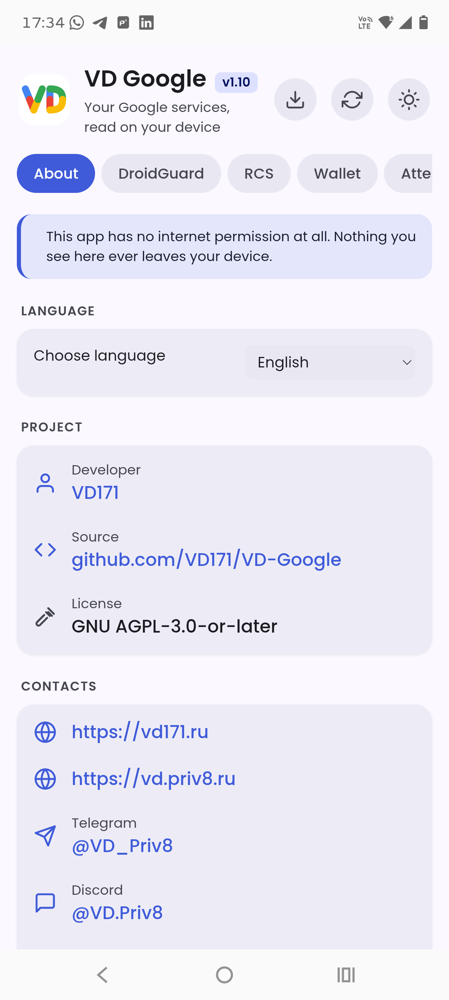
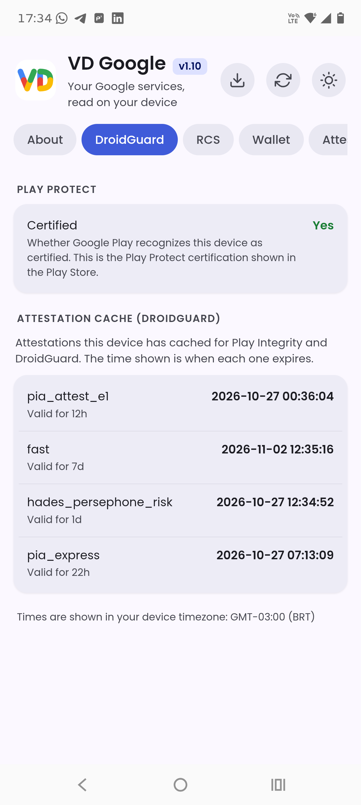
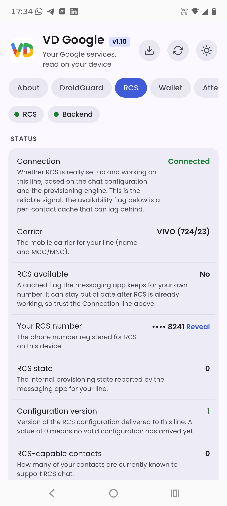
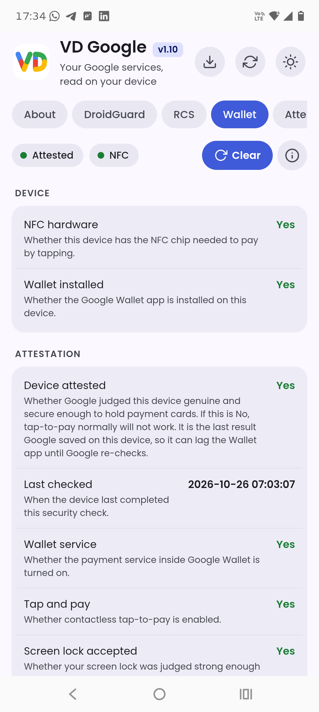
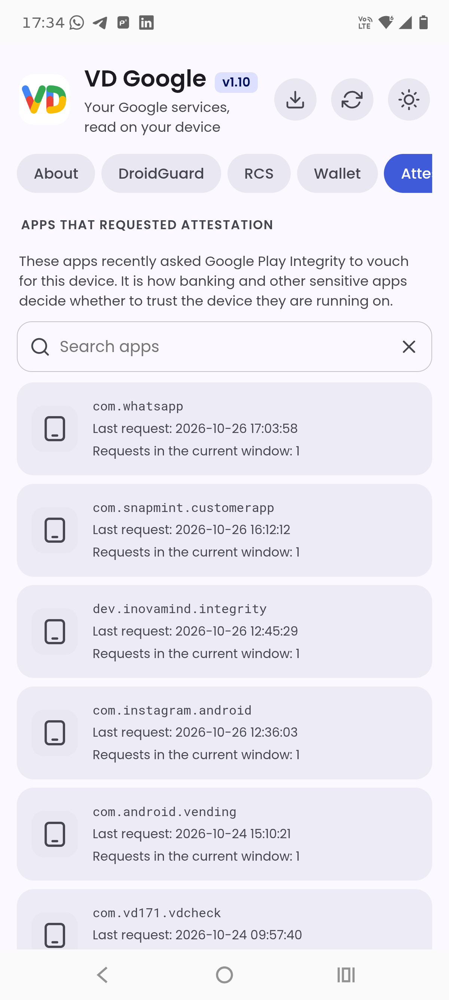

<!--
  VD GOOGLE - RCS, Google Wallet та атестації Play Integrity, зчитані на пристрої.
  Copyright (C) 2026  VD171 - SPDX-License-Identifier: AGPL-3.0-or-later
-->

# VD Google

**Ваші сервіси Google, прочитані на вашому пристрої. Без інтернету, ніколи.**

VD Google показує те, що сам Google записує на вашому телефоні, і пояснює, що означає кожен пункт, нічого нікуди не надсилаючи.

> **Мови:** [English](README.md) · [العربية](README.ar.md) · [Čeština](README.cs.md) · [Deutsch](README.de.md) · [Español](README.es.md) · [فارسی](README.fa.md) · [Français](README.fr.md) · [हिन्दी](README.hi.md) · [Bahasa Indonesia](README.in.md) · [Italiano](README.it.md) · [日本語](README.ja.md) · [한국어](README.ko.md) · [Nederlands](README.nl.md) · [Polski](README.pl.md) · [Português](README.pt.md) · [Русский](README.ru.md) · [Svenska](README.sv.md) · [ไทย](README.th.md) · [Türkçe](README.tr.md) · [Українська](README.uk.md) · [Tiếng Việt](README.vi.md) · [中文](README.zh.md)

    

## Додаток або WebUI

Кожен випуск доступний у двох варіантах, і обидва зчитують одне й те саме на вашому пристрої без інтернету:

- **Додаток** - файл `.apk`, звичайний застосунок Android.
- **WebUI** - файл `.zip`, модуль, який ви прошиваєте у своєму менеджері root-прав (KernelSU, Magisk або APatch) і відкриваєте звідти.

У будь-якому разі потрібні root-права.

## Що він показує

### RCS
Чи доступний RCS для вашого номера, ваш номер RCS, стан RCS, версія конфігурації, скільки ваших контактів підтримують RCS, дозвіл оператора, присутність (UCE), а також пов'язані позначки часу (підготовка, синхронізація, останнє повідомлення, завершення строку дії токена тощо).

### Google Гаманець
Чи пройшов ваш пристрій атестацію для платежів, чи є апаратний модуль NFC, чи встановлено Гаманець, стан платіжної служби та безконтактної оплати, чи прийнято блокування екрана і чи додавалася коли-небудь картка.

### DroidGuard
Чи визнає Google Play цей пристрій сертифікованим. Ідеться про сертифікацію Play Protect, відображену в Google Play. Атестації, кешовані на цьому пристрої для Play Integrity і DroidGuard. Для кожної атестації показано час завершення строку її дії.

### Атестації (Play Integrity)
Застосунки, які нещодавно зверталися до Google Play Integrity, щоб підтвердити ваш пристрій, кожен зі своєю іконкою, назвою, повним часом останнього запиту та кількістю запитів у поточному вікні.

Кожен пункт супроводжується коротким поясненням простою мовою про те, що він насправді означає.

## Приватність: без інтернету

VD Google не оголошує **жодного дозволу**, навіть доступу до інтернету. Нічого з прочитаного ніколи не залишає ваш пристрій. Ви можете переконатися в цьому в маніфесті та у вихідному коді.

## Вимоги

- Android 8.0 (API 26) або новіший.
- **Потрібні root-права.** Наведена вище інформація зберігається в захищених системних розділах Android. VD Google зчитує її з правами суперкористувача і більше нічого з нею не робить. Без root-прав застосунок лише показує екран із поясненням, навіщо потрібні root-права.

## Позначки часу

Усі значення часу показано в поточному часовому поясі вашого пристрою, і часовий пояс завжди позначено.

## Контакти

* https://vd171.ru
* https://vd.priv8.ru
* **Telegram:** @VD_Priv8 https://t.me/VD_Priv8
* **Discord:** @VD.Priv8 https://discord.com/users/1296831918989639721
* **E-mail:** vd.priv8@pm.me
* **XDA-Developers:** @VD171 https://xdaforums.com/m/vd171.4699873/
* **XDA thread:** https://xdaforums.com/t/VD-Google.4803837/
* **GitHub:** @VD171 https://github.com/VD171

## Ліцензія

**GNU AGPL-3.0-or-later** - див. [LICENSE](LICENSE). Копілефт, зокрема мережева умова: кожен, хто запускає змінену версію (навіть як сервіс), зобов'язаний надати її вихідний код. Обрано свідомо, щоб форки залишалися відкритими.

---

`android` `privacy` `security` `rcs` `google-wallet` `play-integrity` `attestation` `nfc` `tap-to-pay` `no-internet` `root` `kernelsu` `magisk` `lsposed` `on-device` `kotlin` `jetpack-compose` `material3` `vdgoogle`
