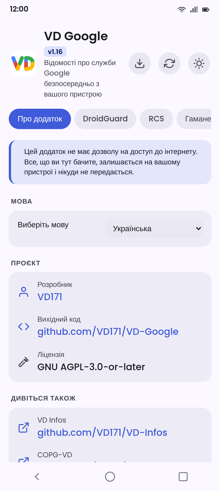
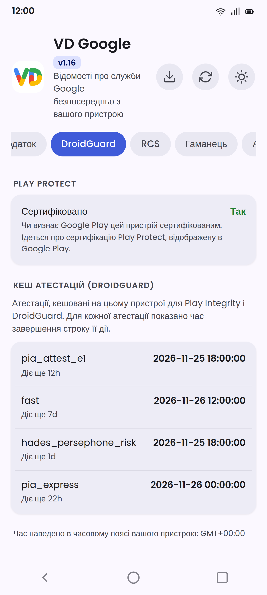
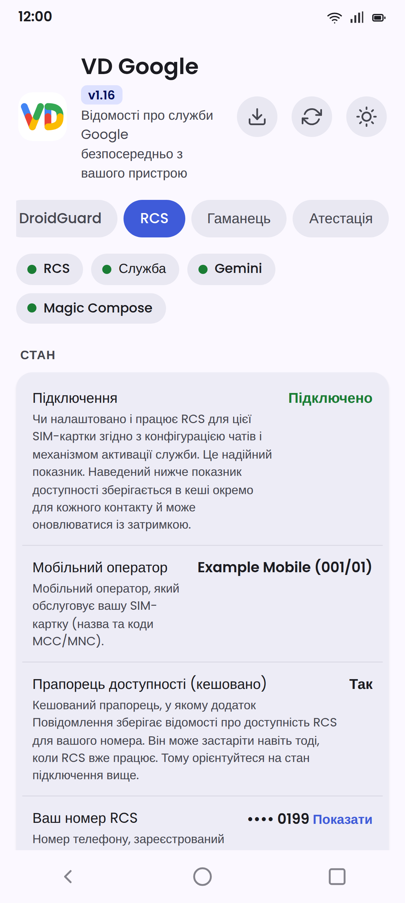
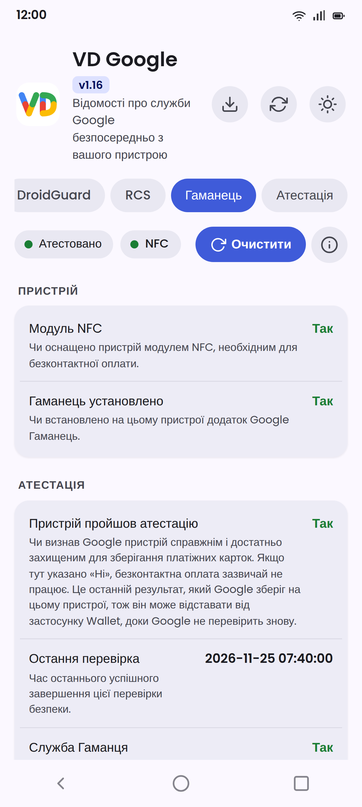
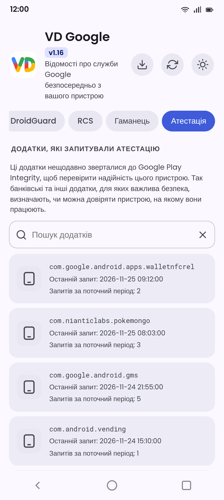

<!--
  ======================================================================
   VD GOOGLE  ::  your Google services, read on-device
   RCS, Google Wallet and Play Integrity attestations: local, no internet.

   Copyright (C) 2026  VD171
   SPDX-License-Identifier: AGPL-3.0-or-later

   Free software under the GNU AGPL v3 or later. NETWORK COPYLEFT: run a
   modified version, even as a service, and you MUST offer its source.

   Site           : https://vd171.ru
   Site           : https://vd.priv8.ru
   Source         : https://github.com/VD171/VD-Google
   GitHub         : @VD171 https://github.com/VD171
   XDA-Developers : @VD171 https://xdaforums.com/m/vd171.4699873/
   XDA thread     : https://xdaforums.com/t/VD-Google.4803837/
   Telegram       : @VD_Priv8 https://t.me/VD_Priv8
   Channel        : @Priv8_VD https://t.me/Priv8_VD
   Discord        : @VD.Priv8 https://discord.com/users/1296831918989639721
   E-mail         : vd.priv8@pm.me
  ======================================================================
-->

# VD Google

  

  
  
  
  

  <b>Ваші сервіси Google, прочитані на вашому пристрої. Без інтернету, ніколи.</b> 
  VD Google показує те, що сам Google записує на вашому телефоні про RCS, Гаманець та Play Integrity, і пояснює кожен пункт, нічого нікуди не надсилаючи.

  <a href="https://github.com/VD171/VD-Google/releases">Releases</a> ·
  <a href="https://github.com/VD171/VD-Google/wiki/uk-Home">Вікі</a> ·
  <a href="https://github.com/VD171/VD-Google/wiki/uk-USER-GUIDE">Посібник користувача</a> ·
  <a href="https://github.com/VD171/VD-Google/wiki/uk-ARCHITECTURE">Архітектура</a> ·
  <a href="https://github.com/VD171/VD-Google/wiki/uk-PRIVACY">Приватність</a> ·
  <a href="https://github.com/VD171/VD-Google/wiki/uk-BINARIES">Вбудовані бінарні файли</a> ·
  <a href="https://github.com/VD171/VD-Google/wiki/uk-FILE-STRUCTURE">Структура файлів</a> ·
  <a href="CHANGELOG.md">Changelog</a> ·
  <a href="https://xdaforums.com/t/VD-Google.4803837/">XDA thread</a>

> **Languages:** [English](README.md) · [العربية](README.ar.md) · [Čeština](README.cs.md) · [Deutsch](README.de.md) · [Español](README.es.md) · [فارسی](README.fa.md) · [Français](README.fr.md) · [हिन्दी](README.hi.md) · [Bahasa Indonesia](README.id.md) · [Italiano](README.it.md) · [日本語](README.ja.md) · [한국어](README.ko.md) · [Nederlands](README.nl.md) · [Polski](README.pl.md) · [Português](README.pt.md) · [Русский](README.ru.md) · [Svenska](README.sv.md) · [ไทย](README.th.md) · [Türkçe](README.tr.md) · [Українська](README.uk.md) · [Tiếng Việt](README.vi.md) · [中文](README.zh.md)

  
  
  
  
  

---

## Додаток або WebUI

Кожен випуск доступний у двох варіантах, і обидва зчитують одне й те саме на вашому пристрої без інтернету:

- **Додаток**: файл `.apk`, звичайний застосунок Android.
- **WebUI**: файл `.zip`, модуль, який ви прошиваєте у своєму менеджері root-прав (KernelSU, APatch або Magisk) і відкриваєте звідти.

У будь-якому разі потрібні root-права.

## Що він показує

### RCS
Чи доступний RCS для вашого номера, ваш номер RCS, стан RCS, версія конфігурації, скільки ваших контактів підтримують RCS, дозвіл оператора, присутність (UCE), а також пов'язані позначки часу (підготовка, синхронізація, останнє повідомлення, завершення строку дії токена тощо). Також показує, чи готовий Gemini у Google Messages: Magic Compose (допомога Gemini в написанні), рушій ШІ на пристрої (AICore, на якому працює Gemini Nano) та чат Gemini, що доставляється через RCS.

### Google Гаманець
Чи пройшов ваш пристрій атестацію для платежів, чи є апаратний модуль NFC, чи встановлено Гаманець, стан платіжної служби та безконтактної оплати, чи прийнято блокування екрана і чи додавалася коли-небудь картка.

### DroidGuard
Чи визнає Google Play цей пристрій сертифікованим. Ідеться про сертифікацію Play Protect, відображену в Google Play. Атестації, кешовані на цьому пристрої для Play Integrity і DroidGuard. Для кожної атестації показано час завершення строку її дії.

### Атестації (Play Integrity)
Застосунки, які нещодавно зверталися до Google Play Integrity, щоб підтвердити ваш пристрій, кожен зі своєю іконкою, назвою, повним часом останнього запиту та кількістю запитів у поточному вікні.

Кожен пункт супроводжується коротким поясненням простою мовою про те, що він насправді означає.

## Приватність: без інтернету

VD Google не оголошує **жодного дозволу**, навіть доступу до інтернету. Нічого з прочитаного ніколи не залишає ваш пристрій. Ви можете переконатися в цьому в маніфесті та у вихідному коді.

## Вимоги

- Android 8.0 (API 26) або новіший.
- Працює на пристроях arm, arm64, x86 та x86_64: телефонах, планшетах, емуляторах і ChromeOS.
- **Потрібні root-права.** Наведена вище інформація зберігається в захищених системних розділах Android. VD Google зчитує її з правами суперкористувача і більше нічого з нею не робить. Без root-прав застосунок лише показує екран із поясненням, навіщо потрібні root-права.

## Позначки часу

Усі значення часу показано в поточному часовому поясі вашого пристрою, і часовий пояс завжди позначено.

## Агенти ШІ

VD Google записує єдиний **експорт** JSON: структурований, машиночитний знімок того, що Google фіксує на вашому пристрої про RCS, Wallet і Play Integrity, без жодних персональних даних. Агент, що перевіряє пристрій, читає цей один файл замість того, щоб вручну перебирати кілька застосунків і баз даних Google. Застосунок і WebUI створюють абсолютно однакову схему, і жоден із них не звертається до мережі. Див. [docs/AI-AGENTS.md](docs/AI-AGENTS.md).

## Збирання

Завжди release, ніколи debug. Android-застосунок збирається з `VDGoogle/` командою `./gradlew assembleRelease`, модуль WebUI пакується за допомогою `webui/package.sh`. Єдиний нативний бінарник: `sqlite3`, отриманий зі сховища Termux разом із замиканням бібліотек і зафіксований своїм SHA-256. Див. [Внесок](CONTRIBUTING.md), [Вбудовані бінарники](https://github.com/VD171/VD-Google/wiki/BINARIES) і [вікі](https://github.com/VD171/VD-Google/wiki).

## Документація

- **[Вікі](https://github.com/VD171/VD-Google/wiki/uk-Home)**: уся документація, доступна для перегляду онлайн.
- **[Посібник користувача](https://github.com/VD171/VD-Google/wiki/uk-USER-GUIDE)**: що зчитує кожен екран і що означає кожен результат.
- **[Архітектура](https://github.com/VD171/VD-Google/wiki/uk-ARCHITECTURE)** та **[Структура файлів](https://github.com/VD171/VD-Google/wiki/uk-FILE-STRUCTURE)**: як це працює і де все міститься.
- **[Приватність](https://github.com/VD171/VD-Google/wiki/uk-PRIVACY)**: жодних інтернет-дозволів, кожне зчитування йде через root, ніщо ніколи не залишає пристрій.
- **[Вбудовані бінарні файли](https://github.com/VD171/VD-Google/wiki/uk-BINARIES)**: походження та SHA-256 кожного готового бінарного файлу, для повного аудиту.
- **[Участь у розробці](https://github.com/VD171/VD-Google/wiki/uk-CONTRIBUTING)** та **[Безпека](https://github.com/VD171/VD-Google/wiki/uk-SECURITY)**.
- **[Журнал змін](CHANGELOG.md)** та **[Кодекс поведінки](https://github.com/VD171/VD-Google/wiki/uk-CODE_OF_CONDUCT)**.

<!-- /vd-docs -->

## Дивіться також

- **[COPG-VD](https://github.com/VD171/COPG-VD)**: глобальний спуфінг fingerprint пристрою / Play Integrity, для всього пристрою з областю дії на рівні застосунків і WebUI.
- **[VDBackup](https://github.com/VD171/VD-Backup)**: повне резервне копіювання та відновлення застосунків і даних з правами root, повністю кероване з WebUI.
- **[VD-dropbear](https://github.com/VD171/VD-dropbear)**: автономний SSH-демон із правами root (Dropbear).
- **[VDInstaller](https://github.com/VD171/VD-Installer)**: безперешкодний root-інсталятор sideload для одиночних, пакетних і розділених APK, з перемикачем верифікатора Play Protect та підробкою джерела встановлення.
- **[VDInfos](https://github.com/VD171/VD-Infos)**: дебагер методів пристрою, що зчитує кожен пункт усіма методами, які можуть його прочитати, і порівнює їх поруч.
- **[VDLiveUpdate](https://github.com/VD171/VDLiveUpdate)**: безфлешевий інкрементальний рушій самооновлення, вбудований у модулі KernelSU/APatch/Magisk.
- **[VD-Modules](https://github.com/VD171/VD-Modules)**: наш репозиторій модулів MMRL/WebUI-X (встановіть їх усі зі свого root-менеджера).
- **[@VictorGabriel7Dev/build.prop](https://github.com/VictorGabriel7Dev/build.prop)**: набір даних fingerprint `build.prop` від Pixel (форк @T3SL4).
- **[@VictorGabriel7Dev/mtproto-store](https://github.com/VictorGabriel7Dev/mtproto-store)**: використовуйте Telegram як об'єктне сховище з крихітного CLI на Go.

## Контакти

- https://vd171.ru
- https://vd.priv8.ru
- **Telegram:** @VD_Priv8 https://t.me/VD_Priv8
- **Channel:** @Priv8_VD https://t.me/Priv8_VD
- **Discord:** @VD.Priv8 https://discord.com/users/1296831918989639721
- **E-mail:** vd.priv8@pm.me
- **XDA-Developers:** @VD171 https://xdaforums.com/m/vd171.4699873/
- **XDA thread:** https://xdaforums.com/t/VD-Google.4803837/
- **GitHub:** @VD171 https://github.com/VD171

## Ліцензія

**GNU AGPL-3.0-or-later**: див. [LICENSE](LICENSE). Копілефт, зокрема мережева умова: кожен, хто запускає змінену версію (навіть як сервіс), зобов'язаний надати її вихідний код. Обрано свідомо, щоб форки залишалися відкритими.

## Торгові марки

VD Google є незалежним, неофіційним проєктом. Він не пов'язаний із Google LLC, не схвалений і не спонсорований нею. «Google», «Google Wallet», «Google Play», «Play Integrity», «Android» та пов'язані назви й логотипи є торговими марками Google LLC. VD Google лише зчитує те, що вже є на вашому пристрої, і нічого нікуди не надсилає.

## Теги

`android` `privacy` `security` `rcs` `google-wallet` `play-integrity` `attestation` `nfc` `tap-to-pay` `no-internet` `root` `kernelsu` `magisk` `lsposed` `on-device` `kotlin` `jetpack-compose` `material3` `vdgoogle`

---

📣 **Приєднуйтесь до каналу для оновлень:** @Priv8_VD https://t.me/Priv8_VD
