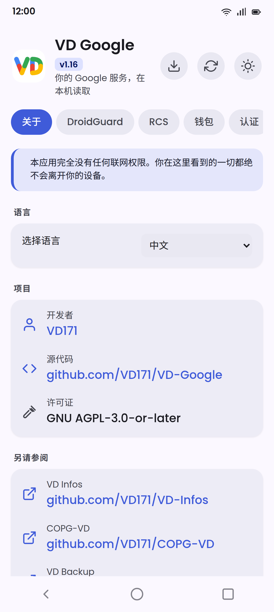
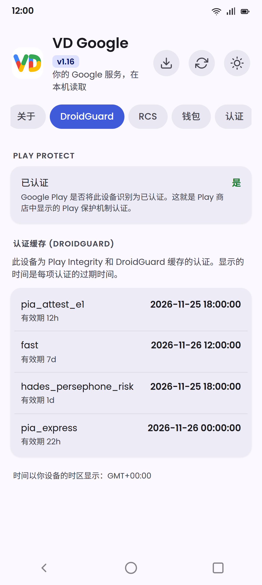
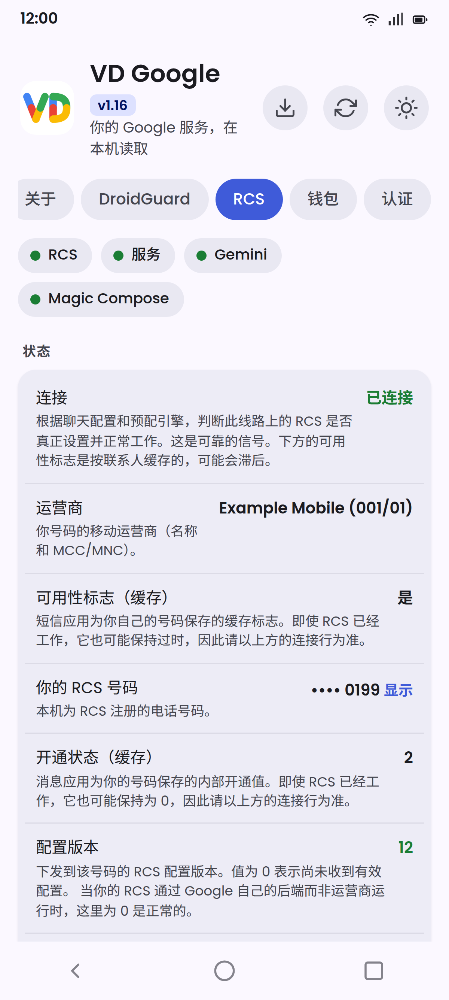
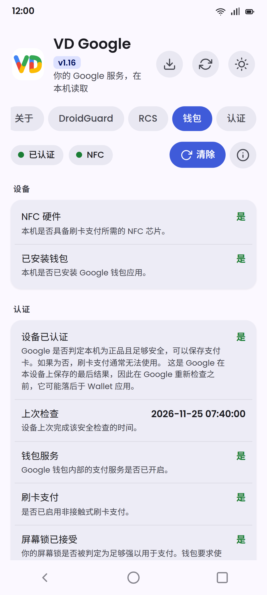
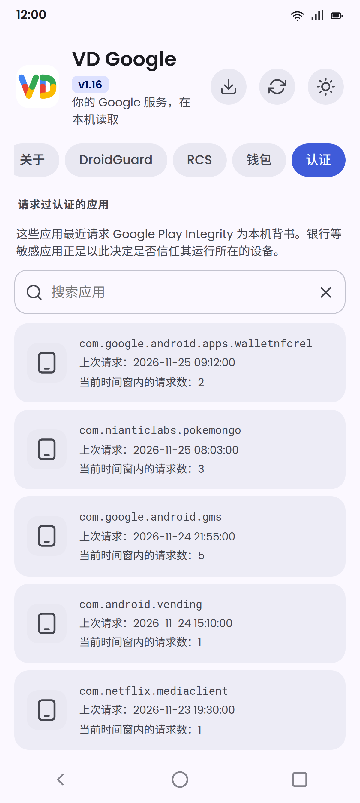

<!--
  ======================================================================
   VD GOOGLE  ::  your Google services, read on-device
   RCS, Google Wallet and Play Integrity attestations: local, no internet.

   Copyright (C) 2026  VD171
   SPDX-License-Identifier: AGPL-3.0-or-later

   Free software under the GNU AGPL v3 or later. NETWORK COPYLEFT: run a
   modified version, even as a service, and you MUST offer its source.

   Site           : https://vd171.ru
   Site           : https://vd.priv8.ru
   Source         : https://github.com/VD171/VD-Google
   GitHub         : @VD171 https://github.com/VD171
   XDA-Developers : @VD171 https://xdaforums.com/m/vd171.4699873/
   XDA thread     : https://xdaforums.com/t/VD-Google.4803837/
   Telegram       : @VD_Priv8 https://t.me/VD_Priv8
   Channel        : @Priv8_VD https://t.me/Priv8_VD
   Discord        : @VD.Priv8 https://discord.com/users/1296831918989639721
   E-mail         : vd.priv8@pm.me
  ======================================================================
-->

# VD Google

  

  
  
  
  

  <b>你的 Google 服务，在本机读取。永不联网。</b> 
  VD Google 向你展示 Google 自己在你手机上记录的关于 RCS、钱包和 Play Integrity 的信息，并解释每一项的含义，而不会把任何内容发送到任何地方。

  <a href="https://github.com/VD171/VD-Google/releases">Releases</a> ·
  <a href="https://github.com/VD171/VD-Google/wiki/zh-Home">Wiki</a> ·
  <a href="https://github.com/VD171/VD-Google/wiki/zh-USER-GUIDE">用户指南</a> ·
  <a href="https://github.com/VD171/VD-Google/wiki/zh-ARCHITECTURE">架构</a> ·
  <a href="https://github.com/VD171/VD-Google/wiki/zh-PRIVACY">隐私</a> ·
  <a href="https://github.com/VD171/VD-Google/wiki/zh-BINARIES">随附二进制文件</a> ·
  <a href="https://github.com/VD171/VD-Google/wiki/zh-FILE-STRUCTURE">文件结构</a> ·
  <a href="CHANGELOG.md">Changelog</a> ·
  <a href="https://xdaforums.com/t/VD-Google.4803837/">XDA thread</a>

> **Languages:** [English](README.md) · [العربية](README.ar.md) · [Čeština](README.cs.md) · [Deutsch](README.de.md) · [Español](README.es.md) · [فارسی](README.fa.md) · [Français](README.fr.md) · [हिन्दी](README.hi.md) · [Bahasa Indonesia](README.id.md) · [Italiano](README.it.md) · [日本語](README.ja.md) · [한국어](README.ko.md) · [Nederlands](README.nl.md) · [Polski](README.pl.md) · [Português](README.pt.md) · [Русский](README.ru.md) · [Svenska](README.sv.md) · [ไทย](README.th.md) · [Türkçe](README.tr.md) · [Українська](README.uk.md) · [Tiếng Việt](README.vi.md) · 中文

  
  
  
  
  

---

## 应用或 WebUI

每个版本都有两种形式，两者都在你的设备上读取相同的信息，且不联网：

- **App**: `.apk`，一个普通的 Android 应用。
- **WebUI**: `.zip`，一个在你的 root 管理器（KernelSU、APatch 或 Magisk）中刷入并从那里打开的模块。

两种方式都需要 root。

## 它显示什么

### RCS
你的号码是否可用 RCS、你的 RCS 号码、RCS 状态、配置版本、有多少联系人支持 RCS、运营商授权、在线状态（UCE），以及相关时间戳（开通、同步、上一条消息、令牌到期等）。 还会显示 Google Messages 中的 Gemini 是否就绪：Magic Compose（Gemini 的写作帮助）、设备端 AI 引擎（运行 Gemini Nano 的 AICore），以及通过 RCS 提供的 Gemini 聊天。

### Google 钱包
你的设备是否已通过支付认证、是否具备 NFC 硬件、是否已安装钱包、支付服务与刷卡支付状态、你的屏幕锁是否被接受，以及是否曾添加过卡片。

### DroidGuard
Google Play 是否将此设备识别为已认证。这就是 Play 商店中显示的 Play 保护机制认证。 此设备为 Play Integrity 和 DroidGuard 缓存的认证。显示的时间是每项认证的过期时间。

### 认证（Play Integrity）
最近请求 Google Play Integrity 为你的设备背书的应用，每个都附带其图标、名称、上次请求的完整时间，以及在当前时间窗内发出的请求数。

每一项都配有一段通俗易懂的简短说明，解释它究竟意味着什么。

## 隐私：不联网

VD Google **不声明任何权限**，连联网权限都没有。它读取的任何内容都绝不会离开你的设备。你可以在清单文件和源代码中确认这一点。

## 要求

- Android 8.0（API 26）或更高版本。
- 可在 arm、arm64、x86 和 x86_64 设备上运行：手机、平板、模拟器和 ChromeOS。
- **需要 Root。** 以上信息位于 Android 中仅系统可访问的受保护区域。VD Google 以超级用户权限读取这些信息，除此之外不做任何事。没有 root 时，应用只会显示一个说明为何需要 root 的界面。

## 时间戳

所有时间均以你设备当前的时区显示，并始终标注时区。

## AI 代理

VD Google 写出单个 JSON **导出**：一份结构化、机器可读的快照，记录 Google 在你设备上关于 RCS、Wallet 和 Play Integrity 所保存的内容，其中不含任何个人数据。审计设备的代理读取这一个文件，而无需手动翻查多个 Google 应用和数据库。应用和 WebUI 生成完全相同的结构，二者都不接触网络。参见 [docs/AI-AGENTS.md](docs/AI-AGENTS.md)。

## 构建

始终 release，绝不 debug。Android 应用从 `VDGoogle/` 用 `./gradlew assembleRelease` 构建；WebUI 模块用 `webui/package.sh` 打包。唯一的原生二进制是 `sqlite3`，从 Termux 仓库连同其库闭包一起获取，并记录其 SHA-256。参见 [贡献](CONTRIBUTING.md)、[随附二进制](https://github.com/VD171/VD-Google/wiki/BINARIES) 和 [wiki](https://github.com/VD171/VD-Google/wiki)。

## 文档

- **[Wiki](https://github.com/VD171/VD-Google/wiki/zh-Home)**：所有文档，可在线浏览。
- **[用户指南](https://github.com/VD171/VD-Google/wiki/zh-USER-GUIDE)**：每个界面读取什么，以及每个结果意味着什么。
- **[架构](https://github.com/VD171/VD-Google/wiki/zh-ARCHITECTURE)** 和 **[文件结构](https://github.com/VD171/VD-Google/wiki/zh-FILE-STRUCTURE)**：它如何工作，以及一切都在哪里。
- **[隐私](https://github.com/VD171/VD-Google/wiki/zh-PRIVACY)**：没有联网权限，每一次读取都经过 root，任何内容都绝不离开设备。
- **[随附二进制文件](https://github.com/VD171/VD-Google/wiki/zh-BINARIES)**：每个预构建二进制文件的来源和 SHA-256，供完整审计。
- **[贡献](https://github.com/VD171/VD-Google/wiki/zh-CONTRIBUTING)** 和 **[安全](https://github.com/VD171/VD-Google/wiki/zh-SECURITY)**。
- **[更新日志](CHANGELOG.md)** 和 **[行为准则](https://github.com/VD171/VD-Google/wiki/zh-CODE_OF_CONDUCT)**。

<!-- /vd-docs -->

## 另请参阅

- **[COPG-VD](https://github.com/VD171/COPG-VD)**：设备 fingerprint / Play Integrity 的全局伪装，覆盖整机并支持按应用范围和一个 WebUI。
- **[VDBackup](https://github.com/VD171/VD-Backup)**：以 root 权限对应用和数据进行完整备份与恢复，完全从 WebUI 操控。
- **[VD-dropbear](https://github.com/VD171/VD-dropbear)**：独立运行的 root SSH 守护进程（Dropbear）。
- **[VDInstaller](https://github.com/VD171/VD-Installer)**：一个面向单个、批量和拆分 APK 的无摩擦 root 侧载安装器，带有 Play Protect 验证器开关和安装来源伪装。
- **[VDInfos](https://github.com/VD171/VD-Infos)**：设备方法调试器，通过每一种能读取它的方法读取每一项，并将它们并排比较。
- **[VDLiveUpdate](https://github.com/VD171/VDLiveUpdate)**：一个无需刷入的增量自更新引擎，嵌入到 KernelSU/APatch/Magisk 模块中。
- **[VD-Modules](https://github.com/VD171/VD-Modules)**：我们的 MMRL/WebUI-X 模块仓库（从你的 root 管理器一次性安装它们全部）。
- **[@VictorGabriel7Dev/build.prop](https://github.com/VictorGabriel7Dev/build.prop)**：一组 Pixel `build.prop` fingerprint 数据集（@T3SL4 的分支）。
- **[@VictorGabriel7Dev/mtproto-store](https://github.com/VictorGabriel7Dev/mtproto-store)**：通过一个小巧的 Go CLI 把 Telegram 当作对象存储使用。

## 联系方式

- https://vd171.ru
- https://vd.priv8.ru
- **Telegram:** @VD_Priv8 https://t.me/VD_Priv8
- **Channel:** @Priv8_VD https://t.me/Priv8_VD
- **Discord:** @VD.Priv8 https://discord.com/users/1296831918989639721
- **E-mail:** vd.priv8@pm.me
- **XDA-Developers:** @VD171 https://xdaforums.com/m/vd171.4699873/
- **XDA thread:** https://xdaforums.com/t/VD-Google.4803837/
- **GitHub:** @VD171 https://github.com/VD171

## 许可证

**GNU AGPL-3.0-or-later**: 参见 [LICENSE](LICENSE)。Copyleft，包含网络条款：任何运行修改版（即使作为服务）的人都必须提供其源代码。特意选择它以保持各分支开放。

## 商标

VD Google 是一个独立的非官方项目。它与 Google LLC 无关，未获其认可或赞助。"Google"、"Google Wallet"、"Google Play"、"Play Integrity"、"Android" 以及相关名称和标志均为 Google LLC 的商标。VD Google 仅读取你设备上已有的内容，不会向任何地方发送任何东西。

## 标签

`android` `privacy` `security` `rcs` `google-wallet` `play-integrity` `attestation` `nfc` `tap-to-pay` `no-internet` `root` `kernelsu` `magisk` `lsposed` `on-device` `kotlin` `jetpack-compose` `material3` `vdgoogle`

---

📣 **加入频道以获取更新：** @Priv8_VD https://t.me/Priv8_VD
